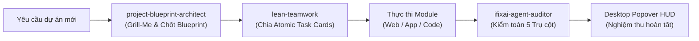
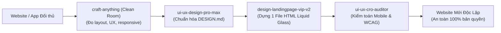
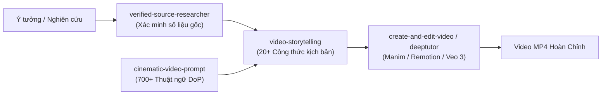
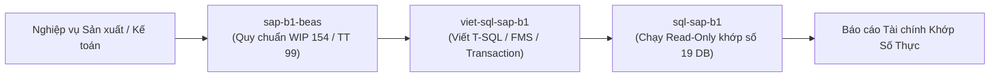

# CẨM NANG TOÀN DIỆN VỀ TOÀN BỘ 36 SKILLS & WORKFLOW HỆ THỐNG ANTIGRAVITY
*(Tài liệu phân tích chuyên sâu kiến trúc, phân loại 8 Cụm nghiệp vụ, quy trình phối hợp và hướng dẫn chạy các công cụ trong `%USERPROFILE%\.gemini\config\skills`)*

---

## 📌 PHẦN 1: BẢN ĐỒ TỔNG QUAN 36 SKILLS THEO 8 CỤM THỰC CHIẾN

Hệ thống hiện tại tích hợp **36 bộ kỹ năng (Skills) chuyên môn hóa sâu**, được tổ chức thành **8 Cụm Nghiệp Vụ** tạo thành một chu trình khép kín: **Kiến trúc Blueprint $\rightarrow$ Điều phối Lean $\rightarrow$ Kiểm toán Nguồn $\rightarrow$ Thực thi (Video/Web/ERP/Reverse) $\rightarrow$ Đo lường & Nghiệm thu.**

```
                               ┌────────────────────────────────────────────────────────┐
                               │     1. QUẢN TRỊ, ĐIỀU PHỐI & KIẾN TRÚC DỰ ÁN           │
                               │  project-blueprint-architect  •  lean-teamwork        │
                               │  nap-tai-lieu-antigravity     •  prompts-chat         │
                               └──────────────────────────┬─────────────────────────────┘
                                                          │
                               ┌──────────────────────────▼─────────────────────────────┐
                               │     2. KIỂM TOÁN ĐỘC LẬP & BẢO MẬT (5 CHỐT CHẶN)       │
                               │  verified-source-researcher  •  ifixai-agent-auditor   │
                               │  security-audit                                        │
                               └──────────────────────────┬─────────────────────────────┘
                                                          │
         ┌─────────────────────────┬──────────────────────┼──────────────────────┬─────────────────────────┐
         │                         │                      │                      │                         │
         ▼                         ▼                      ▼                      ▼                         ▼
┌──────────────────┐      ┌──────────────────┐  ┌──────────────────┐   ┌──────────────────┐      ┌──────────────────┐
│  3. DỊCH NGƯỢC   │      │ 4. LÀM PHIM &    │  │  5. THIẾT KẾ WEB │   │ 6. TIẾP THỊ,     │      │ 7. ERP, SAP B1   │
│  & TÁI LẬP SẠCH  │      │ VIDEO ĐIỆN ẢNH   │  │  & UI/UX STUDIO  │   │ ADS & TỰ ĐỘNG    │      │ & HỆ THỐNG SQL   │
├──────────────────┤      ├──────────────────┤  ├──────────────────┤   ├──────────────────┤      ├──────────────────┤
│• craft-anything  │      │• video-story...  │  │• brand-editorial │   │• google-ads-m... │      │• sap-b1-beas     │
│• reverse-engi... │      │• cinematic-pr... │  │• ui-ux-design... │   │• claude-seo      │      │• sql-sap-b1      │
│  (Clean-Room &   │      │• lam-phim-master │  │• ui-ux-cro-au... │   │• chan-dung-kh... │      │• viet-sql-sap-b1 │
│   Deep Analysis) │      │• create-edit-vid │  │• webapp-app-ux   │   │• tao-san-pham-so │      │  (19 DB, WIP154, │
│                  │      │• deeptutor-cli   │  │• design-landing  │   │• antigravity-br..│      │   TT99/2025)     │
│                  │      │• kinetic-reel    │  │• wordpress-flat..│   │                  │      └──────────────────┘
│                  │      │• painted-anim    │  │• html-to-webcake │   └──────────────────┘
│                  │      │• recordly-tut... │  └──────────────────┘
│                  │      │• shopee-affil... │
│                  │      │• yt-shortcode    │
│                  │      │• gsap-skills     │
└──────────────────┘      └──────────────────┘
                                                          │
                               ┌──────────────────────────▼─────────────────────────────┐
                               │     8. TRI THỨC CHUYÊN SÂU, HUYỀN HỌC & KHOA HỌC       │
                               │  tu-vi-bat-tu-than-so-hoc  •  Bộ Science Plugins       │
                               │  (AlphaFold, ChEMBL, PubMed, OpenFDA, Biomolecular...) │
                               └────────────────────────────────────────────────────────┘
```

---

## 📊 PHẦN 2: BẢNG MA TRẬN 36 SKILLS CHI TIẾT

| STT | Tên Thư Mục Skill | Cụm Nghiệp Vụ | Công Dụng Cốt Lõi | Công Cụ / Scripts / Executables |
| :---: | :--- | :--- | :--- | :--- |
| **1** | **`project-blueprint-architect`** | Quản Trị & Kiến Trúc | Phỏng vấn gỡ điểm mù (`Grill-Me`), chốt 1 Master Blueprint đa ngành & tự động hội tụ test code với `/speckit-converge`. | `scripts/converge_blueprint.py`<br>`scripts/interview_flow.py`<br>`scripts/spec_validator.py` |
| **2** | **`lean-teamwork`** | Quản Trị & Điều Phối | Tối ưu Token/Quota, cơ chế chia việc Atomic Task Cards, điều phối đa tác tử và Popover HUD nghiệm thu. | `scripts/teamwork_bridge.py`<br>`scripts/manage_skills.py`<br>`sync_skill.py` |
| **3** | **`nap-tai-lieu-antigravity`** | Quản Trị & Tri Thức | Quy chuẩn 5 bước nạp tài liệu thô (PDF, Word, Sách, SQL) & bảo dưỡng Bộ Não Lai Javis (SQLite FTS5 + RRF). | Hướng dẫn chuẩn hóa & mẫu cấu trúc thư mục Javis |
| **4** | **`prompts-chat`** | Quản Trị & Tri Thức | Tra cứu, tối ưu System Prompt từ 2,627 mẫu Awesome Prompts + 31 chương sách Prompt Engineering & MCP tools. | MCP Client `prompts.chat` API |
| **5** | **`verified-source-researcher`** | Kiểm Toán & Nguồn Gốc | Chống ảo giác AI (Zero Hallucination), bắt buộc 4 tọa độ (Ở đâu - File nào - Trang/Dòng nào - Tác giả), trích nguyên văn $\le 25$ từ, check HTTP 200, DOI/PubMed. | `cli.py`<br>`scripts/link_validator.py`<br>`scripts/academic_checker.py` |
| **6** | **`ifixai-agent-auditor`** | Kiểm Toán & Độc Lập | Giám khảo độc lập kiểm toán AI Agent qua 5 trụ cột (Chống bịa đặt, Lừa dối, Thao túng, Mất kiểm soát, Che giấu), xuất Scorecard A–F. | `cli.py`<br>Test suites: `smoke`, `strategic`, `core`, `all` |
| **7** | **`security-audit`** | Kiểm Toán & Bảo Mật | Rà soát bảo mật mã nguồn, kiểm thử lỗ hổng Web/API, phát hiện lộ secret/API key, rà soát binary và xuất báo cáo an toàn. | Bộ checklist bảo mật OWASP, scan secret |
| **8** | **`craft-anything`** | Dịch Ngược & Tái Lập | 100% Rust thuần, 302 tools, Desktop GUI egui. Nghiên cứu website, app, game hoạt động ra sao rồi để AI tự code lại bản mới (Clean-room hoặc Deep). | `bin/craft-anything.exe`<br>`bin/craft-anything-cli.exe` (MCP Server 302 tools) |
| **9** | **`reverse-engineer-anything`** | Dịch Ngược & Bóc Tách | Dịch ngược chuyên sâu tệp nhị phân (.exe, .dll), Electron `app.asar`, .NET C#, PyInstaller .pyc, Android APK qua JADX và Ghidra. | `scripts/rea.mjs` (CLI Node.js)<br>MCP tool REA upstream v6.8.0 |
| **10** | **`lam-phim-video-master`** | Sản Xuất Phim & Video | Siêu Hub tổng hợp 13 bộ skill làm phim AI: biên kịch, nhân vật 3D 4 góc, màu nước, WebGL, GSAP/Remotion và hậu kỳ. | Tổng hợp tài nguyên DoP, 1,875 files cấu hình |
| **11** | **`video-storytelling`** | Sản Xuất Phim & Video | Cỗ máy biên kịch 20+ công thức quốc tế (AIDA, PAS-T, 7-Beat, Pixar, Lemmino), sinh prompt song song ByteDance Seedance & Google Veo 3.1. | `cli.py`<br>`generator.py`<br>Các kịch bản mẫu trong `engines/` |
| **12** | **`cinematic-video-prompt`** | Sản Xuất Phim & Video | Từ điển quay phim 700+ thuật ngữ DoP Hollywood (góc máy, camera motion, ánh sáng, ống kính, màu sắc, bố cục). | 7 tệp từ điển tham chiếu chuyên sâu |
| **13** | **`create-and-edit-video`** | Sản Xuất Phim & Video | Lập trình và biên tập video tự động bằng 5 Engine: Remotion (React), Motion Canvas, Manim (Python), Auto-Editor, Editly. | Tích hợp Remotion, Manim, Motion Canvas |
| **14** | **`deeptutor-cli`** | Sản Xuất Phim & Video | Trợ giảng AI học tập, nghiên cứu tài liệu khoa học arXiv, RAG đa engine & dựng video bài giảng Manim/Remotion tự động. | `deeptutor` CLI, module `math_animator`, `video_lesson` |
| **15** | **`kinetic-reel`** | Sản Xuất Phim & Video | Dựng video Kinetic Typography & Motion Reels (MP4) bằng Canvas 2D, Three.js WebGL, khớp nhạc từng phách & render FFmpeg. | `scripts/build_reel.py`, render headless |
| **16** | **`painted-animation`** | Sản Xuất Phim & Video | Dựng phim hoạt hình màu nước phong cách nghệ thuật bằng p5.js + p5.brush, đồng bộ lời bình voiceover và xuất MP4. | `scripts/render_animation.py` |
| **17** | **`gsap-skills`** | Sản Xuất Phim & Video | Lập trình hiệu ứng chuyển động Web & Video 60fps bằng GSAP: Timeline, ScrollTrigger, SplitText, MorphSVG, Flip. | Mã nguồn GSAP preset, template HTML5/Canvas |
| **18** | **`recordly-tutorial-ai`** | Sản Xuất Phim & Video | Quay màn hình và dựng video hướng dẫn thao tác phần mềm: tự chèn giọng đọc AI giải thích, phụ đề .SRT, Auto-Zoom điểm nhấn chuột. | `scripts/recordly_engine.py` |
| **19** | **`shopee-affiliate-video-studio`** | Sản Xuất Phim & Video | Đọc thông số sản phẩm Shopee qua ảnh/link, AI sáng tác câu chuyện bán hàng đa góc nhìn, chèn chữ chạy & dựng video ngắn 9:16. | `scripts/shopee_generator.py` |
| **20** | **`yt-shortcode-commander`** | Sản Xuất Phim & Video | Điều khiển dây chuyền sản xuất video YouTube & Facebook hàng loạt qua 6 lệnh chuẩn (Nội dung, Prompt, Render, Lịch, Profile, Kênh mới). | Dây chuyền auto-production pipeline |
| **21** | **`brand-editorial-graphic-studio`** | Thiết Kế & Giao Diện | Siêu Hub thiết kế Logo SVG, Bộ nhận diện CIP, Banner Ads, Báo giá, Tạp chí & Dàn trang in ấn PDF/DOCX/PPTX/Typst. | `scripts/typst_compiler.py`, bộ template SVG CIP |
| **22** | **`ui-ux-design-pro-max`** | Thiết Kế & Giao Diện | Siêu Hub UI/UX 192 ngành nghề: 79 phong cách UI, 84 hệ DESIGN.md thương hiệu lớn, chuyển thiết kế sang code cho 22 frameworks. | `scripts/ui_style_generator.py` |
| **23** | **`ui-ux-cro-auditor`** | Thiết Kế & Giao Diện | Kiểm toán logic UI/UX, Responsive Mobile, Web doanh nghiệp & Tỷ lệ chuyển đổi Landing Page: WCAG 2.2, phân cấp P0/P1/P2. | `scripts/cro_audit_runner.py` |
| **24** | **`webapp-app-ux-workflow`** | Thiết Kế & Giao Diện | Thiết kế luồng UX cho Web App (SaaS/Admin/ERP) và Mobile App: logic State, routing URL, CRUD bảng dữ liệu & gia cố lỗi form. | Bộ mẫu UX Flows, State Machine schemas |
| **25** | **`design-landingpage-vip-v2`** | Thiết Kế & Giao Diện | Thiết kế Landing Page VIP đóng gói 1 file HTML hoàn chỉnh: hiệu ứng Liquid Glass, 138 icon SVG inline, form, thanh toán VietQR, CAPI dual-tracking. | 138 icon SVG, templates Liquid Glass |
| **26** | **`wordpress-flatsome-designer`** | Thiết Kế & Giao Diện | Thiết kế web WordPress chuẩn Flatsome 3.x: 100% native shortcodes UX Builder, shop bán hàng, giỏ hàng, bảng giá, 80 tiêu chí QA Checklist. | Thư viện shortcodes Flatsome chuẩn |
| **27** | **`html-to-webcake`** | Thiết Kế & Giao Diện | Chuyển đổi mã nguồn HTML sang định dạng `.pke` để mở và kéo thả chỉnh sửa trực tiếp trên nền tảng Webcake Landing Page. | Parser HTML sang cấu trúc JSON .pke |
| **28** | **`google-ads-master`** | Tiếp Thị & Quảng Cáo | Siêu Hub 12 skill Google Ads & CRO: nghiên cứu từ khóa, cấu hình tracking GA4/GTM, audit tài khoản A1-A14, tối ưu ROAS & xuất file Editor CSV. | `scripts/kw_planner.py`<br>`scripts/ads_editor_csv.py` |
| **29** | **`claude-seo`** | Tiếp Thị & Quảng Cáo | Kiểm toán SEO toàn diện & Tối ưu AI Search (GEO): Technical SEO, Core Web Vitals, E-E-A-T, Schema JSON-LD, tối ưu trích dẫn AI Overviews. | 62 scripts kiểm toán SEO & dữ liệu có cấu trúc |
| **30** | **`chan-dung-khach-hang-9-phan`** | Tiếp Thị & Quảng Cáo | Phương pháp vẽ chân dung khách hàng 9 phần: Khảo sát nỗi đau (Pains), Lợi ích mong muốn (Gains), Jobs-to-be-done, Bản đồ Thấu cảm 6 vùng. | Biểu mẫu Canvas 9 phần chuẩn hóa |
| **31** | **`tao-san-pham-so-bang-ai`** | Tiếp Thị & Quảng Cáo | Đồng hành đóng gói kinh nghiệm chuyên gia thành sản phẩm số (ebook, workbook, checklist, template) và phễu bán tự động trong 7 ngày. | 5 tài liệu quy trình đóng gói & phễu bán |
| **32** | **`antigravity-browser-controller`** | Tự Động Hóa Trình Duyệt | Điều khiển trình duyệt Chrome/Cốc Cốc qua CDP/WebSocket: quản lý đa profile đăng nhập, vượt captcha, tự động đăng bài Facebook & chụp ảnh. | `scripts/cdp_bridge.py`<br>`scripts/fb_poster.py` |
| **33** | **`sap-b1-beas`** | ERP & Hệ Thống Dữ Liệu | Kiến trúc SAP Business One (9.3/10.0) & Boyum Beas Manufacturing: quản lý sản xuất, định mức BOM, tính giá thành WIP 154, tuân thủ Thông tư 99/2025. | `scripts/beas_cost_calculator.py` |
| **34** | **`sql-sap-b1`** | ERP & Hệ Thống Dữ Liệu | Kết nối an toàn đến 4 Server / 19 Database SAP B1 (24, 160, 52, 27), thực thi SQL Read-Only khớp số liệu thực tế, Service Layer & xuất Excel. | 10 scripts kết nối & query an toàn |
| **35** | **`viet-sql-sap-b1`** | ERP & Hệ Thống Dữ Liệu | Viết & kiểm thử câu lệnh T-SQL / HANA SQLScript cho SAP B1 & Beas: FMS (Formatted Search), TransactionNotification chặn lỗi logic nghiệp vụ. | `scripts/sql_validator.py` + 323 mẫu T-SQL |
| **36** | **`tu-vi-bat-tu-than-so-hoc`** | Huyền Học & Khoa Học Cổ | Lập và luận giải lá số Tử Vi Đẩu Số (iztro-py), Bát Tự Tứ Trụ theo 24 Tiết Khí thiên văn & Thần Số Học Pythagoras: xuất 10 hồ sơ SOP V3.0. | `scripts/chart_calculator.py`<br>`scripts/html_exporter.py` |

---

## 🔄 PHẦN 3: WORKFLOW LIÊN KẾT GIỮA CÁC SKILL (ECOSYSTEM SYNERGY)

Hệ thống 36 skill vận hành theo **4 Chuỗi Liên Hoàn Thực Chiến**:

### Chuỗi 1: Tiếp Nhận Dự Án Mới $\rightarrow$ Xây Dựng & Nghiệm Thu


### Chuỗi 2: Nghiên Cứu Phần Mềm / Website Đối Thủ $\rightarrow$ Tái Lập Phiên Bản Sạch


### Chuỗi 3: Sản Xuất Video Điện Ảnh / Bài Giảng Khoa Học AI


### Chuỗi 4: Vận Hành Doanh Nghiệp & Dữ Liệu Lớn ERP


---

## 🛠️ PHẦN 4: HƯỚNG DẪN BẢO DƯỠNG & NẠP TRI THỨC MỚI

Khi muốn nạp thêm tài liệu chuyên môn hoặc bổ sung kỹ năng mới, luôn tuân thủ nguyên tắc trong [`HUONG_DAN_NAP_TAI_LIEU_VA_SKILL_ANTIGRAVITY.md`](file:///C:/Users/INFOASIA/.gemini/config/HUONG_DAN_NAP_TAI_LIEU_VA_SKILL_ANTIGRAVITY.md):

1. **Ưu tiên Thêm vào Skill đã có (Trường hợp A):**
   - Đặt tài liệu chuyên sâu vào thư mục con `references/` của skill tương ứng (định dạng `.md` hoặc `.sql`).
   - Thêm 1 dòng liên kết vào bảng tra cứu trong file `SKILL.md`.
2. **Tạo Skill mới (Trường hợp B):**
   - Đặt tại `C:\Users\INFOASIA\.gemini\config\skills\<ten-skill-moi>\`.
   - File `SKILL.md` bắt buộc có phần Frontmatter chuẩn: `name`, `description` ($\le 150$ ký tự) và mục `## Khi nào dùng (Triggers)`.
3. **Cập nhật Chỉ mục Javis (Tự động):**
   - Bộ não Lai Javis OS tự động quét SHA-256 delta và đánh chỉ mục SQLite FTS5 để định vị tài liệu trong `< 150ms`.
