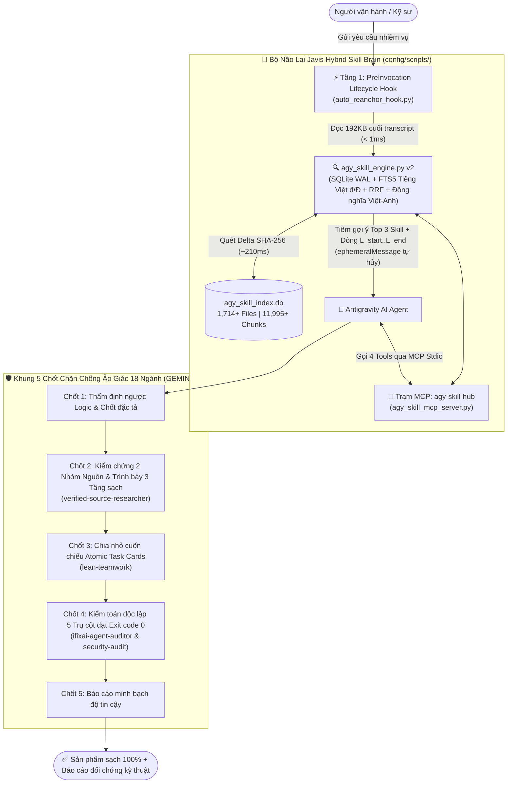

# 🧠 Antigravity x Javis Hybrid Skill Brain & 5-Gate Anti-Hallucination Suite

> **Hệ điều hành Tri thức Lai (Hybrid Knowledge & Skill Router), Khung Kiểm soát Chống Ảo Giác 5 Chốt Chặn Đa Lĩnh Vực (18 Ngành) và Hệ sinh thái 81 Kỹ năng Chuyên sâu (22 Global Skills + 12 Bộ Plugins) dành cho Google Antigravity IDE / CLI (`agy`).**

---

## 📌 1. Bài Toán Giải Quyết & Giá Trị Cốt Lõi

Khi mở rộng hệ thống AI Agent lên hàng chục bộ kỹ năng (Skills) và hàng ngàn tài liệu tham chiếu (`.md`, `.sql`, `.py`, sách chuyên khảo, SOP doanh nghiệp), các mô hình AI thường gặp **3 điểm nghẽn nghiêm trọng**:
1. **Tràn & Trôi Ngữ Cảnh (*Context Bloat & Context Drift*):** Nạp toàn bộ tài liệu dài vào Context Window gây tốn 70–85% Token và làm suy giảm độ chính xác suy luận ở các phiên hội thoại dài.
2. **Ảo Giác AI (*AI Hallucination*):** Mô hình tự suy diễn số liệu tài chính, câu lệnh SQL/ERP, điều khoản pháp lý, mã y sinh học hoặc trích dẫn nguồn không tồn tại với giọng điệu rất tự tin.
3. **Khó Đóng Gói & Di Chuyển Đa Máy (*Portability Lock-in*):** Đường dẫn tuyệt đối và cấu hình MCP/Hook bị gắn cứng vào một máy cá nhân, gây lỗi khi triển khai cho đội ngũ kỹ sư.

Bộ giải pháp này giải quyết triệt để cả 3 bài toán thông qua sự kết hợp giữa **Bộ Não Chỉ Mục Lai Javis (`agy-skill-hub`)** và **Quy Trình 5 Chốt Chặn Kiểm Chứng Độc Lập (`GEMINI.md`)**:

| Chỉ Số Vận Hành Thực Tế | Kết Quả Đạt Được | Cơ Chế Kỹ Thuật Đằng Sau |
| :--- | :--- | :--- |
| **Quy mô tri thức quản lý** | **81 Skills** (`1,714+` files, `11,995+` chunks) | Quét đa tầng: Workspace $\rightarrow$ Global (`22`) $\rightarrow$ Plugins (`50`) $\rightarrow$ Builtin (`9`) |
| **Tốc độ tìm kiếm lai (Warm Search)** | **`6 ms – 56 ms`** | SQLite WAL + FTS5 tiếng Việt không dấu (`đ/Đ`) + Reciprocal Rank Fusion (RRF) |
| **Tốc độ cập nhật Delta SHA-256** | **`~210 ms – 420 ms`** | Chỉ cập nhật đúng file có thay đổi mã băm SHA-256 với FTS5 `contentless_delete=1` |
| **Tiết kiệm Context Token** | **`70% – 85%`** | Lazy Section Excerpt: chỉ cắt đúng mục Heading hoặc đoạn dòng `L_start..L_end` |
| **Ngân sách định tuyến Frontmatter** | **`~2,744 / 4,000` ký tự** | Chuẩn hóa mỗi `SKILL.md` `description <= 150` ký tự, đẩy chi tiết xuống `references/` |

---

## 🏗️ 2. Kiến Trúc Tổng Thể Hệ Thống



---

## ⚙️ 3. Giải Thích Bộ Công Cụ Lõi Của Bộ Não Lai (`config/scripts/`)

Thư mục `config/scripts/` đóng vai trò là **nhân điều phối trung tâm** giữa tệp tài liệu gốc trên ổ đĩa và mô hình ngôn ngữ lớn:

### 3.1. `agy_skill_engine.py` — Động Cơ Chỉ Mục & Tìm Kiếm Lai Đa Tầng (v2 Enterprise)
- **Nguồn sự thật gốc trên ổ đĩa (*Filesystem as Single Source of Truth*):** Cơ sở dữ liệu `agy_skill_index.db` chỉ là lớp chỉ mục tăng tốc có thể xóa và dựng lại bất cứ lúc nào trong `~1.5 giây` mà không bao giờ làm mất tài liệu gốc.
- **Chuẩn hóa Tiếng Việt & Thuật ngữ Song ngữ:** Xử lý triệt để dấu tiếng Việt (bao gồm ký tự `đ/Đ`), kết hợp từ điển đồng nghĩa nghiệp vụ Việt–Anh (ví dụ: truy vấn *"lệch kho giá thành"* tự động ánh xạ sang `OINM`, `OJDT`, `WIP 154`, `sap-b1-beas`).
- **Xếp hạng Lai RRF (*Reciprocal Rank Fusion*):** Kết hợp điểm khớp chính xác trên thẻ định danh Skill, điểm khớp cụm từ nguyên văn (*Phrase Match*), điểm BM25 FTS5 trên từng đoạn Heading/SQL và trọng số độ tin cậy theo tầng (`Workspace 1.05` > `Global 1.00` > `Plugin 0.92` > `Builtin 0.88`).
- **Kiểm toán Sức khỏe Tự động:** Tự động phát hiện lỗi cú pháp YAML, lỗi BOM `\ufeff`, mô tả vượt trần `150` ký tự, đường dẫn `references/` bị đứt hoặc trùng lặp tên Skill.

### 3.2. `agy_skill_mcp_server.py` — Trạm MCP `agy-skill-hub` (4 Công Cụ Chuyên Biệt)
Đăng ký trực tiếp vào Antigravity qua giao thức MCP `stdio`, cung cấp 4 công cụ cho AI Agent:
1. **`agy_search_skills(query, top_k, tier)`**: Tìm kiếm lai xuyên toàn bộ Skills và hàng ngàn file con (`references/*.md`, `*.sql`, `scripts/*.py`), trả về đúng tên Skill, file khớp nhất và tọa độ dòng `line_start..line_end`.
2. **`agy_read_skill_section(skill_or_path, heading_or_query, start_line, end_line)`**: **Nạp lười (*Lazy Section Loader*)** — chỉ trích xuất đúng mục Heading hoặc khoảng dòng cần dùng (mặc định trần `6,000` ký tự) thay vì đọc tràn cả file dài vào Context Window.
3. **`agy_manage_skill(slug, action, ...)`**: Kiểm tra cấu trúc (`inspect`), chuẩn hóa YAML frontmatter `<= 150` ký tự (`update_frontmatter`), hoặc cập nhật từng mục kiến thức (`upsert_section`) kèm cơ chế tạo bản sao lưu `.bak` tự động.
4. **`agy_sync_and_audit_skills(force_rebuild)`**: Quét cập nhật Delta SHA-256 tức thì và xuất báo cáo kiểm toán toàn bộ kho tri thức.

### 3.3. `auto_reanchor_hook.py` — PreInvocation Lifecycle Hook Chống Trôi Ngữ Cảnh
- Tự động kích hoạt trước mỗi lượt suy luận của mô hình thông qua cấu hình `hooks.json`.
- Đọc nhanh `192 KB` cuối của nhật ký hội thoại (`< 1ms`), trích xuất yêu cầu mới nhất của người dùng, tra cứu `agy_skill_index.db` và đính kèm gợi ý **Top 3 Skill + File tham chiếu + Dòng `L_start..L_end`** dưới dạng `ephemeralMessage` (thông điệp tạm thời tự hủy sau lượt hiện tại, không làm phình lịch sử chat).
- Đồng bộ trạng thái tương tác hai chiều với giao diện **Desktop Widget HUD** (`lean-teamwork`) để giải phóng khung chat khỏi các hộp thoại hỏi đáp gây gián đoạn.

### 3.4. `setup_portable_antigravity.py` — Trình Khởi Tạo Đa Máy Không Phụ Thuộc Đường Dẫn
- Tự động phát hiện đường dẫn `python` / `pythonw` thực tế trên máy đích (Windows, macOS, Linux).
- Ghép nối an toàn cấu hình `agy-skill-hub` và `prompts-chat` vào `mcp_config.json` (giữ nguyên toàn bộ MCP Server hiện có của người dùng).
- Cập nhật `hooks.json`, khởi tạo tệp cấu hình mẫu từ `config.example.json` (nếu tải về từ Git) và dựng mới hoàn toàn `agy_skill_index.db`.

---

## 🛡️ 4. Quy Trình 5 Chốt Chặn Chống Ảo Giác AI Đa Lĩnh Vực (18 Ngành)

Được định nghĩa tại `config/GEMINI.md` và sổ tay `QUY_TRINH_CHUNG_5_CHOT_CHAN_CHONG_AO_GIAC_AI.md`, áp dụng cơ chế **Phân luồng Nhanh – Chậm thông minh** (*Fast-Track Mode* cho câu hỏi tra cứu ngắn và *Full 5-Gate Lock* cho dự án/nghiệp vụ trọng yếu thuộc 18 ngành: Phần mềm, ERP/SQL, Web/SEO, Marketing, Quảng cáo đa kênh, Làm Phim AI, Xây kênh, Học thuật, Kế toán/Thuế, Pháp lý, Tử vi/Bát tự, Y Sinh học, TMĐT, Giáo dục, Nhân sự, Data/BI, Đầu tư, Dịch thuật):

1. **Chốt 1 — Thẩm Định Ngược Yêu Cầu & Chốt Đặc Tả:** Kiểm tra rủi ro kiến trúc/bảo mật/logic trước khi thực thi (chống vâng lời mù quáng); dừng hỏi ngay khi thiếu dữ kiện đầu vào bắt buộc; tuyệt đối không đoán mò.
2. **Chốt 2 — Nguồn Dẫn Chứng Cấp 1 & Trình Bày Nguồn 3 Tầng Chuyên Nghiệp:**
   - Đối chiếu rõ ràng giữa tài liệu nội bộ do người dùng cung cấp và tài liệu chính thống bên ngoài (Docs hãng, văn bản pháp luật, bài báo khoa học có DOI/PMID/ISBN, link `HTTP 200`).
   - **Tầng 1 (Nội dung thành phẩm/Code/Lời bình):** Sạch 100%, không chèn mã nguồn kiểm toán làm ngắt mạch đọc.
   - **Tầng 2 (Cuối bài viết chuyên môn công khai):** Mục tài liệu tham chiếu ngắn gọn chuẩn xuất bản.
   - **Tầng 3 (Báo cáo đối chứng kỹ thuật):** Bảng ánh xạ tọa độ nguồn chi tiết (Ở đâu — Tệp/Sách nào — Trang/Dòng nào — Tác giả & Trích dẫn nguyên văn) tách riêng cho người vận hành kiểm tra.
3. **Chốt 3 — Chia Nhỏ Cuốn Chiếu (*Atomic Task Cards*):** Hoàn thành và nghiệm thu dứt điểm từng hạng mục nhỏ trước khi sang bước kế tiếp; cấm viết mã giả (`mock/stub`) hoặc chạy script gán văn bản hàng loạt thiếu kiểm soát.
4. **Chốt 4 — Kiểm Toán Độc Lập 5 Trụ Cột (`Exit code 0`):** Chạy kiểm thử thực tế và quét kiểm định độc lập qua 5 trụ cột rủi ro (*Fabrication, Deception, Manipulation, Unpredictability, Opacity*), yêu cầu đạt điểm `Grade A/B (>= 80/100)`.
5. **Chốt 5 — Minh Bạch Hóa Độ Tin Cậy:** Phân tách rạch ròi giữa dữ liệu đã xác minh thực chứng, phương án đề xuất của AI và hạng mục cần con người phê duyệt cuối cùng.

---

## 🧰 5. Danh Mục & Giải Thích Chi Tiết 22 Global Skills (`config/skills/`)

Toàn bộ **22 Global Skills** được tổ chức thành **7 Cụm Chuyên Môn** hiệp đồng chặt chẽ:

### Cụm A — Điều Phối Đa Tác Tử, Quản Trị Tri Thức & Kiểm Toán AI (5 Skills)
| Tên Skill | Vai Trò & Năng Lực Cốt Lõi | Công Cụ / CLI Đi Kèm |
| :--- | :--- | :--- |
| **`lean-teamwork`** | Điều phối đa tác tử tinh gọn, tối ưu Token/Quota, chia nhỏ Atomic Task Cards, 3 Thiết luật First-Time Right & kết nối Desktop Widget HUD. | `scripts/teamwork_bridge.py`, `scripts/manage_skills.py`, `sync_skill.py` |
| **`nap-tai-lieu-antigravity`** | Quy chuẩn 5 bước chưng cất tài liệu mới (PDF, Word, Sách dài 3-Pass, SQL) thành Skill chuẩn Javis (`description <= 150` ký tự) & đồng bộ chỉ mục. | Kết nối trực tiếp 4 MCP Tools của `agy-skill-hub` |
| **`verified-source-researcher`** | Động cơ kiểm chứng nguồn sự thật gốc: quét link sống `HTTP 200`, xác thực mã học thuật CrossRef DOI, PubMed PMID, OpenLibrary ISBN. | `cli.py`, `scripts/link_validator.py`, `academic_checker.py`, `book_checker.py` |
| **`ifixai-agent-auditor`** | Thẩm phán kiểm toán độc lập AI Agent theo 5 trụ cột rủi ro với 60+ bài kiểm tra chuyên sâu, chống rò rỉ dữ liệu nội bộ & chấm điểm Scorecard `A–F`. | `cli.py`, Full SDK `ifixai` v4.2.0 |
| **`prompts-chat`** | Tra cứu, tối ưu System Prompt (TEXT / STRUCTURED JSON) và tìm kiếm Agent Skills từ kho 2,627 mẫu Awesome Prompts + 31 chương sách Prompt Engineering. | Kết nối Live MCP [prompts.chat](https://prompts.chat) (`/api/mcp`) |

### Cụm B — Bảo Mật Mã Nguồn & Thẩm Định An Toàn Hệ Thống (1 Skill)
| Tên Skill | Vai Trò & Năng Lực Cốt Lõi | Công Cụ / CLI Đi Kèm |
| :--- | :--- | :--- |
| **`security-audit`** | Rà soát bảo mật chuyên sâu (AppSec) cho mã nguồn, Web/API, CLI & dịch vụ ngầm theo danh mục lớp tấn công (Injection, Auth, SSRF, Deserialization, Path Traversal), bắt buộc đối chứng Coverage Ledger chống bỏ sót tệp. *(Đã vá tương thích 100% trên cả Windows & POSIX)*. | `scripts/validate-findings.cjs`, `scripts/validate-coverage-ledger.cjs`, `references/ATTACK-CLASSES.md` |

### Cụm C — Sản Xuất Phim AI, Hoạt Hình Code-as-Video & Đồ Họa Chuyển Động (7 Skills)
| Tên Skill | Vai Trò & Năng Lực Cốt Lõi | Công Cụ / Engine Đi Kèm |
| :--- | :--- | :--- |
| **`lam-phim-video-master`** | **Siêu Hub Tổng Hợp 13 Bộ Skill Làm Phim (`1,875+` files)**: điều phối trọn gói 5 giai đoạn từ biên kịch, khóa nhân vật 3D, dựng video bằng code đến hậu kỳ & xuất bản. | Bao hàm 13 module con (`01` $\rightarrow$ `13`), kho 703 mẫu Code-as-Video & PromptDirector |
| **`video-storytelling`** | Biên kịch video đa thể loại theo 20+ công thức quốc tế (AIDA, PAS, ABT, Pixar, Dan Harmon, 7-Beat), khóa đồng bộ nhân vật 4 góc, xuất luồng prompt Veo 3 & Seedance 2.0. | `cli.py`, `generator.py`, `engines/` |
| **`cinematic-video-prompt`** | Từ điển đạo diễn hình ảnh (DoP) với 700+ thuật ngữ góc máy, chuyển động camera, ánh sáng, ống kính, màu sắc, Khóa Gen Nhân Vật 6 Lớp & Giải phẫu Tư thế 3D 5 Tầng. | `references/01..07` |
| **`create-and-edit-video`** | Lập trình và biên tập hậu kỳ video tự động bằng 5 Engine mã nguồn mở: dựng đồ họa React/Toán học và tự động cắt khoảng lặng âm thanh. | Remotion, Motion Canvas, Manim, Auto-Editor, Editly |
| **`kinetic-reel`** | Dựng video Kinetic Typography, Showreel & Product Promo (MP4) hoàn toàn bằng code với bố cục chữ chuyển động cường độ cao, lớp 3D WebGL và nhạc điện tử tự tổng hợp khớp từng khung hình (*beat-locked score*). | Canvas 2D + `Three.js` WebGL + Headless Chrome `render.mjs` + Node `score.mjs` + FFmpeg |
| **`painted-animation`** | Sản xuất phim hoạt hình vẽ tay **Màu Nước & Mực Tàu** (MP4) bằng code, hỗ trợ diễn xuất biểu cảm nhân vật, đồng bộ lời bài hát (LRC/BPM) và render song song đa luồng. | `p5.js` + `p5.brush` + `scripts/beat_grid.py` + Headless Chrome + FFmpeg |
| **`gsap-skills`** | Bộ kỹ năng chính thức lập trình hiệu ứng chuyển động Web & Video tốc độ 60fps bằng thư viện GreenSock (GSAP). | Tweens, Timelines, ScrollTrigger, SplitText, MorphSVG, Flip, React `useGSAP` |

### Cụm D — Thiết Kế Web, Landing Page Chuyển Đổi Cao & Kiểm Toán SEO/GEO (3 Skills)
| Tên Skill | Vai Trò & Năng Lực Cốt Lõi | Công Cụ / CLI Đi Kèm |
| :--- | :--- | :--- |
| **`design-landingpage-vip-v2`** | Thiết kế Landing Page chuyển đổi cao đóng gói gọn trong 1 tệp HTML hoàn chỉnh: 9 Design Systems (Liquid Glass, Apple, E-commerce...), 138 icon SVG inline, form đăng ký, mã thanh toán VietQR động & Server-side Meta/TikTok CAPI qua Webhook (tuyệt đối không lộ Token ở Frontend). | 9 bộ `system-design/`, kho 138 SVG `assets/icons/`, mẫu workflow `n8n` |
| **`wordpress-flatsome-designer`** | Thiết kế & tùy biến giao diện WordPress chuẩn Theme Flatsome 3.x với 100% Native UX Builder Shortcodes, cấu trúc Child Theme an toàn và tối ưu tốc độ tải trang. | Bộ mẫu UX Builder Shortcodes & Hooks `functions.php` |
| **`claude-seo`** | Hệ thống kiểm toán Technical SEO & Tối ưu hóa Công cụ Tìm kiếm AI (*GEO / AI Overviews*) v2.4.2: Core Web Vitals (LCP, INP, CLS), E-E-A-T, Schema JSON-LD, Sitemap & `llms.txt`. | 26 sub-skills, `scripts/` phân tích HTML/Playwright |

### Cụm E — Tự Động Hóa Trình Duyệt Đa Profile & Dây Chuyền Kênh Video (2 Skills)
| Tên Skill | Vai Trò & Năng Lực Cốt Lõi | Công Cụ / CLI Đi Kèm |
| :--- | :--- | :--- |
| **`antigravity-browser-controller`** | Cầu nối điều khiển đa trình duyệt (Chrome, Cốc Cốc) qua giao thức CDP & WebSocket: quản lý độc lập nhiều Profile người dùng, nạp tệp nhị phân ngầm qua `DOM.setFileInputFiles` (không bật hộp thoại hệ điều hành), chụp ảnh màn hình kiểm chứng & đăng bài tự động. | `scripts/server.py`, `scripts/cli.py`, `scripts/fb_auto_post.py` |
| **`yt-shortcode-commander`** | Trung tâm điều phối dây chuyền sản xuất nội dung YouTube & Facebook khép kín theo 6 lệnh tắt (Nghiên cứu ngách, Kịch bản, Prompt, Render, Lên lịch đăng, Quản trị kênh). | Quy trình điều phối 6 Shortcodes chuẩn hóa |

### Cụm F — Quản Trị ERP Công Nghiệp (SAP Business One / Boyum Beas) & Kỹ Nghệ SQL (3 Skills)
| Tên Skill | Vai Trò & Năng Lực Cốt Lõi | Công Cụ / CLI Đi Kèm |
| :--- | :--- | :--- |
| **`sap-b1-beas`** | Kiến trúc sư giải pháp ERP SAP Business One (9.3 / 10.0) & Boyum Beas Manufacturing: quy trình sản xuất công nghiệp, tính giá thành `WIP 154`, đối chiếu sổ kho (`OINM`) – sổ cái (`OJDT`), chuẩn mực kế toán Việt Nam (Thông tư 99/2025/TT-BTC & Thông tư 200), DI API/Service Layer & DTW. | Kho tài liệu kiến trúc `references/` |
| **`viet-sql-sap-b1`** | Kỹ sư trưởng viết & tối ưu hóa truy vấn T-SQL / HANA SQLScript cho SAP B1 & Beas: chuẩn nối bảng `DocEntry`/`BaseEntry`, thiết kế Formatted Search (FMS), `SBO_SP_TransactionNotification` và kho **300+ mẫu truy vấn SQL thực chiến**. | `references/` (`310+` tệp mẫu `.sql` & cẩm nang tối ưu) |
| **`sql-sap-b1`** | Công cụ kết nối cơ sở dữ liệu SAP B1 ở chế độ **An toàn Chỉ Đọc (*Strict Read-Only*)** để đối chiếu số liệu thực tế và xuất báo cáo trực tiếp ra `.xlsx`, `.pdf`, `.csv`. *(Đi kèm tệp mẫu `config.example.json`, tự động bảo vệ thông tin kết nối thật qua `.gitignore`)*. | `scripts/sap_customer_sql_plugin.py`, `config.example.json` |

### Cụm G — Quảng Cáo Google Ads Thực Chiến, Phân Tích Từ Khóa & Tối Ưu Chuyển Đổi CRO (1 Siêu Hub / 12 Bộ Skill Thành Phần)
| Tên Skill | Vai Trò & Năng Lực Cốt Lõi | Công Cụ / CLI Đi Kèm |
| :--- | :--- | :--- |
| **`google-ads-master`** | **Siêu Hub Tổng Hợp 12 Bộ Skill Google Ads & CRO (`51` files — Lộ trình 18 Module v3)**: điều phối xuyên suốt vòng đời tài khoản quảng cáo từ thiết lập hồ sơ `account-context.yaml` (`setup`), cổng kiểm định Conversion Tracking / GA4 / CAPI chống đếm trùng (`measurement`), kiểm toán sức khỏe & chẩn đoán rò rỉ ngân sách A1–A14 bằng GAQL (`audit`), kiểm toán trang đích CRO xuất HTML Dashboard (`toi-uu-chuyen-doi-web`), gom nhóm từ khóa CSV Keyword Planner theo 3 giai đoạn hành trình ra Excel 6 sheets (`keyword-analysis`), lập kế hoạch ngân sách & dự báo CPA/ROAS (`plan`), dựng chiến dịch Search & RSA/PMax Assets (`builder-search`, `assets`), khai thác Search Terms / Negative Keywords & phân hạng tối ưu tài khoản đang chạy (`optimizer`), đến kiểm định an toàn & xuất tệp Google Ads Editor CSV luôn ở trạng thái `PAUSED` (`pusher`). | **14 Python CLI Scripts** (`validate_context.py`, `money_leak_report.py`, `a14_product_report.py`, `forecaster.py`, `search_term_miner.py`, `tiering.py`, `validate_spec.py`, `validate_changeset.py`, `spec_to_editor_csv.py`, `spec_to_paste.py`, `spec_to_pmax_checklist.py`, `changeset_to_actions.py`, `spec_to_xlsx.py`, `recalc_xlsx_check.py`) + **18 Playbooks A1–A14** + **4 JSON/YAML Contracts** |

---

## 🧩 6. Hệ Sinh Thái 12 Bộ Plugins Mở Rộng (`config/plugins/` — 50+ Sub-Skills)

Bên cạnh 22 Global Skills, gói cài đặt tích hợp sẵn **12 Bộ Plugins chuyên ngành**:

1. **`science` (27 Kỹ năng Nghiên cứu Khoa học & Y Sinh học Quốc tế):**
   - *Cấu trúc Protein & Phân tử 3D:* `alphafold-database-fetch-and-analyze`, `pdb-database`, `uniprot-database`, `interpro-database`, `foldseek-structural-search`, `protein-sequence-msa`, `protein-sequence-similarity-search`, `pymol` và trình xem cấu trúc 3D tương tác trực tiếp **`biomolecular-structure-viewer` (Mol\* Sidecar)**.
   - *Hệ Gen, Biến thể & Điều hòa Biểu hiện:* `alphagenome-single-variant-analysis`, `alphagenome-variant-impact-score`, `alphagenome-atlas-website-links`, `clinvar-database`, `gnomad-database`, `dbsnp-database`, `ensembl-database`, `gtex-database`, `encode-ccres-database`, `jaspar-database`, `unibind-database`, `ucsc-conservation-and-tfbs`, `human-protein-atlas-database`.
   - *Dược phẩm, Thử nghiệm Lâm sàng & Sinh học Hệ thống:* `chembl-database`, `pubchem-database`, `openfda-database`, `clinical-trials-database`, `opentargets-database`, `reactome-database`, `string-database`, `quickgo-database`, `embl-ebi-ols`, `ncbi-sequence-fetch`.
   - *Tìm kiếm Văn헌 Học thuật Mở & Cổ văn:* `pubmed-database`, `literature-search-arxiv`, `literature-search-biorxiv`, `literature-search-europepmc`, `literature-search-openalex`, `predictingthepast`.
2. **Bộ 4 Plugins Google Workspace Chính Thức (`gdocs`, `gdrive`, `gsheets`, `gslides`):** Đọc, soạn thảo, định dạng, đồng bộ Markdown và quản trị trực tiếp Google Docs, Google Drive, Google Sheets và Google Slides.
3. **`android-cli-plugin`:** Tích hợp công cụ dòng lệnh `android`, **Android Device Hub Sidecar** (phản chiếu và điều khiển thiết bị thật/máy ảo AVD trực tiếp) và **Jetpack Compose Preview Sidecar**.
4. **`content-writing-by-noti-plugin` (`cong-thuc-viet-content-by-noti-v4`):** Hệ thống viết nội dung bán hàng & quảng cáo theo 14 công thức kinh điển (AIDA, PAS, FAB, 4Cs, BAB, Storytelling...) tích hợp preset cho 9 ngành hàng và 10 nền tảng.
5. **`design-landingpage-vip-plugin`:** Bản đóng gói Plugin độc lập của hệ thống thiết kế Landing Page chuyển đổi cao + VietQR + Webhook CAPI.
6. **Các Plugin Hạ tầng Phát triển Khác:** `chrome-devtools-plugin`, `firebase`, `google-antigravity-sdk`, `modern-web-guidance-plugin`.

---

## 🚀 7. Hướng Dẫn Cài Đặt Nhanh (1-Click Windows & Đa Nền Tảng)

### Yêu Cầu Môi Trường
- **Python `>= 3.11`** (khuyến nghị Python `3.11 – 3.13` để kích hoạt tính năng xóa chỉ mục siêu tốc FTS5 `contentless_delete=1` của SQLite `>= 3.43`).
- **Node.js `>= 20`** (phục vụ kiểm thử `security-audit` và render video bằng code trong `kinetic-reel`, `painted-animation`, `create-and-edit-video`).
- **Git** & **FFmpeg** (tùy chọn khi kết xuất video MP4).

### Cách 1: Cài Đặt Tự Động 1-Click Trên Windows
1. Tải kho mã nguồn này về máy:
   ```powershell
   git clone https://github.com/thanhdientech/antigravity-hybrid-brain.git
   cd antigravity-hybrid-brain
   ```
2. Nhấp đúp chạy **`CAI_DAT_1_CLICK_WINDOWS.bat`**:
   - Tự động sao chép `GEMINI.md`, sổ tay quy trình, `scripts/`, **22 Global Skills** và **12 Plugins** vào `%USERPROFILE%\.gemini\config\`.
   - Tự động chạy `setup_portable_antigravity.py` để đăng ký MCP Server `agy-skill-hub` và `PreInvocation Hook` khớp với đường dẫn Python của máy mới.
3. Nhấp đúp chạy tiếp **`CAI_THU_VIEN_PYTHON_CHO_SKILLS.bat`**:
   - Cài đặt đầy đủ các thư viện Python (`mcp`, `pyyaml`, `aiohttp`, `websockets`, `beautifulsoup4`, `requests`, `playwright`, `pyodbc`, `pymssql`, `reportlab`, `pydantic`, `rich`...) và trình duyệt Chromium Headless.
   - Tự động dựng mới chỉ mục tìm kiếm lai `agy_skill_index.db` trên máy đích.
4. Khởi động lại **Antigravity IDE** hoặc **Antigravity CLI (`agy`)** để toàn bộ hệ thống sẵn sàng hoạt động.

### Cách 2: Cài Đặt Bằng Dòng Lệnh (macOS / Linux / Windows PowerShell)
```bash
git clone https://github.com/thanhdientech/antigravity-hybrid-brain.git
cd antigravity-hybrid-brain

# 1. Sao chép cấu hình vào thư mục chuẩn ~/.gemini/config
mkdir -p ~/.gemini/config
cp -R config/* ~/.gemini/config/

# 2. Cài đặt thư viện Python & Chromium
python3 -m pip install --upgrade pip
python3 -m pip install -r ~/.gemini/config/skills/requirements.txt
python3 -m playwright install chromium

# 3. Tự động đăng ký MCP agy-skill-hub, PreInvocation Hook & dựng chỉ mục FTS5 + RRF
python3 ~/.gemini/config/scripts/setup_portable_antigravity.py
```

### Kiểm Tra Trạng Thái Bộ Não Lai Sau Khi Cài Đặt
```bash
# Kiểm toán sức khỏe 81 Skills và đo tốc độ chỉ mục:
python ~/.gemini/config/scripts/agy_skill_engine.py --audit

# Thử nghiệm tìm kiếm lai tiếng Việt không dấu / song ngữ (< 50ms):
python ~/.gemini/config/scripts/agy_skill_engine.py --search "lech kho gia thanh wip 154"
python ~/.gemini/config/scripts/agy_skill_engine.py --search "audit google ads pmax money leak"
```

---

## 📘 8. Quy Trình 5 Bước Nạp Tài Liệu Mới Thành Tri Thức Chuẩn Javis

Khi cần đưa thêm sách PDF, tài liệu Word, SOP doanh nghiệp hoặc bộ truy vấn `.sql` mới vào hệ thống (chi tiết xem tại [`HUONG_DAN_NAP_TAI_LIEU_VA_SKILL_ANTIGRAVITY.md`](./HUONG_DAN_NAP_TAI_LIEU_VA_SKILL_ANTIGRAVITY.md)):
1. **Chọn đúng tầng lưu trữ:** Bổ sung vào `references/` của Skill đã có (ưu tiên số 1), tạo Skill Global mới tại `~/.gemini/config/skills/<slug>/`, hoặc tạo Skill riêng cho từng dự án tại `<Workspace>/.agents/skills/<slug>/`.
2. **Chuẩn hóa Frontmatter `SKILL.md` (`<= 150` ký tự):** Lưu chuẩn `UTF-8` (không BOM), bọc `description` trong dấu ngoặc kép `"..."`, nêu thẳng năng lực cốt lõi dưới 145 ký tự và đặt danh sách từ khóa kích hoạt vào mục `## Khi nào dùng`.
3. **Chưng cất 3-Pass & Đặt Heading tự đủ ngữ cảnh:** Chia tài liệu dài thành các tệp chuyên đề `references/01-...md` (`<= 256 KB`/tệp), đặt tiêu đề `## Heading` mang đầy đủ tên nghiệp vụ song ngữ để bộ cắt đoạn `L_start..L_end` định vị chính xác tuyệt đối.
4. **Đồng bộ chỉ mục Delta SHA-256:** Gọi công cụ MCP `agy_sync_and_audit_skills` (hoặc chạy `agy_skill_engine.py --audit`) đảm bảo `0` cảnh báo lỗi.
5. **Nghiệm thu truy xuất thực tế:** Thử nghiệm 3 truy vấn (Tiếng Việt có dấu, Tiếng Việt không dấu có chữ `d/đ`, và Tiếng Anh) qua `agy_search_skills` để xác nhận tài liệu mới lên Top 1–2.

---

## 🔐 9. Quy Tắc An Toàn Bảo Mật Khi Lưu Trữ Trên Git (`.gitignore`)

Kho mã nguồn đã được trang bị sẵn tệp **`.gitignore`** nhiều lớp bảo vệ:
- **Chặn tuyệt đối dữ liệu máy cục bộ:** Không bao giờ đẩy tệp chỉ mục sinh tự động (`agy_skill_index.db*`) hoặc các tệp chứa đường dẫn/token cá nhân (`config/mcp_config.json`, `config/hooks.json`, `config/config.json`, `.env`).
- **Bảo vệ thông tin kết nối ERP / Database:** Tự động chặn `config/skills/sql-sap-b1/config.json` và các tệp ghi chú thông tin máy chủ nội bộ; người dùng mới khi `git clone` về sẽ tự động nhận tệp mẫu sạch `config.example.json` để điền tài khoản Read-Only riêng của doanh nghiệp mình.
- **Khuyến nghị chế độ Repository:**
  - Chọn **Private Repository** nếu đội ngũ giữ nguyên các tệp tham chiếu/mẫu truy vấn SQL có chứa tên bảng mở rộng (UDF/UDT) hoặc quy ước máy chủ nội bộ của doanh nghiệp.
  - Chọn **Public Repository** chỉ sau khi đã rà soát loại bỏ tên máy chủ/dự án nội bộ khỏi các tệp ví dụ trong `references/`.

---

## 📚 Tiêu chuẩn công nghệ & Tài liệu tham chiếu

• **Model Context Protocol (MCP Specification):** Chuẩn giao tiếp mở kết nối công cụ và ngữ cảnh dữ liệu cục bộ qua giao thức `stdio` (*Anthropic / Linux Foundation MCP Docs*).
• **SQLite FTS5 & Contentless-Delete Architecture:** Cơ chế đánh chỉ mục toàn văn tốc độ cao hỗ trợ xóa bản ghi trực tiếp `contentless_delete=1` trên chế độ nhật ký `WAL` (*SQLite Official Documentation, v3.43+*).
• **Reciprocal Rank Fusion (RRF — Cormack, Clarke & Buettcher):** Thuật toán hợp nhất xếp hạng đa luồng tìm kiếm không phụ thuộc thang điểm tuyệt đối (*SIGIR Proceedings*).
• **OWASP Application Security Verification Standard (ASVS):** Khung đối chiếu các lớp lỗ hổng bảo mật mã nguồn và dịch vụ Web/API (*OWASP Foundation*).
• **Google Search Central & Schema.org Structured Data:** Bộ tiêu chuẩn kỹ thuật đánh giá Core Web Vitals, tín hiệu chuyên gia E-E-A-T và dữ liệu có cấu trúc (*Google Developers Documentation*).
• **Google Ads Query Language (GAQL) & Google Ads Editor Import Specification:** Chuẩn truy vấn chẩn đoán tài khoản quảng cáo, đo lường chuyển đổi và hợp đồng xuất tệp chiến dịch an toàn (*Google Ads API Official Documentation*).
