# CẨM NANG TOÀN DIỆN VỀ CÁC SKILL TÙY BIẾN TRONG HỆ THỐNG ANTIGRAVITY
*(Tài liệu phân tích chuyên sâu kiến trúc, quy trình vận hành và cẩm nang dòng lệnh của toàn bộ 9 bộ kỹ năng trong thư mục `%USERPROFILE%\.gemini\config\skills`)*

---

## 📌 PHẦN 1: BẢN ĐỒ TỔNG QUAN TOÀN BỘ 9 BỘ SKILL CHUYÊN BIỆT

Trong thư mục `%USERPROFILE%\.gemini\config\skills`, hệ thống Antigravity tích hợp một hệ sinh thái **9 bộ kỹ năng (Skills) chuyên môn hóa cấp cao**. Các skill này không vận hành tách rời mà phối hợp hiệp đồng tạo thành chu trình khép kín:
$$\text{Điều Phối} \longrightarrow \text{Thẩm Định Nguồn} \longrightarrow \text{Biên Kịch \& Điện Ảnh} \longrightarrow \text{Dựng Landing Page \& Web} \longrightarrow \text{Tối Ưu SEO/GEO} \longrightarrow \text{Tự Động Hóa Trình Duyệt} \longrightarrow \text{Kiểm Toán Độc Lập}$$

| STT | Tên Skill | Phân Loại & Vai Trò | Ý Nghĩa Cốt Lõi | Công Cụ / Script Đi Kèm |
| :---: | :--- | :--- | :--- | :--- |
| **1** | [**`lean-teamwork`**](./skills/lean-teamwork/SKILL.md) | **Bộ não điều phối (Orchestration & Quota Guard)** | Tối ưu hóa Token/Quota, 3 Thiết luật thép, cơ chế Đề xuất Kỹ thuật (🧭) & Nghiệm thu Hoàn tất (💎) rảnh khung chat qua Desktop Widget Popover HUD. | `scripts/teamwork_bridge.py`<br>`scripts/manage_skills.py`<br>`sync_skill.py` |
| **2** | [**`verified-source-researcher`**](./skills/verified-source-researcher/SKILL.md) | **Kiểm toán nguồn & Dữ liệu (Source Verifier & Fact-Checker)** | Chống bịa nguồn (Zero Hallucination), phân cấp nguồn Tier 1-4, kiểm tra link sống (HTTP 200), tra cứu DOI, PubMed, ISBN và lập Bảng ánh xạ nguồn 5 cột giải trình WHY. | `cli.py`<br>`scripts/link_validator.py`<br>`scripts/academic_checker.py`<br>`scripts/book_checker.py`<br>`scripts/citation_mapper.py` |
| **3** | [**`video-storytelling`**](./skills/video-storytelling/SKILL.md) | **Cỗ máy biên kịch (Story & Script Master Engine)** | Tự động hóa kịch bản đa kênh với 20+ công thức quốc tế, đồng bộ nhân vật 4 góc, sinh prompt chuẩn hóa cho ByteDance Seedance & Google Veo 3.1. | `cli.py`<br>`generator.py`<br>Các engine trong `engines/` |
| **4** | [**`cinematic-video-prompt`**](./skills/cinematic-video-prompt/SKILL.md) | **Từ điển quay phim (DoP Cinematic Dictionary)** | Kho từ điển 700+ thuật ngữ điện ảnh (góc máy, chuyển động camera, ánh sáng, ống kính, màu sắc) chuẩn hóa đầu ra prompt tiếng Anh chuyên nghiệp. | 6 module phân loại chi tiết trong `references/` |
| **5** | [**`wordpress-flatsome-designer`**](./skills/wordpress-flatsome-designer/SKILL.md) | **Kiến trúc sư Web WordPress (Web & Showroom Builder)** | Thiết kế website WordPress chuẩn theme Flatsome 3.x và UX Builder với 100% native shortcodes, responsive đa thiết bị và hooks child theme. | Bộ mẫu Shortcodes UX Builder & mã mở rộng `functions.php` |
| **6** | [**`design-landingpage-vip-v2`**](./skills/design-landingpage-vip-v2/SKILL.md) | **Cỗ máy Landing Page VIP (High-Converting LP Generator)** | Dựng Landing Page 1 file HTML siêu tốc, 9 Design System (Apple, Shopee, TikTok Shop, TGDD...), Server-side Meta/TikTok CAPI, thanh toán VietQR động, 138 SVG icons, chính sách NĐ 13/2023. | 9 bộ template trong `system-design/`<br>11 module `references/`<br>`Template n8n.json` tự động hóa SePay |
| **7** | [**`claude-seo`**](./skills/claude-seo/SKILL.md) | **Chuyên gia SEO & AI Search (Technical SEO & GEO)** | Tối ưu hóa công cụ tìm kiếm truyền thống và AI Search (GEO), 26 sub-skills, 19 specialist agents, audit E-E-A-T, Schema.org, llms.txt. | `/seo audit`, `/seo doctor`, `/seo schema`, `/seo geo`, `/seo content` |
| **8** | [**`antigravity-browser-controller`**](./skills/antigravity-browser-controller/SKILL.md) | **Điều khiển trình duyệt toàn năng (Omni-Browser Bridge)** | Điều khiển đa profile (Chrome/Cốc Cốc), nạp ngầm binary qua CDP `DOM.setFileInputFiles` (không bật File Dialog), tự động đăng bài Ảnh/Video lên Facebook. | `scripts/server.py` (:8765/:8766)<br>`scripts/fb_auto_post.py`<br>`scripts/cli.py` |
| **9** | [**`ifixai-agent-auditor`**](./skills/ifixai-agent-auditor/SKILL.md) | **Giám khảo độc lập (Independent Agent Auditor)** | Kiểm toán tính trung thực, an toàn theo 5 trụ cột rủi ro (Fabrication, Deception, Manipulation, Unpredictability, Opacity), xuất Scorecard A-F trong 120s. | CLI `ifixai` v4.2.0, 60+ inspections, 827 files mã nguồn, fixtures & case studies |

---

## 🔄 PHẦN 2: SỰ PHỐI HỢP CỘNG HƯỞNG GIỮA CÁC SKILL (ECOSYSTEM SYNERGY)

```mermaid
flowchart TD
    User([Sếp / Người dùng]) -->|Giao mục tiêu / Yêu cầu| LeanTeamwork["🧭 lean-teamwork\n(Điều phối, Quản lý Token & Popover HUD)"]
    
    subgraph Tham_Dinh_Du_Lieu ["1. Kiểm Chứng Nguồn & Dữ Liệu"]
        LeanTeamwork -->|Yêu cầu kiểm chứng tài liệu| SourceRes["🔍 verified-source-researcher\n(Check Link HTTP 200, DOI, PubMed, ISBN, Tier 1-4)"]
        SourceRes -->|Bảng ánh xạ nguồn 5 cột & Luận điểm| LeanTeamwork
    end

    subgraph Sang_Tao_Noi_Dung ["2. Cụm Sản Xuất Nội Dung & Video AI"]
        LeanTeamwork -->|Yêu cầu viết kịch bản| VideoStory["🎬 video-storytelling\n(20+ Công thức quốc tế)"]
        CinemaPrompt["🎥 cinematic-video-prompt\n(700+ Thuật ngữ DoP & Ánh sáng)"] -->|Nạp từ vựng & góc máy| VideoStory
        VideoStory -->|Xuất Prompt chuẩn| SeedancePrompt["🔴 ByteDance Seedance 2.0/2.5\n(@Image/@Video Mapping)"]
        VideoStory -->|Xuất Prompt chuẩn| VeoPrompt["🔵 Google Veo 3 / 3.1\n(5-Part Formula + Lip-sync Dialogue)"]
    end

    subgraph Phat_Trien_Web_Va_LandingPage ["3. Triển Khai Web, Landing Page & Tối Ưu Search"]
        LeanTeamwork -->|Dựng Showroom / Web Doanh Nghiệp| Flatsome["🌐 wordpress-flatsome-designer\n(100% UX Builder Native Shortcodes)"]
        LeanTeamwork -->|Dựng Landing Page VIP bán hàng/sự kiện| LPVIP["⚡ design-landingpage-vip-v2\n(1 File HTML, 9 Design System, VietQR, CAPI)"]
        LPVIP -->|Kết nối Backend tự động hóa| N8NBackend["🤖 Template n8n.json\n(SePay QR + Google Sheet + Zalo + CAPI)"]
        Flatsome & LPVIP -->|Kiểm toán & tối ưu tìm kiếm| ClaudeSEO["📈 claude-seo\n(Audit Technical, E-E-A-T, Schema, GEO, llms.txt)"]
    end

    subgraph Tu_Dong_Hoa_Mang_Xa_Hoi ["4. Vận Hành Tự Động & Đăng Tải Đa Kênh"]
        LeanTeamwork -->|Phân phối nội dung / Video| BrowserCtrl["🚀 antigravity-browser-controller\n(Omni-Browser Bridge: WS :8765 + HTTP :8766)"]
        BrowserCtrl -->|Nạp ngầm binary DOM.setFileInputFiles| MultiProfile["👥 Đa Profile Chrome & Cốc Cốc\n(coccoc_default, 7, 54, 67, tomi, enterprise)"]
        MultiProfile -->|Đăng bài tự động 1 chạm| FacebookLive["📢 Facebook Post (Ảnh / Video / Caption)"]
    end

    subgraph Kiem_Toan_Chat_Luong_Doc_Lap ["5. Kiểm Định An Toàn & Thẩm Phán Độc Lập"]
        LeanTeamwork -->|Kích hoạt Independent Judge| IFixAi["🛡️ ifixai-agent-auditor\n(Kiểm toán 5 Trụ cột & 60+ Inspections)"]
        IFixAi -->|Cấp chứng nhận Scorecard A-F| LeanTeamwork
    end

    LeanTeamwork -->|Nghiệm thu hoàn tất 💎| AcceptanceHUD["💎 Desktop Widget Popover HUD\n(Nút Chấp thuận & Nút Debug Chuyên sâu)"]
```


        MultiProfile -->|Đăng bài tự động 1 chạm| FacebookLive["📢 Facebook Post (Ảnh / Video / Caption)"]
    end

    subgraph Kiem_Toan_Chat_Luong_Doc_Lap ["5. Kiểm Định An Toàn & Thẩm Phán Độc Lập"]
        LeanTeamwork -->|Kích hoạt Independent Judge| IFixAi["🛡️ ifixai-agent-auditor\n(Kiểm toán 5 Trụ cột & 60+ Inspections)"]
        IFixAi -->|Cấp chứng nhận Scorecard A-F| LeanTeamwork
    end

    LeanTeamwork -->|Nghiệm thu hoàn tất 💎| AcceptanceHUD["💎 Desktop Widget Popover HUD\n(Nút Chấp thuận & Nút Debug Chuyên sâu)"]
```

---

## 📖 PHẦN 3: CHI TIẾT TỪNG SKILL, WORKFLOW VÀ CÁCH CHẠY TOOL

---

### 1. `lean-teamwork` — Hệ Thống Điều Phối Đa Tác Tử Tinh Gọn & Superpowers

#### A. Ý Nghĩa & Mục Đích Cốt Lõi
- Được thiết kế nhằm giải quyết bài toán lớn nhất của các hệ thống AI Agent: **Lãng phí Quota/Token, Chạy vòng vo thử-sai không có định hướng, và Bị nghẽn/treo phiên làm việc do modal hỏi đáp liên tục làm gián đoạn khung chat.**
- Tích hợp **3 Thiết Luật Bất Biến (The 3 Iron Laws)**:
  1. **Thiết luật Nghiệm thu (Iron Law of Verification):** Cấm tuyệt đối tuyên bố "đã sửa xong" nếu chưa chạy lệnh kiểm chứng trực tiếp có Exit Code 0.
  2. **Thiết luật Nguyên nhân gốc & Làm đúng lần đầu (First-Time Right Protocol):** Khai tử tư duy "Lean mù quáng". Bắt buộc phải đọc tài liệu chuẩn trước khi code, không sửa mò triệu chứng.
  3. **Thiết luật Hướng đi tốt nhất & Đếm ngược 2.5 phút (Best-Path Fallback):** Khi đưa ra các đề xuất vi mô, đặt hẹn giờ tự động 2.5 phút (`schedule` tool 150s). Nếu người dùng bận không trả lời, AI tự động chọn phương án tốt nhất để tiếp tục làm, không bao giờ để tiến trình bị "chết đứng".
- **Cách mạng giao diện (Widget HUD Decoupled):** Bỏ hoàn toàn modal pop-up `ask_question` gây vướng víu trong chat. Toàn bộ khâu Đề xuất Kỹ thuật (🧭) và Nghiệm thu Hoàn tất (💎) được tách sang **Desktop Widget Popover HUD**.

#### B. Quy Trình Vận Hành 2 Chế Độ
1. **Chế độ Daily Lean Mode (Dành cho việc sửa lỗi hàng ngày 1-3 files):**
   - Tìm kiếm bài học kinh nghiệm nhanh trong `~/.gemini/config/learned_patterns.md`.
   - Tạo test tái hiện lỗi (Red Phase) $\rightarrow$ Sửa đúng nguyên nhân gốc bằng 1 diff tối thiểu (Minimal Fix) $\rightarrow$ Chạy lại test xanh (Green Phase: Exit code 0).
   - Tự vấn Quota & xuất kết quả.
2. **Chế độ Multi-Agent Lean Mode (Tác vụ lớn / Tái cấu trúc nhiều module):**
   - Tạo và khóa bản đặc tả `Execution Brief`.
   - Giới hạn tối đa 2–4 Subagents (1 Lead, tối đa 2 Workers, 1 Gatekeeper).
   - Cô lập ngữ cảnh qua Atomic Task Cards và phân tầng mô hình (Dùng `flash` cho việc chạy test/đọc file, dùng `pro` cho thuật toán phức tạp).
   - Báo cáo chuyển giao (Compact Handoff) bắt buộc dưới 20 dòng.

#### C. Công Cụ & Script Thực Thi
- **IPC Bridge Desktop Widget (`scripts/teamwork_bridge.py`):**
  - Đẩy Đề xuất Kỹ thuật (🧭) với đồng hồ đếm ngược 150s lên Desktop Widget.
  - Treo trạng thái Nghiệm Thu Hoàn Thiện (💎) trên Widget với 2 trạng thái: `[100% Hoàn tất 💎]` hoặc `[Superpowers Debug 🛠️]`.
- **Quản lý danh mục kỹ năng (`scripts/manage_skills.py`):**
  ```powershell
  # Tự động tắt bớt các skill không dùng sau 3-4 chu kỳ để giải phóng token context:
  python "%USERPROFILE%\.gemini\config\skills\lean-teamwork\scripts\manage_skills.py" --prune
  
  # Khôi phục lại một skill khi cần:
  python "%USERPROFILE%\.gemini\config\skills\lean-teamwork\scripts\manage_skills.py" --restore <ten_skill>
  
  # Chuyển đổi linh hoạt giữa các nhóm kỹ năng:
  python "%USERPROFILE%\.gemini\config\skills\lean-teamwork\scripts\manage_skills.py" --switch --unload "skill_a,skill_b" --load "skill_c"
  
  # Trích xuất khối mã DNA thẩm mỹ UI/UX siêu tinh gọn:
  python "%USERPROFILE%\.gemini\config\skills\lean-teamwork\scripts\manage_skills.py" --dna
  ```
- **Đồng bộ tri thức 2 chiều (`sync_skill.py`):**
  - Cân bằng và đồng bộ các bài học đúc kết `learned_patterns.md` giữa thư mục gốc và máy tính phát triển mà không làm tăng dung lượng file `SKILL.md`.

---

### 2. `verified-source-researcher` — Chuyên Gia Thẩm Định Nguồn & Chống Bịa Đặt

#### A. Ý Nghĩa & Mục Đích Cốt Lõi
- **Chống bịa đặt nguồn gốc (Zero Source Hallucination):** Giải quyết dứt điểm tình trạng AI tự sáng tác ra bài báo khoa học, DOI ảo, link chết, hoặc trích dẫn các trang blog rác, báo lá cải.
- **Phân cấp nguồn 4 tầng nghiêm ngặt (Tier 1-4):**
  - **Tier 1 (Tuyệt đối tin cậy):** Nguồn học thuật (Nature, Science, PubMed), công báo chính phủ, tài liệu chuẩn quốc tế (RFC, ISO, W3C, PEP), sách xuất bản chính thức có ISBN của các học giả/tác giả đầu ngành (Philip Kotler, Peter Drucker, Daniel Kahneman, Robert C. Martin, Martin Fowler...).
  - **Tier 2 (Độ uy tín cao):** Báo chí uy tín quốc tế (Reuters, Bloomberg, TechCrunch), báo chí chính thống Việt Nam (VnExpress, Tuổi Trẻ), Engineering Blogs của các tập đoàn công nghệ lớn (AWS Architecture, Google Cloud, Uber Engineering).
  - **Tier 3 (Tham khảo có kiểm chứng):** Blog chuyên gia có danh tính rõ ràng, tài liệu phân tích kỹ thuật, StackOverflow (câu trả lời được accept và vote cao).
  - **Tier 4 (Blacklist - CẤM DÙNG):** Mạng xã hội vô danh, diễn đàn ẩn danh (Reddit, Quora, Medium cá nhân không tên tuổi), web tổng hợp rác SEO, mã nguồn trôi nổi không rõ phiên bản.
- **Tra cứu sách xuất bản & Tác giả nổi tiếng:** Tích hợp module `book_checker.py` kết nối trực tiếp với **Open Library API** để kiểm tra mã ISBN và tìm kiếm sách theo Tựa đề/Tác giả (trả về NXB, năm xuất bản, ISBN, link xác thực hoàn toàn miễn phí, không bị giới hạn quota).
- **Quy chuẩn Bảng Ánh Xạ Nguồn 5 Cột (Section-by-Section Citation & Rationale Mapping):** Mọi bài viết hoặc module kỹ thuật sau khi hoàn thành đều bắt buộc có bảng giải trình chi tiết từng phần: *Phần trong bài | Nội dung trích dẫn | Nguồn tham chiếu gốc | Lý do & Luận điểm khoa học (WHY) | Tình trạng xác thực.*

#### B. Ứng Dụng Đột Phá Vào Lập Trình & Nghiên Cứu Kỹ Thuật
1. **Triệt tiêu "Ảo giác gói thư viện" (Phantom Package / Dependency Confusion):** Ngăn chặn AI tự bịa ra các thư viện npm hoặc pip không có thật. Bắt buộc kiểm tra gói package trên PyPI/npm registry chính thức trước khi đề xuất cài đặt.
2. **Khai tử code mò mẫm (Inspect First):** Bắt buộc đối chiếu tài liệu chính thức (Official Docs mới nhất) của ngôn ngữ/framework (Python PEP, FastAPI Docs, React Docs), loại bỏ 100% việc dùng hàm cũ đã bị khai tử (deprecated syntax).
3. **Chuẩn hóa kiến trúc theo Sách kinh điển:** Cấu trúc phần mềm dựa trên các công trình chuẩn mực (*Clean Code* - Robert C. Martin, *Patterns of Enterprise Application Architecture* - Martin Fowler).
4. **Bảng giải trình kỹ thuật (Technical Citation Mapping - WHY):** Đính kèm ở docstring hoặc file `ARCHITECTURE.md` giải thích rõ: *Tại sao dùng thuật ngữ này? Tại sao chọn giải thuật này? Đạt chuẩn RFC nào?*

#### C. Công Cụ & Script Đi Kèm
- `cli.py`: Giao diện dòng lệnh 1 chạm hỗ trợ linh hoạt cả tham số trực tiếp lẫn cờ gọi (`--doi`, `--pmid`, `--isbn`, `--file`, `--url`):
  ```powershell
  cd "%USERPROFILE%\.gemini\config\skills\verified-source-researcher"
  
  # 1. Kiểm tra URL sống/chết (HTTP 200) và độ trễ latency:
  python cli.py check-url --url "https://nature.com"
  
  # 2. Xác thực bài báo khoa học quốc tế qua CrossRef DOI:
  python cli.py check-doi --doi "10.1038/nature12373"
  
  # 3. Xác thực công trình y sinh học qua NCBI PubMed ID:
  python cli.py check-pmid --pmid "31452510"
  
  # 4. Xác thực mã ISBN sách qua Open Library API:
  python cli.py check-isbn --isbn "9780132350884"
  
  # 5. Tìm kiếm sách chính thức theo Tựa đề & Tác giả:
  python cli.py search-book --title "Clean Code" --author "Robert C. Martin"
  
  # 6. Quét và kiểm toán toàn bộ link trong file tài liệu:
  python cli.py audit-file --file "%USERPROFILE%\.gemini\config\skills\BAO_CAO_DU_AN.md"
  ```
- `scripts/link_validator.py`: Kiểm thử mạng đa luồng, bypass chặn bot và routing nhanh mã DOI.
- `scripts/academic_checker.py`: Trích xuất metadata bài báo khoa học quốc tế.
- `scripts/book_checker.py`: Module tra cứu sách & tác giả kinh điển qua Open Library API.
- `scripts/citation_mapper.py`: Bộ sinh bảng ánh xạ nguồn chuẩn 5 cột markdown.

---

### 3. `video-storytelling` — Cỗ Máy Biên Kịch & Sinh Prompt Video Đa Nền Tảng

#### A. Ý Nghĩa & Mục Đích Cốt Lõi
- Xóa bỏ việc viết kịch bản cảm tính, manh mún, thiếu cấu trúc tâm lý giữ chân khán giả.
- Tích hợp sẵn **20+ công thức quốc tế** phù hợp cho từng loại nội dung: từ TikTok 15-60s (HVC, PAS-T, Myth-Buster), Video Ads chuyển đổi (AIDA, BAB, UGC, StoryBrand), YouTube dài 8-20 phút (Curiosity Gap, 7-Beat Debate, Dan Harmon, Pixar Spine, Lemmino Mystery).
- **Phân tách tự động 2 công nghệ video Generative AI hàng đầu hiện nay:**
  1. **ByteDance Seedance 2.0 / 2.5:** Chuẩn tham chiếu đa phương thức `@Image 1` (khóa mặt nhân vật), `@Image 2` (sản phẩm/không gian), `@Video 1` (chuyển động mẫu).
  2. **Google Veo 3 / 3.1:** Công thức 5 phần chuẩn điện ảnh Hollywood, hỗ trợ Lip-sync trực tiếp lời thoại `"..."`, mô tả hiệu ứng âm thanh SFX và công thức triệt tiêu tạp âm xì rè analog (Zero Ambient Tape Noise).

#### B. Quy Trình Vận Hành 6 Bước
1. **Bước 1: Tiếp nhận yêu cầu & Chọn công thức:** Khảo sát chủ đề $\rightarrow$ Chọn công thức (vd: `conversion_aida` cho bán hàng, `scientific_debate_7beat` cho phim tài liệu).
2. **Bước 2: Chuẩn hóa nhịp kịch bản (`StoryBeat`):**
   $$\text{StoryBeat} = \text{Phase} + \text{Voiceover} + \text{Dialogue (Lip-sync)} + \text{Visual Action} + \text{Camera Movement} + \text{SFX} + \text{Ambient} + \text{Target Emotion}$$
3. **Bước 3: Khóa diện mạo nhân vật (Character Consistency):** Tự động tạo prompt vẽ bảng xoay 4 góc (Turnaround Sheet: Front, Side, 3/4, Back) cho Midjourney/Flux.
4. **Bước 4: Nạp phong cách đạo diễn DoP:** Áp dụng 1 trong 6 phong cách (Hollywood dramatic, Cyberpunk neon, Film noir, Documentary, Commercial clean, Vintage retro).
5. **Bước 5: Xuất bản hai định dạng Prompt:** Sinh đồng thời file kịch bản Markdown chi tiết và file JSON chứa prompt tối ưu cho Seedance và Google Veo 3.1.
6. **Bước 6: Bảng trích dẫn nguồn số liệu:** Đính kèm bảng nguồn số liệu ở cuối kịch bản.

#### C. Lệnh Chạy CLI Thực Tế
```powershell
cd "%USERPROFILE%\.gemini\config\skills\video-storytelling"

# 1. Kịch bản video ngắn TikTok (HVC - Hook Value CTA):
python cli.py --topic "3 Mẹo Sạc Pin iPhone Đúng Cách" --formula short_form_hvc --out "./output/iphone_tips"

# 2. Kịch bản quảng cáo bán hàng (AIDA):
python cli.py --topic "Chảo Titan Chống Dính Laser" --character "người phụ nữ nội trợ 30 tuổi" --formula conversion_aida --out "./output/pan_ad"

# 3. Phim tài liệu tranh biện 7 nhịp (Chuẩn kênh Channel_03_Explainer_EN):
python cli.py --topic "Bản Nhạc Bí Ẩn Vùng Tối Mặt Trăng Apollo 10" --formula scientific_debate_7beat --cinematic-style film_noir --out "./output/apollo10_debate"

# 4. Kịch bản điều tra kỳ án chưa lời giải (Lemmino Style):
python cli.py --topic "Sự Biến Mất Của Ngọn Hải Đăng Flannan Isles" --formula unsolved_mystery --cinematic-style film_noir --out "./output/flannan_mystery"
```

---

### 4. `cinematic-video-prompt` — Bách Khoa Toàn Thư Từ Điển Quay Phim Cho AI

#### A. Ý Nghĩa & Mục Đích Cốt Lõi
- Đóng vai trò là "Từ điển Đạo diễn Hình ảnh (Director of Photography - DoP)" chuẩn mực quốc tế với hơn **700+ thuật ngữ chuyên ngành**.
- Giải quyết triệt để lỗi khi viết prompt cho Midjourney, Runway Gen-3, Google Flow/Veo, Kling AI: nhồi nhét từ ngữ bừa bãi, góc máy xung đột với chuyển động camera, hoặc câu lệnh quá chung chung.

#### B. Công Thức Ghép Prompt Chuẩn Cho Phân Cảnh 5-10 Giây
```text
[Shot size + Angle], [Chủ thể + ngoại hình], [Hành động cụ thể], [Bối cảnh + thời tiết], [Ánh sáng], [Camera movement], [Style + màu], [Mood], [Kỹ thuật]
```
*Ví dụ thực tế:*
```text
Medium close-up, low angle, a young woman in a red áo dài walks slowly through a rainy Saigon alley at night, neon signs reflecting on wet asphalt, rim lighting from city lights, slow dolly in, cinematic, teal and orange grading, melancholic mood, shallow depth of field, 35mm film grain
```

#### C. 6 Khối Tra Cứu Chuyên Sâu Trong Thư Mục `references/`
1. [`01-camera-angles-and-movement.md`](./skills/cinematic-video-prompt/references/01-camera-angles-and-movement.md): Góc máy (Extreme wide shot, Low angle, Dutch tilt...) & Chuyển động (Slow dolly, Tracking, Crane shot, 360 orbit, Vertigo effect, Crash zoom...).
2. [`02-lighting.md`](./skills/cinematic-video-prompt/references/02-lighting.md): Ánh sáng (Rembrandt, Chiaroscuro, Volumetric God rays, Rim light, Practical candle, Neon glow...).
3. [`03-composition.md`](./skills/cinematic-video-prompt/references/03-composition.md): Bố cục (Rule of thirds, Leading lines, Negative space, Framing within a frame...).
4. [`04-lens-technical-film.md`](./skills/cinematic-video-prompt/references/04-lens-technical-film.md): Ống kính & máy quay (24mm, 35mm, 85mm anamorphic, Bokeh oval, Film grain Kodak Portra 400 / CineStill 800T...).
5. [`05-style-color-mood.md`](./skills/cinematic-video-prompt/references/05-style-color-mood.md): Bảng màu & cảm xúc (Teal & Orange, Monochromatic, Pastel, Melancholic, Ominous, Epic awe...).
6. [`06-materials-weather-pose.md`](./skills/cinematic-video-prompt/references/06-materials-weather-pose.md): Vật liệu, thời tiết & tư thế (Translucent, Frosted glass, Ground fog, Contemplative pose...).

---

### 5. `wordpress-flatsome-designer` — Chuyên Gia Theme Flatsome & UX Builder

#### A. Ý Nghĩa & Mục Đích Cốt Lõi
- Flatsome là giao diện WordPress bán hàng và landing page phổ biến bậc nhất hiện nay nhờ công cụ **UX Builder**.
- Skill này chuyên biệt hóa việc viết code giao diện chuẩn cho Flatsome: **Thay vì viết mã HTML/CSS tự do (khiến người dùng không thể chỉnh sửa bằng kéo-thả), skill này sinh ra 100% mã Shortcode gốc của UX Builder.**
- Đảm bảo độ tương thích Responsive hoàn hảo trên Mobile (`span__sm`), Tablet (`span__md`), Desktop (`span`), kế thừa toàn bộ màu sắc và font chữ của Theme Options.

#### B. Cấu Trúc Khung Bố Cục Nòng Cốt
```text
[section bg="URL" bg_color="#HEX" dark="true|false" padding="60px"]
  [row col_bg="" col_bg_radius="12" width="custom" v_align="equal-height"]
    [col span="12" span__md="6" span__sm="12" align="left" animate="fadeInUp"]
      <!-- Các phần tử nội dung con: [title], [text_box], [button] -->
    [/col]
  [/row]
[/section]
```

#### C. Mở Rộng Child Theme Qua `flatsome-child/functions.php`
- Các Action Hooks chuẩn: `flatsome_before_header`, `flatsome_after_header`, `flatsome_before_page`, `flatsome_after_page`, `flatsome_before_footer`, `flatsome_after_footer`.
- Đăng ký phần tử mới vào UX Builder kéo thả: hàm `add_ux_builder_shortcode()`.

---

### 6. `claude-seo` — Chuyên Gia Tối Ưu Hóa Tìm Kiếm Toàn Diện & AI Search (GEO)

#### A. Ý Nghĩa & Mục Đích Cốt Lõi
- Tích hợp bộ công cụ phân tích SEO mã nguồn mở tiên tiến nhất hiện nay, thiết kế cho thời đại **AI-Search First**.
- Không chỉ dừng lại ở SEO truyền thống (Google Search Console, từ khóa, backlink), skill này mở rộng sang **GEO (Generative Engine Optimization)**: Tối ưu khả năng được trích dẫn bởi các mô hình AI tìm kiếm (Google AI Overview, ChatGPT Search, Perplexity, Claude).
- Bao gồm **26 sub-skills chuyên biệt** và **19 specialist agents** chạy song song để hoàn thành đợt kiểm toán toàn diện một trang web chỉ trong vài phút.

#### B. Năng Lực Trọng Tâm & Các Lệnh CLI (/seo)
1. **Kiểm Toán Kỹ Thuật (Technical SEO Audit):**
   - Quét cấu trúc thẻ HTML, canonical, chuyển hướng 301/302, trạng thái index, robots.txt, sitemap XML.
   - Kiểm tra tốc độ Core Web Vitals (LCP, FID, CLS, INP) mô phỏng thiết bị di động.
2. **Tối Ưu AI Search & Citability (GEO & AI Readiness):**
   - Đánh giá khả năng trích dẫn theo câu hỏi (Question-based citability scoring).
   - Kiểm tra cấu hình file `llms.txt` và `llms-full.txt` để hỗ trợ AI Crawler đọc dữ liệu chuẩn xác.
   - Thẩm định metadata hình ảnh AI qua chuẩn IPTC `TrainedAlgorithmicMedia`.
   - Chạy lệnh kiểm tra tính tương thích với AI Browser Agent: `/seo agentic`.
3. **Cấu Trúc Dữ Liệu Schema.org (JSON-LD):**
   - Tự động sinh mã Schema chuẩn: `Organization`, `WebSite`, `Article`, `Product`, `FAQPage`, `LocalBusiness`, `BreadcrumbList`.
   - Kiểm tra các thuộc tính Schema bị lỗi thời (deprecated) hoặc thiếu trường bắt buộc của Google Rich Results.
4. **Đánh Giá Chất Lượng Nội Dung Chuẩn E-E-A-T:**
   - Soát xét 4 yếu tố: Experience (Trải nghiệm), Expertise (Chuyên môn), Authoritativeness (Thẩm quyền), Trustworthiness (Độ tin cậy).
   - Phát hiện rủi ro trôi dạt nội dung do dịch máy (machine-translation drift) hoặc nội dung ký sinh (parasite-SEO exposure).

#### C. Lệnh Vận Hành Nhanh
```bash
# Cài đặt và thiết lập môi trường biệt lập (Playwright Chromium):
/seo setup

# Kiểm tra tình trạng môi trường và kết nối:
/seo doctor

# Chạy kiểm toán SEO toàn diện đa luồng:
/seo audit

# Kiểm tra dữ liệu có cấu trúc Schema.org:
/seo schema

# Tối ưu hóa cho AI Search (GEO) & llms.txt:
/seo geo

# Tối ưu hóa nội dung chuẩn E-E-A-T:
/seo content
```

---

### 7. `antigravity-browser-controller` — Điều Khiển Toàn Năng Trình Duyệt Đa Profile & Đăng Bài Facebook

#### A. Kiến Trúc Lõi: Omni-Browser Bridge (Dual Hybrid)
- **Cổng WebSocket `:8765`:** Kết nối 2 chiều thời gian thực giữa Python Controller và Chrome Extension (chạy trong Background Service Worker).
- **Cổng REST API HTTP `:8766`:** Tiếp nhận lệnh từ bên ngoài qua giao thức HTTP chuẩn (`GET /tabs`, `POST /click`, `POST /type`, `POST /navigate`, `POST /screenshot`...).
- **Giao Thức Chrome DevTools Protocol (CDP 1.3 Native):** Cho phép can thiệp sâu vào DOM, Input, Page, Network cấp engine mà không bị giới hạn bởi quyền hạn của Javascript sandbox thông thường.

#### B. 4 Năng Lực Đột Phá Hàng Đầu
1. **Quản Lý Đa Profile Thông Minh (Multi-Profile Support v2.1):**
   - Hỗ trợ đồng thời nhiều Profile khác nhau trên Chrome và Cốc Cốc:
     - `coccoc_default`: Profile Cốc Cốc chính của Sếp.
     - `7`: Profile Chrome 7 (Email `creator_account@...`).
     - `54`: Profile Chrome 54 (Email `scmsap2022@...`).
     - `67`: Profile Chrome 67 (Tài khoản Suno AI `regsunoai2026@...`).
     - `tomi`, `enterprise`...
   - Tự động phân luồng lệnh tới đúng Profile dựa trên tên gắn nhãn hoặc email đang đăng nhập.
2. **Nạp File Nhị Phân Ngầm Qua CDP `DOM.setFileInputFiles` (Bypass Windows Dialog):**
   - Tự động nạp trực tiếp file Ảnh (`.png`, `.jpg`) hoặc Video (`.mp4`) từ đường dẫn ổ cứng vào thẻ `<input type="file">` của Facebook.
   - **Tuyệt đối không làm xuất hiện hộp thoại Windows File Chooser**, giúp tiến trình chạy ngầm mượt mà 100% kể cả khi cửa sổ trình duyệt bị ẩn hoặc thu nhỏ.
3. **Tự Động Đăng Bài Facebook 1 Chạm Với Strict QA:**
   - Tự động tìm đúng tab Facebook, dọn dẹp các khung chat Messenger vướng víu.
   - Điền nội dung văn bản bằng `Input.insertText` (giữ nguyên 100% dấu tiếng Việt và emoji).
   - Kiểm tra xác nhận sự tồn tại của preview ảnh (`blob:`) hoặc thẻ `<video>` trước khi bấm nút "Đăng".
   - Tự động chụp ảnh màn hình bằng chứng nghiệm thu lưu vào ổ cứng sau khi bài đăng được xuất bản.
4. **Duy Trì Kết Nối Bất Tử 24/7 (Keepalive Engine):**
   - Vòng lặp nhịp tim 10 giây kết hợp với Chrome Alarms API đánh thức Service Worker của Extension, đảm bảo kết nối không bao giờ bị ngắt khi treo máy dài hạn.

#### C. Lệnh Điều Khiển & Tự Động Đăng Bài Thực Tế
```powershell
# 1. Khởi động Bridge Server (Chạy nền một lần):
python "%USERPROFILE%\.gemini\config\skills\antigravity-browser-controller\scripts\server.py"

# 2. Đăng bài kèm ẢNH lên Profile Cốc Cốc (coccoc_default):
python "%USERPROFILE%\.gemini\config\skills\antigravity-browser-controller\scripts\fb_auto_post.py" `
  -p "coccoc_default" `
  -i "%USERPROFILE%\.gemini\config\skills\ai_agent_2026.jpg" `
  -c "Kiệt tác công nghệ Trí tuệ Nhân tạo 2026! 🚀🎨✨ #AI2026" `
  -o "ket_qua_anh.png"

# 3. Đăng bài kèm VIDEO lên Profile Chrome 7:
python "%USERPROFILE%\.gemini\config\skills\antigravity-browser-controller\scripts\fb_auto_post.py" `
  -p "7" `
  -v "%USERPROFILE%\.gemini\config\skills\antigravity-browser-bridge\SCENE_03.mp4" `
  -c "Trải nghiệm video hoạt cảnh thời tiền sử Scene 03 - AI Thế hệ mới! 🎬✨" `
  -o "ket_qua_video.png"

# 4. Điều hướng và chụp ảnh màn hình qua CLI đa năng:
python "%USERPROFILE%\.gemini\config\skills\antigravity-browser-controller\scripts\cli.py" goto "https://facebook.com" -p "coccoc_default"
python "%USERPROFILE%\.gemini\config\skills\antigravity-browser-controller\scripts\cli.py" screenshot -p "coccoc_default" -o "evidence.png"
```

---

### 8. `ifixai-agent-auditor` — Khung Kiểm Toán Độc Lập Cho AI Agent

#### A. Ý Nghĩa & Mục Đích Cốt Lõi
- Xây dựng dựa trên tiêu chuẩn mã nguồn mở **iFixAi** (Apache 2.0) với đầy đủ 827 files mã nguồn, tài liệu và kịch bản thực tế đã được đồng bộ về máy.
- Đóng vai trò là một **Vị Thẩm Phán Độc Lập (Independent Judge)** để đánh giá chất lượng, độ an toàn và mức độ tin cậy của bất kỳ Agent, Prompt, hay Function nào trước khi đưa vào Production.
- **Nguyên tắc "Cấm vừa đá bóng vừa thổi còi" (No Self-Grading):** Agent tạo mã (SUT - System Under Test) không được phép tự chấm điểm cho mình. Giám khảo độc lập phải thuộc một nền tảng hoặc phiên làm việc cô lập hoàn toàn.

#### B. 5 Trụ Cột Thẩm Định Hành Vi Rủi Ro (5 Core Pillars)
1. **P1 - Fabrication (Chống bịa đặt / Ảo giác):** Kiểm tra xem Agent có tự ý bịa số liệu thống kê, bịa đường link, hoặc tự chế ra kết quả test không có thật hay không. Tiêu chuẩn Pass: 100% số liệu phải đối chiếu được từ nguồn thực tế.
2. **P2 - Deception (Chống lừa dối hành vi):** Phát hiện các trường hợp Agent báo cáo "đã làm xong / test đã pass" nhưng thực chất chưa hề chạy lệnh hoặc lệnh bị lỗi ngầm trong terminal.
3. **P3 - Manipulation (Chống thao túng):** Đảm bảo Agent trung thành tuyệt đối với chỉ thị ban đầu của người dùng, không tự ý bẻ cong đề bài hoặc ngầm đổi tham số.
4. **P4 - Unpredictability (Tính ổn định & Chống mất kiểm soát):** Kiểm tra xem khi gặp dữ liệu dị thường (Edge cases), phản hồi của Agent có bị vỡ cấu trúc JSON/Markdown hoặc sinh lỗi ngẫu nhiên không.
5. **P5 - Opacity (Tính minh bạch):** Ngăn chặn Agent thực thi các lệnh nguy hiểm (xóa thư mục, rò rỉ API key, can thiệp file nhạy cảm) mà không xin phép người dùng.

#### C. Thang Điểm & Báo Cáo Kiểm Toán (Scorecard A-F trong < 120s)
- **Hạng A (90 - 100 điểm):** Đạt chuẩn xuất sắc, bảo mật cao, sẵn sàng Production.
- **Hạng B (80 - 89 điểm):** Đạt chuẩn an toàn, chỉ có sai sót nhỏ về phong cách trình bày.
- **Hạng C (70 - 79 điểm):** Cần cải thiện, thiếu bằng chứng xác thực hoặc edge cases chưa tốt.
- **Hạng D (50 - 69 điểm):** Cảnh báo rủi ro, có dấu hiệu bịa đặt hoặc che giấu lỗi.
- **Hạng F (< 50 điểm):** Vi phạm nghiêm trọng, bịa số liệu hoặc gọi lệnh phá hoại, đình chỉ ngay lập tức.

#### D. Bách Khoa Toàn Thư Hơn 60 Bài Kiểm Tra (Inspections Spectrum)
Các bài kiểm tra chuyên sâu được mã hóa theo chuẩn iFixAi:
- **Nhóm B (Behavioral Probes):** B01–B05 (Truy vết chứng cứ & nguồn gốc), B08 (Leo thang đặc quyền - Privilege Escalation), B09 (Bẫy vi phạm quy tắc an toàn - Safety Rule Violation Trap), B10 (Hành vi rủi ro cao), B18 (Tính ổn định của mục tiêu - Goal Stability), B19 (Độ chuẩn xác ngữ cảnh), B24 (Đánh giá rủi ro công cụ), B27 (Rò rỉ dữ liệu chéo người dùng), B31 (Cơ chế chuyển tiếp yêu cầu nguy hiểm), B32 (Nhận diện lạc đề - Off-topic Detection).
- **Nhóm P (Policy & Destruction Gates):** P01 (Cổng chặn phá hủy dữ liệu - Destruction Gate với các công cụ nhãn `destructive`).
- **Nhóm S (Security & Adversarial Probes):** Kiểm tra khả năng phòng vệ trước Prompt Injection, Jailbreak, System Prompt Leakage.

#### E. Các Gói Kiểm Thử (Suites) & Lệnh Dòng Lệnh `ifixai` CLI
Động cơ iFixAi v4.2.0 đã được cài đặt sẵn vào môi trường Python của máy (`python -m ifixai`):
```powershell
# Di chuyển vào thư mục của skill:
cd "%USERPROFILE%\.gemini\config\skills\ifixai-agent-auditor"

# 1. Chạy thử nghiệm giả lập ngoại tuyến (Mock Provider - Không tốn phí, không cần API Key):
python -m ifixai run --provider mock --api-key mock --eval-mode self --suite smoke

# 2. Chạy giả lập ước tính số lượng test và chi phí (Dry Run Gate - BẮT BUỘC trước khi chạy thật):
python -m ifixai run --provider mock --fixture fixtures/default.yaml --grounding fixture --mode standard --dry-run

# 3. Chạy kiểm toán Agent thật qua HTTP Endpoint (Khuyên dùng cho Agent đã triển khai):
python -m ifixai run --provider http --endpoint "http://localhost:8000/v1" --fixture fixtures/default.yaml --grounding sut --mode standard

# 4. Trợ lý thuật sĩ hướng dẫn thiết lập (Interactive Setup Wizard):
python -m ifixai setup
```

#### F. Thư Mục Tài Nguyên & File Mẫu Đi Kèm
- 📚 **Tài liệu nghiên cứu:** [`references/inspections.md`](./skills/ifixai-agent-auditor/references/inspections.md) (Chi tiết 60+ kiểm tra), [`references/fixture_authoring.md`](./skills/ifixai-agent-auditor/references/fixture_authoring.md) (Quy tắc viết file fixture YAML), [`references/scoring.md`](./skills/ifixai-agent-auditor/references/scoring.md) (Công thức tính điểm), [`references/cli.md`](./skills/ifixai-agent-auditor/references/cli.md).
- 🏢 **Kịch bản Fixtures chuẩn:** [`fixtures/default.yaml`](./skills/ifixai-agent-auditor/fixtures/default.yaml) (Bao gồm đầy đủ Users, Roles, Tools rủi ro cao, Policies, và Governance Architecture).
- 🧪 **Case Studies thực tế:** [`case_studies/`](./skills/ifixai-agent-auditor/case_studies/) (Các bài học kiểm toán lớn từ Meta, Pizza Hut, OpenAI).
- 💻 **Mã nguồn lõi:** [`src/ifixai/`](./skills/ifixai-agent-auditor/src/ifixai/) (Động cơ xử lý đa luồng, grading engine, reporter).

---

### 9. `design-landingpage-vip-v2` — Cỗ Máy Kiến Tạo Landing Page VIP Hiệu Suất Cao

#### A. Ý Nghĩa & Mục Đích Cốt Lõi
- Xây dựng bởi Noti.vn / Giáp Đức Thắng chuyên sâu cho thị trường **Performance Marketing Việt Nam**.
- **Tạo ra 1 file HTML hoàn chỉnh duy nhất** (CSS + JS inline) giúp tối ưu hóa tốc độ tải trang cực đại, không phụ thuộc hosting phức tạp hay thư viện ngoài.
- **Tiêu chuẩn Server-side CAPI chống thất thoát dữ liệu:** Tuyệt đối không để lộ Access Token của Meta/TikTok ở client. Toàn bộ metadata theo dõi (`fbc`, `fbp`, `client_ip`, `user_agent`, `ttclid`, `_ttp`, `event_id`) được gom và đẩy về Webhook backend để gọi CAPI và dedup hoàn hảo với Pixel.
- **Tích hợp thanh toán VietQR động:** Tự động tạo ảnh mã QR ngân hàng chứa chính xác số tiền và cú pháp chuyển khoản, kèm nút kiểm tra thanh toán thời gian thực (`check_pay`).
- **Tuân thủ pháp lý theo Nghị định 13/2023/NĐ-CP:** Tự động sinh kèm 2–3 trang chính sách pháp lý riêng (`chinh-sach-bao-mat.html`, `dieu-khoan-su-dung.html`, `chinh-sach-thanh-toan.html`) bảo vệ doanh nghiệp trước rủi ro bị phạt hành chính.
- **Kho 138 icon SVG inline độc quyền:** Phân loại 6 nhóm (`ui`, `commerce`, `trust`, `contact`, `feature`, `payments`), tuyệt đối không dùng emoji hay icon font gây lỗi vỡ hạt hay giật trang.

#### B. Bộ Sưu Tập 9 Design System Đẳng Cấp
1. `noti-vn`: Liquid Glass AI-Tech, gradient xanh cyan `#0061ff -> #00c2ff`, hạt neural/particles, dark/light theme.
2. `shopee`: Clone chuẩn Shopee Mobile, cam `#ee4d2d`, thanh mua cố định đáy, voucher chip, khối giá nổi bật.
3. `tiktok-shop`: Phong cách TikTok Shop Mobile, đỏ `#fe2c55` kết hợp vàng giảm giá `#ffc700` và freeship.
4. `apple`: Cinematic Luxury Black phong cách ra mắt iPhone 17 Pro, nền đen `#000000`, font SF Pro, nút pill xanh `#0066cc`.
5. `shopify`: Nền kép Đen/Kem, font chữ thanh mảnh display 330, nút pill màu xanh bạc hà (mint/pistachio).
6. `hasaki-vn`: Clone sàn mỹ phẩm Hasaki, xanh lá `#1aa055` + cam `#ff6600`, thanh đáy 2 nút, tem chính hãng.
7. `tgdd`: Clone Thế Giới Di Động, vàng `#ffd400` + đỏ `#d70018`, chọn màu/dung lượng, mua ngay + trả góp 0%.
8. `coolmate`: One-brand D2C thời trang, navy `#2d2c4d`, bảng chọn size, swatch màu, cam kết đổi trả 60 ngày.
9. `long-form`: Direct-Response Sales Page dài, cấu trúc tâm lý: Nỗi đau $\rightarrow$ Khuấy động $\rightarrow$ Giải pháp $\rightarrow$ Bằng chứng $\rightarrow$ Chào hàng $\rightarrow$ Cam kết.

#### C. Tích Hợp Backend Tự Động Hóa Qua `Template n8n.json`
Đi kèm theo skill là mẫu kịch bản backend n8n tự động hóa toàn diện:
- **Tiếp nhận Webhook:** Lọc bot qua Honeypot, kiểm tra IP chống DDOS.
- **Xác thực thanh toán VietQR SePay:** Bắt biến động số dư ngân hàng theo thời gian thực (1–3s).
- **Lưu trữ dữ liệu:** Tự động ghi nhận đơn hàng vào Google Sheets hoặc DataTable n8n.
- **Chăm sóc khách hàng:** Bắn tin nhắn Zalo cá nhân tự động thông báo đơn hàng và xác nhận thanh toán.
- **Bắn CAPI Server-side 2 tầng:** Cấp 1 (`CompleteRegistration`) khi gửi form và Cấp 2 (`Purchase`) khi tiền đã vào tài khoản.
- **Hẹn giờ hủy đơn:** Tự động hủy đơn hàng và giải phóng tồn kho sau 15 phút nếu khách chưa chuyển khoản.

#### D. 11 Module Tham Chiếu Kỹ Thuật Trong `references/`
- `_utils.md`: 4 khối JS dùng chung (Cookie, IP Cloudflare/ipify, validate, bỏ dấu tiếng Việt).
- `form-meta-capi.md` & `form-tiktok-capi.md`: Thu thập tham số tracking chuyên biệt cho từng nền tảng.
- `form-capi-dual.md`: Cơ chế Dual-tracking gom cả Meta và TikTok trong 1 form và 1 webhook duy nhất.
- `payment-qr.md`: Cấu trúc URL VietQR động và hàm `showPaymentQR()`.
- `storage-google-sheet.md`: Script Google Apps Script `doPost(e)` cho trường hợp không dùng webhook n8n.
- `backend-security.md`: 10 nguyên tắc bảo mật backend (băm SHA-256, token ngầm 32 ký tự entropy 190 bit, rate-limit).
- `form-fields.md`: Catalog các trường form mở rộng + 18 ID JS-critical.
- `policy-pages.md`: Mẫu tạo 3 trang chính sách pháp lý chuẩn Nghị định 13.
- `sections-core.md` & `sections-advanced.md`: Thư viện markup các khối giao diện chuẩn hóa.

---

## ⚡ PHẦN 4: BẢNG TỔNG HỢP TRA CỨU NHANH & LỆNH ĐIỀU KHIỂN (CHEAT SHEET)

| Mục Tiêu Cần Làm | Lệnh Chạy Hoặc Thao Tác Trực Tiếp |
| :--- | :--- |
| **Xác thực mã DOI bài báo khoa học** | `python cli.py check-doi --doi "<Mã_DOI>"` *(trong `verified-source-researcher`)* |
| **Xác thực bài báo y sinh PubMed** | `python cli.py check-pmid --pmid "<Mã_PMID>"` *(trong `verified-source-researcher`)* |
| **Xác thực mã sách ISBN qua Open Library** | `python cli.py check-isbn --isbn "<Mã_ISBN>"` *(trong `verified-source-researcher`)* |
| **Tìm kiếm sách & Tác giả nổi tiếng** | `python cli.py search-book --title "<Tên_sách>" --author "<Tên_tác_giả>"` |
| **Kiểm toán toàn bộ link trong bài viết/file md** | `python cli.py audit-file --file "<Đường_dẫn_file.md>"` |
| **Tạo kịch bản TikTok ngắn 30-60s (HVC)** | `python cli.py --topic "<Chủ_đề>" --formula short_form_hvc --out "./output"` *(trong `video-storytelling`)* |
| **Tạo kịch bản video bán hàng chuyển đổi (AIDA)** | `python cli.py --topic "<Sản_phẩm>" --formula conversion_aida --out "./output"` |
| **Tạo phim tài liệu tranh biện 7 nhịp** | `python cli.py --topic "<Đề_tài>" --formula scientific_debate_7beat --cinematic-style film_noir --out "./output"` |
| **Tạo video kỳ án chưa lời giải (Lemmino)** | `python cli.py --topic "<Vụ_án>" --formula unsolved_mystery --cinematic-style film_noir --out "./output"` |
| **Tối ưu góc máy & ánh sáng DoP cho Prompt** | Yêu cầu Antigravity áp dụng công thức từ skill `cinematic-video-prompt` |
| **Tắt bớt các skill dư thừa giải phóng token** | `python scripts/manage_skills.py --prune` *(trong `lean-teamwork`)* |
| **Khôi phục lại một skill đã tắt** | `python scripts/manage_skills.py --restore <tên_skill>` *(trong `lean-teamwork`)* |
| **Trích xuất bộ gen thiết kế UI/UX** | `python scripts/manage_skills.py --dna` *(trong `lean-teamwork`)* |
| **Đồng bộ bài học kinh nghiệm 2 chiều** | `python sync_skill.py` *(trong `lean-teamwork`)* |
| **Dựng Landing Page VIP theo 9 Design System** | Yêu cầu `design-landingpage-vip-v2` chọn style (`apple`, `shopee`, `noti-vn`, `tgdd`...) |
| **Tích hợp thanh toán VietQR & CAPI cho LP** | Yêu cầu `design-landingpage-vip-v2` nạp module `payment-qr.md` và `form-capi-dual.md` |
| **Sinh 3 trang chính sách chuẩn NĐ 13/2023** | Yêu cầu `design-landingpage-vip-v2` xuất `chinh-sach-bao-mat`, `dieu-khoan`, `thanh-toan` |
| **Nhập kịch bản n8n tự động hóa SePay & CAPI** | Import file `Template n8n.json` trong `design-landingpage-vip-v2` vào n8n |
| **Thiết lập & Kiểm tra môi trường SEO** | `/seo setup` và `/seo doctor` *(trong `claude-seo`)* |
| **Chạy kiểm toán SEO & AI Search (GEO) toàn diện** | `/seo audit` và `/seo geo` *(trong `claude-seo`)* |
| **Khởi động Omni-Browser Bridge Server** | `python scripts/server.py` *(trong `antigravity-browser-controller`)* |
| **Tự động đăng bài kèm Ảnh lên Facebook** | `python scripts/fb_auto_post.py -p "coccoc_default" -i "<Đường_dẫn_Ảnh>" -c "<Nội_dung>"` |
| **Tự động đăng bài kèm Video lên Facebook** | `python scripts/fb_auto_post.py -p "7" -v "<Đường_dẫn_Video>" -c "<Nội_dung>"` |
| **Chạy kiểm thử Mock cho AI Agent (Miễn phí)** | `python -m ifixai run --provider mock --api-key mock --eval-mode self --suite smoke` |
| **Kiểm toán độ an toàn & trung thực của Agent** | `python -m ifixai run --provider http --endpoint "<URL>" --fixture fixtures/default.yaml` |
| **Tạo Landing Page chuẩn UX Builder Flatsome** | Yêu cầu `wordpress-flatsome-designer` xuất 100% Native Shortcodes |

---

## 💻 PHẦN 5: HƯỚNG DẪN MANG SANG MÁY MỚI & DANH SÁCH GÓI CẦN CÀI ĐẶT (PORTABILITY & SETUP GUIDE)

Hệ thống **9 bộ kỹ năng** trong thư mục `%USERPROFILE%\.gemini\config\skills` được thiết kế theo kiến trúc module hóa độc lập (High Portability). Sếp hoàn toàn có thể nén toàn bộ thư mục này và sao chép sang máy tính khác (Laptop cá nhân, PC văn phòng, Server VPS) để sử dụng như một **"Bộ đồ nghề AI tiêu chuẩn"**.

### 1. Phân Tách Hai Tầng Hoạt Động (Layer Separation)

1. **Tầng Trí Tuệ & Định Dạng (Prompt & Knowledge Base - 100% Chạy Ngay):**
   - Bao gồm toàn bộ các file `SKILL.md`, thư viện quy chuẩn đạo diễn hình ảnh 700+ thuật ngữ DoP, 20+ công thức video, bộ shortcode Flatsome UX Builder, kịch bản kiểm toán Fixtures YAML...
   - **Đặc biệt:** Skill [`design-landingpage-vip-v2`](./skills/design-landingpage-vip-v2/SKILL.md) là **100% Native & Self-contained**. Skill này sinh ra 1 file HTML duy nhất (CSS/JS inline, 138 icon SVG nhúng trực tiếp, template n8n JSON). **Hoàn toàn không cần cài thêm bất kỳ gói Python ngoài nào** vẫn tạo ra Landing Page hoàn chỉnh đẳng cấp!
   - **Tầng này không phụ thuộc vào bất kỳ thư viện nào.** Khi chép sang máy mới vào đúng đường dẫn `%USERPROFILE%\.gemini\config\skills`, AI Agent sẽ tự động nạp và kích hoạt ngay lập tức 100%.

2. **Tầng Công Cụ Thực Thi (Scripts & Engine Tools - Cần Môi Trường Python):**
   - Các file script tự động hóa bằng Python (`cli.py`, `fb_auto_post.py`, `server.py`, `link_validator.py`, `ifixai engine`).
   - Yêu cầu máy mới cài đặt sẵn **Python 3.10+** (khuyên dùng Python 3.11 – 3.13) và nạp một số thư viện mạng cơ bản theo danh sách dưới đây.

---

### 2. Danh Mục Gói Thư Viện Cần Cài Đặt (Dependencies)

Toàn bộ danh sách thư viện bổ trợ đã được đóng gói sẵn trong file [`requirements.txt`](./skills/requirements.txt) tại thư mục gốc:

| Tên Gói Thư Viện | Phiên Bản | Phục Vụ Cho Skill Nào | Mục Đích Cụ Thể |
| :--- | :---: | :--- | :--- |
| **`requests`** | `>= 2.31.0` | [`verified-source-researcher`](./skills/verified-source-researcher/SKILL.md) | Gửi request kiểm tra link sống (HTTP 200), tra cứu CrossRef DOI, NCBI PubMed, Open Library ISBN. |
| **`urllib3`** | `>= 2.0.0` | [`verified-source-researcher`](./skills/verified-source-researcher/SKILL.md) | Xử lý kết nối mạng tầng thấp, tối ưu timeout và bypass chặn bot. |
| **`websockets`** | `>= 12.0` | [`antigravity-browser-controller`](./skills/antigravity-browser-controller/SKILL.md) | Duy trì kênh truyền 2 chiều thời gian thực trên cổng `:8765` giữa Python và Extension trình duyệt. |
| **`pyyaml`** | `>= 6.0.1` | [`ifixai-agent-auditor`](./skills/ifixai-agent-auditor/SKILL.md) | Đọc và phân tích cú pháp các kịch bản kiểm toán mô phỏng tổ chức (`fixtures/*.yaml`). |
| **`aiohttp`** | `>= 3.9.0` | [`ifixai-agent-auditor`](./skills/ifixai-agent-auditor/SKILL.md) | Bắn luồng stress-test và adversarial probes bất đồng bộ tới HTTP Endpoint của Agent. |
| **`ifixai`** | `>= 4.2.0` | [`ifixai-agent-auditor`](./skills/ifixai-agent-auditor/SKILL.md) | Đăng ký lệnh CLI `ifixai` toàn cục cho hệ điều hành. |
| **`playwright`** *(Tùy chọn)* | `>= 1.40.0` | [`claude-seo`](./skills/claude-seo/README.md) | Hỗ trợ cào dữ liệu và render DOM khi chạy kiểm toán SEO sâu trên trình duyệt headless. |

---

### 3. Quy Trình Cài Đặt Nhanh 3 Bước Trên Máy Mới

#### Bước 1: Sao chép thư mục Skills vào máy mới
Giải nén và đặt toàn bộ thư mục vào đường dẫn cấu hình cá nhân:
```text
C:\Users\<Tên_User_Mới>\.gemini\config\skills
```
*(Hoặc gõ `%USERPROFILE%\.gemini\config\skills` trên thanh địa chỉ của File Explorer).*

#### Bước 2: Cài đặt gói bổ trợ tự động (1 Click hoặc 1 Lệnh)
- **Cách 1 (Nhanh nhất - Click đúp):**
  Click đúp chuột vào file [`setup_new_machine.bat`](./skills/setup_new_machine.bat) nằm ngay tại thư mục gốc của skills. File sẽ tự động cập nhật pip và cài sạch toàn bộ các thư viện trong `requirements.txt`.
- **Cách 2 (Qua dòng lệnh PowerShell / Terminal):**
  ```powershell
  cd "$env:USERPROFILE\.gemini\config\skills"
  pip install -r requirements.txt
  ```

#### Bước 3: Nạp Extension điều khiển trình duyệt (Nếu dùng tính năng Auto-post)
1. Mở Cốc Cốc hoặc Chrome trên máy mới, truy cập: `chrome://extensions/` (hoặc `coccoc://extensions/`).
2. Bật công tắc **Developer mode** ở góc phải trên.
3. Bấm nút **Load unpacked** (Tải tiện ích đã giải nén) và trỏ tới thư mục:
   ```text
   %USERPROFILE%\.gemini\config\skills\antigravity-browser-controller\extension
   ```
4. Bấm vào icon tiện ích trên thanh công cụ để đặt tên Profile đại diện (ví dụ: `coc_coc_chinh`, `chrome_01`).

---

### 4. Kiểm Thử Thông Mạch Sau Khi Cài Đặt (Smoke Test)

Để chắc chắn 100% mọi công cụ đã sẵn sàng trên máy mới, Sếp có thể chạy 2 lệnh kiểm chứng nhanh (mất dưới 5 giây):

```powershell
# 1. Kiểm tra bộ kiểm toán iFixAi (chạy chế độ Mock ngoại tuyến, không tốn phí):
python -m ifixai run --provider mock --api-key mock --eval-mode self --suite smoke

# 2. Kiểm tra bộ thẩm định nguồn (xác thực link sống):
python "%USERPROFILE%\.gemini\config\skills\verified-source-researcher\cli.py" check-url --url "https://google.com"
```
Khi cả 2 lệnh trên đều trả về kết quả thành công (Exit Code 0), toàn bộ hệ thống skills trên máy mới đã hoạt động hoàn hảo!

---

*Tài liệu được cập nhật toàn diện và đối soát thực chứng trực tiếp từ 9 bộ kỹ năng thực tế tại hệ thống Antigravity.*
