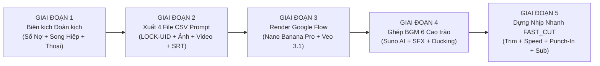

# TỔNG QUAN HỆ THỐNG LÀM PHIM DRAMA AI TOÀN DIỆN (MASTER BLUEPRINT & SOP): TỪ 20 REPO KỊCH BẢN TRUNG QUỐC $\rightarrow$ VIẾT PROMPT $\rightarrow$ RENDER GOOGLE FLOW $\rightarrow$ GHÉP NHẠC 6 CAO TRÀO & DỰNG NHỊP NHANH (`FAST_CUT`)

> **Mục đích sử dụng:** Đây là **Tài liệu Tổng Quan Trung Tâm (Single Source of Truth)** của toàn bộ hệ thống sản xuất Phim Drama AI (Cổ trang Cung đấu, Hiện đại Hào môn/Tổng tài, Nghịch tập Vả mặt, và Phim Dọc `9:16` Học Tiếng Anh kiểu ReelShort).
> Khi bắt đầu bất kỳ bộ phim mới nào, chỉ cần tham chiếu trực tiếp file này để chạy trọn gói **5 Giai đoạn Chuẩn Công Nghiệp**:
> 1. **Giai đoạn 1:** Viết Truyện, Thiết kế Nhân vật & Viết Kịch bản theo công thức **20 Repo Đoản kịch Trung Quốc (`Hồng Quả / Douyin / ReelShort`)**.
> 2. **Giai đoạn 2:** Chuyển Kịch bản sang **Bộ 4 File CSV Prompt Chuẩn (`Nhân vật LOCK-UID` + `Ảnh Khung Đầu` + `Video Có Thoại` + `Phụ đề SRT`)**.
> 3. **Giai đoạn 3:** Render Tự động Đa luồng trên **Google Flow (`Nano Banana Pro` + `Veo 3.1 Lite`)** qua công cụ `timeline_studio`.
> 4. **Giai đoạn 4:** Sản xuất & Ghép **Nhạc nền 6 Cao trào (`Suno AI v4.5 BGM`) + Tiếng động (`SFX`) + Tự hạ nhạc khi nhân vật nói (`Sidechain Ducking`)**.
> 5. **Giai đoạn 5:** Dựng hậu kỳ **Đẩy nhịp nhanh (`Director's Fast-Cut`: Cắt khoảng chết + Tăng tốc `1.07x–1.20x` + Cắt cận cảnh `1.16x Punch-In`)** và xuất Master `.mp4`.

---

## PHẦN 1: BẢN ĐỒ TÀI NGUYÊN & CÁC DỰ ÁN MẪU TRONG WORKSPACE (`e:\DIEN APP\Lam phim AI Trung`)

Toàn bộ kho mã nguồn, sổ tay chuyên sâu, script tự động hóa và 2 dự án phim mẫu đã được tổ chức chuẩn hóa tại thư mục gốc `e:\DIEN APP\Lam phim AI Trung\`:

| Nhóm Tài Nguyên | Đường Dẫn File / Thư Mục (Click để mở) | Nội Dung & Công Dụng Thực Chiến |
| :--- | :--- | :--- |
| **1. Kho 20 Repo Kịch Bản Đoản Kịch & Sảng Văn Trung Quốc (`8,554 files`)** | - Thư mục gốc: [`github_drama_repos\`](file:///e:/DIEN%20APP/Lam%20phim%20AI%20Trung/github_drama_repos)<br>- Sổ tay đúc kết: [`KHO_REPO_VA_CONG_THUC_VIET_KICH_BAN_DOAN_KICH_TRUNG_QUOC.md`](file:///e:/DIEN%20APP/Lam%20phim%20AI%20Trung/KHO_REPO_VA_CONG_THUC_VIET_KICH_BAN_DOAN_KICH_TRUNG_QUOC.md) | Chứa 20 Repo quán quân (`hongguo-shortdrama-screenwriting`, `emma-screenwriting-skills`, `Chinese-WebNovel-Skill`, `0xsline/short-drama`, `SumOneHK`, `Hao0321`, `zenstory-ai/drama-skills`...) kèm Bộ 3 Siêu Prompt biên kịch. |
| **2. Bộ Cẩm Nang Viết Prompt, Vượt Lọc Google Flow, Ghép Nhạc & Dựng Nhịp Nhanh** | - [`CAM_NANG_TOAN_DIEN_LAM_PHIM_CO_TRANG_DRAMA_AI_GOOGLE_FLOW.md`](file:///e:/DIEN%20APP/Lam%20phim%20AI%20Trung/CAM_NANG_TOAN_DIEN_LAM_PHIM_CO_TRANG_DRAMA_AI_GOOGLE_FLOW.md)<br>- [`SO_TAY_LAM_PHIM_AI_GOOGLE_FLOW_VA_PROMPT_MAU.md`](file:///e:/DIEN%20APP/Lam%20phim%20AI%20Trung/SO_TAY_LAM_PHIM_AI_GOOGLE_FLOW_VA_PROMPT_MAU.md)<br>- [`PHAN_TICH_QUY_TRINH_LAM_PHIM_AI_CLAUDE_H3.md`](file:///e:/DIEN%20APP/Lam%20phim%20AI%20Trung/PHAN_TICH_QUY_TRINH_LAM_PHIM_AI_CLAUDE_H3.md) | Công thức viết Prompt Nhân vật (`Turnaround Sheet`), Prompt Ảnh First Frame, Prompt Video 8s, mẹo vượt bộ lọc chính sách Google Flow, thuật toán trộn BGM 6 pha và cắt nhịp nhanh `FAST_CUT`. |
| **3. Sổ Tay Xây Kênh Học Tiếng Anh Qua Phim Drama Dọc `9:16`** | - [`HUONG_DAN_XAY_KENH_HOC_TIENG_ANH_QUA_PHIM_AI_9_16.md`](file:///e:/DIEN%20APP/Lam%20phim%20AI%20Trung/HUONG_DAN_XAY_KENH_HOC_TIENG_ANH_QUA_PHIM_AI_9_16.md) | Công thức làm phim dọc `9:16` kiểu *ReelShort / DramaBox* kết hợp phụ đề song ngữ Anh–Việt và thẻ từ vựng (`Target Phrase`). |
| **4. Dự Án Mẫu #01 (Phim Cổ Trang `16:9` Đã Render & Hậu Kỳ Hoàn Chỉnh)** | - Thư mục: [`01_Phe_Hau_Tro_Ve\`](file:///e:/DIEN%20APP/Lam%20phim%20AI%20Trung/01_Phe_Hau_Tro_Ve)<br>- Bản Nhịp Nhanh VietSub (`03:13`): [`01_Phe_Hau_Tro_Ve_FAST_CUT_VIETSUB.mp4`](file:///e:/DIEN%20APP/Lam%20phim%20AI%20Trung/01_Phe_Hau_Tro_Ve/FINAL/01_Phe_Hau_Tro_Ve_FAST_CUT_VIETSUB.mp4)<br>- Bản Đầy Đủ VietSub (`05:01`): [`01_Phe_Hau_Tro_Ve_MASTER_VIETSUB.mp4`](file:///e:/DIEN%20APP/Lam%20phim%20AI%20Trung/01_Phe_Hau_Tro_Ve/FINAL/01_Phe_Hau_Tro_Ve_MASTER_VIETSUB.mp4) | Bộ phim mẫu 38 cảnh (`UID01..UID03`), có sẵn 6 bản nhạc BGM cổ trang (`4 am nhac sfx/`) và 4 script Python mẫu (`build_project_csvs.py`, `run_flow_render.py`, `build_bgm_and_remaster.py`, `build_fast_paced_director_cut.py`). |
| **5. Dự Án Mẫu #02 (Series Hiện Đại Việt Nam 5 Tập `9:16` — 125 Cảnh)** | - Thư mục: [`02_Chu_Tich_An_Danh_5_Tap\`](file:///e:/DIEN%20APP/Lam%20phim%20AI%20Trung/02_Chu_Tich_An_Danh_5_Tap)<br>- Kịch bản tổng 5 tập: [`KICH_BAN_5_TAP_CHU_TICH_AN_DANH_TIEC_LY_HON_TANG_68.md`](file:///e:/DIEN%20APP/Lam%20phim%20AI%20Trung/02_Chu_Tich_An_Danh_5_Tap/KICH_BAN_5_TAP_CHU_TICH_AN_DANH_TIEC_LY_HON_TANG_68.md)<br>- 5 Thư mục Tập (`Tap_01`..`Tap_05`) | Series hiện đại Sài Gòn 5 tập (mỗi tập 24–26 cảnh = ~3m20s), đã tạo sẵn toàn bộ Kịch bản + CSV Prompt Nhân vật (`UID01..UID05`), Ảnh `9:16`, Video và `.srt` cho cả 5 tập. |
| **6. Công Cụ Render & Ghép Video Tự Động (`timeline_studio`)** | - Tool gốc: `E:\DIEN APP\Xây Kênh Youtube\Tool render edit Video\timeline_studio`<br>- Bộ điều phối Google Flow: `E:\DIEN APP\Xây Kênh Youtube\Tool render edit Video\omniflash\youtube\flow_ui_batch.py` | Điều khiển trực tiếp giao diện Google Flow (`flow.google.com`) qua FlowKit Extension (`:8100`), tự đính kèm ảnh nhân vật `@uid01..uid05`, tự tải ảnh/video gốc qua Signed URL. |

---

## PHẦN 2: QUY TRÌNH CHUẨN 5 GIAI ĐOẠN SẢN XUẤT PHIM DRAMA AI (SOP THỰC CHIẾN)



---

### GIAI ĐOẠN 1: VIẾT TRUYỆN, XÂY DỰNG NHÂN VẬT & VIẾT KỊCH BẢN CHUẨN TRUNG QUỐC (LUÔN LÀM TRƯỚC KHI RENDER)

> **Nguyên tắc vàng:** Tuyệt đối **KHÔNG BẤM RENDER** khi chưa chốt xong **Kịch bản Đầy đủ** có cốt truyện, nhân vật, hành động vật lý (`△`), âm thanh (`♪`) và lời thoại sắc bén (`"..."`).

#### 1.1. 6 Quy Tắc Biên Kịch Cốt Lõi (Từ 20 Repo Đoản Kịch Hồng Quả / Douyin)
1. **Tương phản Cốt lõi (`Core Identity Gap`):** Nhân vật chính luôn có vẻ ngoài giản dị/nhẫn nhịn nhưng nắm giữ thân phận hoặc bằng chứng tối thượng (Chủ tịch ẩn danh, Kiến trúc sư trưởng, Phế hậu giữ mật chỉ).
2. **Hệ thống Phản diện Đa tầng (`4-Tier Villain`):**
   - *Tầng 1 (Pháo hôi):* Mẹ chồng thực dụng, quản lý hách dịch, tiểu tam khoe của $\rightarrow$ Bị vả mặt ngay trong Tập 1–2.
   - *Tầng 2 (Đối thủ chính):* Chồng bội bạc, kẻ cướp công trạng $\rightarrow$ Giằng co đến Tập 3–4.
   - *Tầng 3 (Trùm cuối / Cú Twist):* Âm mưu lớn nhất bị phơi bày ở Tập 4–5.
3. **Sổ Nợ Sảng Khoái (`Payoff Debt Ledger` — `Hao0321/ai-short-drama`):**
   - Mỗi lần nhân vật chính chịu ấm ức ở đầu phim đều phải gắn với **1 Đạo cụ Neo cảm xúc** (Cây bút kỷ vật bị dẫm, Tờ đơn ly hôn, Sợi dây chuyền bị trộm, Bản vẽ bị đánh cắp).
   - Ở cao trào, nhân vật chính bắt buộc dùng **đúng đạo cụ đó và câu nói đó** để trả nợ gấp 10 lần!
4. **Cấu trúc Tập Phim 3–5 Phút (`长档 Song Hiệp` — `hongguo-shortdrama-screenwriting`):**
   - Mỗi tập (24–38 cảnh $\times$ 8s) chia làm **2 Hiệp (`Hiệp A` + `Hiệp B`)**:
     - **Giây 1–5 (`Móc câu 5 giây vàng`):** Mở màn ngay bằng một hành động xung đột thị giác (hất rượu, ném đơn ly hôn, mở mật chỉ).
     - **Hiệp A (`0:00 – 1:30`):** Phản diện ép bức $\rightarrow$ Nhân vật chính phản đòn bước 1 $\rightarrow$ **Móc câu giữa tập (`中段小钩`)** tại phút 1:30 đẩy xung đột lên cấp độ nguy hiểm hơn.
     - **Hiệp B (`1:30 – 3:20`):** Nhân vật chính tung bằng chứng/quyền lực trả 1 khoản nợ sảng khoái (`Payoff`) $\rightarrow$ **Điểm cắt cuối tập (`本集断章卡点`)**: Dừng đúng khoảnh khắc gay cấn nhất để buộc khán giả xem tập tiếp theo!
5. **Bộ 3 Đậm Đặc Kịch Tính (`SumOneHK`):**
   - Mọi cảm xúc phải **ngoại hóa thành hành động vật lý (`△`)** mà ống kính quay thấy được (siết chặt tay, thả nhẫn vào ly rượu, đặt tay lên máy quét tĩnh mạch).
6. **Luật Ngân sách Lời thoại (`Speech Budget`):**
   - Mỗi cảnh `8 giây` trên Veo 3.1 chỉ viết **12–18 từ Tiếng Việt (hoặc Tiếng Anh)** để giọng đọc AI phát âm rõ ràng, đanh thép trong `4.5–5.5 giây`, chừa `2.5 giây` cho tiếng động SFX và biểu cảm gương mặt.

---

### GIAI ĐOẠN 2: VIẾT PROMPT NHÂN VẬT (`LOCK-UID`), PROMPT ẢNH CẢNH & PROMPT VIDEO CÓ THOẠI

Mỗi tập phim lưu trong 1 thư mục riêng (VD: `Tap_01\`) gồm 4 file CSV chuẩn `UTF-8-SIG` BOM:

#### 2.1. Công thức Prompt Nhân Vật (`1 prompt nhan vat/B2_Nhan_Vat.csv`)
- Định dạng: `[uid01] <STYLE_PREFIX> <16:9 hoặc 9:16> Character Identity Sheet on a clean off-white studio background (#F8F6F0), no environment, no props... <DNA_UID01> --no text, words, letters, watermark, real human photo, celebrity`
- **Từ khóa bắt buộc để vượt bộ lọc Khuôn mặt / Người nổi tiếng của Google Flow:** Luôn có cụm **`(Unreal Engine 5 Stylized Cinema aesthetic, fictional stylized 3D animated character, non-photorealistic)`**.

#### 2.2. Công thức Prompt Ảnh Khung Hình Đầu (`2 prompt anh canh/B3_Prompt_Anh_Canh.csv`)
- Định dạng:
  `[SCENE_01] [{uid03}] [{uid01}] <STYLE_PREFIX> <Cỡ cảnh & Góc máy>, <Tiêu cự ống kính>. Spatial blocking: <Mô tả vị trí đứng/ngồi + DNA nhân vật + Đạo cụ cầm trên tay + Ánh sáng> --no text, words, letters, subtitles, watermark, real human photo, celebrity`
- **Lưu ý quan trọng:** Chỉ liệt kê tối đa **1–2 mã `[{uidXX}]`** xuất hiện trực diện trong khung hình để `flow_ui_batch.py` đính kèm đúng ảnh tham chiếu nhân vật.

#### 2.3. Công thức Prompt Video Chuyển Động & Thoại (`3 prompt video/B5_Prompt_Video_English.csv`)
- Định dạng:
  `[SCENE_01] <STYLE_PREFIX><Camera Motion>. <Mô tả khung hình đầu>. [0.0s-8.0s Action]: The subject <hành động vật lý tiếp diễn>. The <mô tả nhân vật> speaks aloud in <mô tả chất giọng tiếng Anh>: "<Lời thoại Tiếng Việt hoặc Tiếng Anh>" SFX: <tiếng động vật lý>. No background music, no subtitles, no on-screen text.`
- **Quy tắc An toàn Chính sách (`Policy Filter Bypass`):**
  - Trong phần mô tả hành động tiếng Anh (`[0.0s-8.0s Action]`), dùng từ ngữ điện ảnh an toàn (VD: `splashes red grape juice onto white silk lapel` thay vì `throws blood/wine in face`; `knocks wooden box onto marble floor` thay vì `stomps violently`).
  - Phần lời thoại Tiếng Việt nằm trong ngoặc kép `"..."` vẫn giữ nguyên 100% độ sắc bén, kịch tính!

---

### GIAI ĐOẠN 3: LỆNH RENDER TỰ ĐỘNG TRÊN GOOGLE FLOW QUA `TIMELINE_STUDIO`

Khi kịch bản và 4 file CSV đã được duyệt, chạy lệnh Python điều phối `flow_ui_batch.py`:

```powershell
# Render Tập phim ở tỷ lệ DỌC 9:16 (TikTok / Reels / Shorts / Đoản kịch)
python "e:\DIEN APP\Lam phim AI Trung\02_Chu_Tich_An_Danh_5_Tap\Tap_01\run_ep01_render.py" all

# Hoặc gọi trực tiếp flow_ui_batch.py cho bất kỳ thư mục tập phim nào:
python "E:\DIEN APP\Xây Kênh Youtube\Tool render edit Video\omniflash\youtube\flow_ui_batch.py" `
  --video-dir "e:\DIEN APP\Lam phim AI Trung\02_Chu_Tich_An_Danh_5_Tap\Tap_01" `
  --scenes "all" `
  --threads 3 `
  --aspect "9:16" `
  --imodel "nano_banana_pro" `
  --vmodel "veo_3_1_lite"
```

---

### GIAI ĐOẠN 4: GHÉP NHẠC NỀN 6 CAO TRÀO (`BGM`) + TIẾNG ĐỘNG (`SFX`) + TỰ HẠ NHẠC KHI NÓI (`DUCKING`)

Một tập phim Drama được chia thành **6 Pha Âm Nhạc (`6 Musical Phases`)** bám sát đường cong cảm xúc:
1. **Pha 1 (`Cảnh 01–04` — Mở màn Áp bức):** Cello trầm tối + Nhịp đồng hồ/trống căng thẳng.
2. **Pha 2 (`Cảnh 05–09` — Xung đột Leo thang & Móc câu giữa tập):** Dàn dây (`Staccato Strings`) dồn dập.
3. **Pha 3 (`Cảnh 10–13` — Tín hiệu Phản kích):** Nhịp trống điện tử / Trống trận kết hợp Piano sắc lạnh.
4. **Pha 4 (`Cảnh 14–18` — Ra đòn Trả nợ Bước 1):** Giai điệu Đảo chiều (`Reversal Pulse`) uy quyền.
5. **Pha 5 (`Cảnh 19–22` — Nhân vật Lớn / Bằng chứng Thép Xuất hiện):** Dàn kèn đồng (`Brass`) và trống đại hồng chung bùng nổ.
6. **Pha 6 (`Cảnh 23–25` — Điểm cắt Cuối tập `Cliffhanger`):** Đẩy kịch tính lên tột đỉnh rồi ngắt phụp ở giây cuối!

**Công thức trộn âm thanh chuẩn trong script (`build_bgm_and_remaster.py`):**
- Tăng độ rõ lời thoại gốc (`volume=1.35` + lọc tạp âm `highpass=f=80`).
- Giữ nhạc nền ở mức `24%–28%` khi có thoại, tự động dâng lên ở đầu/cuối cảnh và chuẩn hóa âm lượng toàn phim ở mức **`-14 LUFS` (`loudnorm=I=-14:TP=-1.5:LRA=11`)**.

---

### GIAI ĐOẠN 5: DỰNG HẬU KỲ NHỊP NHANH (`DIRECTOR'S FAST_CUT`) & ĐÓNG PHỤ ĐỀ

Sau khi có bản `MASTER.mp4` (ghép nguyên các cảnh 8 giây), chạy tiếp thuật toán **`build_fast_paced_director_cut.py`** để tạo bản **`FAST_CUT_VIETSUB.mp4`** cuốn hút gấp đôi:
1. **Cắt bỏ khoảng chết đầu & cuối cảnh (`Trim Dead Air`):** Dùng bộ dò năng lượng âm thanh (`RMS Speech Envelope`) cắt bỏ `0.3s–1.2s` nhân vật đứng chờ trước và sau khi nói xong.
2. **Tăng tốc theo loại cảnh (`Speed Ramping`):**
   - Cảnh hành động / vả mặt / quát tháo: Tăng tốc **`1.14x – 1.20x`** (giữ nguyên trầm bổng giọng nói bằng bộ lọc `atempo`).
   - Cảnh đấu khẩu đối thoại: Tăng tốc **`1.08x – 1.12x`**.
   - Cảnh cao trào cảm xúc / rơi nước mắt: Giữ nhịp **`1.00x – 1.05x`** để lắng đọng.
3. **Cắt Cận Cảnh Quang Học Giữa Cảnh (`1.16x Optical Close-Up Punch-In`):**
   - Với những cảnh dài trên `5.0 giây`, tại đúng điểm giữa câu thoại (sau dấu phẩy hoặc nhịp nghỉ), tự động cắt sang góc máy **phóng cận mặt `1.16x` (`crop + scale lanczos`)** tạo hiệu ứng chuyển máy quay đa góc như phim truyền hình thật!
4. **Đóng Phụ đề Tiếng Việt (hoặc Song ngữ Anh–Việt) khớp từng mili-giây:** Tự động tính lại mốc thời gian `.srt` sau khi cắt nhanh và burn-in phụ đề viền đen rõ nét lên video.

---

## PHẦN 3: CÁCH GỌI NHANH KHI BẮT ĐẦU LÀM PHIM MỚI

Từ nay, mỗi khi anh muốn làm một bộ phim hoặc tập phim mới, anh chỉ cần nhắn 1 câu ngắn gọn:
- **Mẫu 1 (Viết kịch bản trước):** *"Em dựa vào file Tổng Quan `00_TONG_QUAN_HE_THONG_LAM_PHIM_DRAMA_AI_TOAN_DIEN.md`, viết cho anh kịch bản [Chủ đề / Số tập / Tỷ lệ 9:16 hoặc 16:9] trước nha, khoan render."*
- **Mẫu 2 (Khi đã duyệt kịch bản và muốn Render):** *"Kịch bản Tập X duyệt rồi, em chạy Render Google Flow + ghép nhạc 6 cao trào + xuất bản FAST_CUT theo chuẩn Tổng Quan nha."*

---

## Tiêu chuẩn công nghệ & Tài liệu tham chiếu

- **Tổ hợp 20 Kho Mã Nguồn Mở Biên Kịch Đoản Kịch & Sảng Văn Trung Quốc (`github_drama_repos/`):** Quy chuẩn cấu trúc kịch bản Hồng Quả / Douyin v4.0 (`hongguo-shortdrama-screenwriting`), 26 kỹ năng biên kịch & bản địa hóa Anh–Mỹ (`emma-screenwriting-skills`), Sổ nợ Sảng khoái (`Hao0321/ai-short-drama`), 8 sổ tay Sảng kịch (`0xsline/short-drama`) và Bộ 3 Đậm đặc Kịch tính (`SumOneHK/short-drama-scriptwriter`).
- **Kiến trúc Sản xuất Video AI Đa Luồng (`Google Flow Veo 3.1 Lite` & `Nano Banana Pro`):** Quy chuẩn khóa nhân vật `LOCK-UID`, điều phối cầu nối `timeline_studio / flow_ui_batch.py`, trộn nhạc nền 6 pha (`Suno AI v4.5`) và thuật toán dựng nhịp nhanh `FAST_CUT` (*FFmpeg Loudnorm EBU R128 & Optical Punch-In Pipeline*).
