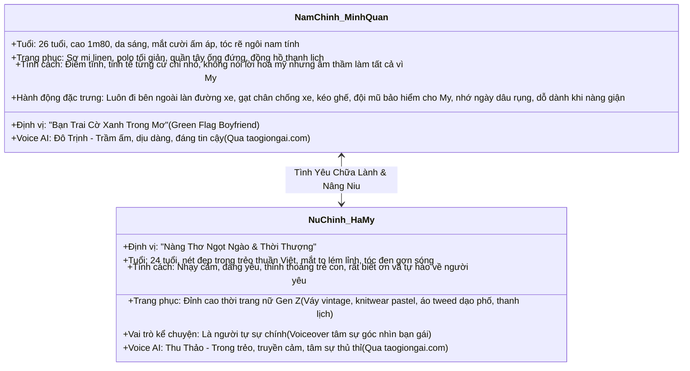
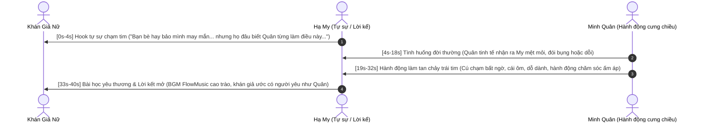

# 🌸 KẾ HOẠCH TỔNG THỂ XÂY KÊNH KOL: "NGƯỜI YÊU TRONG MƠ CỦA NÀNG" (9:16)
### *Chiến Lược Chạm Cảm Xúc Hàng Triệu Phái Nữ & Định Vị Bán Hàng Thời Trang Nữ Dài Hạn*

---

## 💎 1. ĐỊNH VỊ CỐT LÕI (CORE IDENTITY & EMOTIONAL HOOK)

* **Tên Kênh / Series:** *Nhật Ký Cờ Xanh — Chuyện Của Quân & My* (Green Flag Boyfriend Diaries).
* **Định Dạng:** **100% Khung Hình Dọc 9:16** (Chuẩn TikTok, Instagram Reels, YouTube Shorts).
* **Mục Tiêu Cảm Xúc Tối Thượng:** 
  > *"Khi xem video, mọi cô gái đều phải thốt lên: 'Trời ơi, sao trên đời lại có người yêu tuyệt vời đến thế! Mình ước gì cũng có một anh người yêu như thế này!'."*
* **Nguyên Tắc Giai Đoạn Đầu:** **TUYỆT ĐỐI 0% BÁN HÀNG — 0% QUẢNG CÁO SẢN PHẨM**. Toàn bộ câu chuyện tập trung vào cảm xúc, sự ngọt ngào, tinh tế đời thường, tạo tệp fan nữ trung thành và nghiện xem.
* **Mục Tiêu Thương Mại Hóa Dài Hạn:** **Tiếp thị liên kết (Affiliate) Thời Trang Nữ & Phong Cách Sống Phái Đẹp**:
  * Khi khán giả nữ đã mê mẩn và đồng cảm với Hạ My, họ sẽ khao khát có được vẻ ngoài ngọt ngào, thanh lịch như My để được người yêu nâng niu.
  * Mọi set đồ Hạ My mặc trong từng tập (váy hoa nhí, áo len dệt kim, set dạo phố thanh lịch, kẹp tóc, túi xách, giày búp bê) sẽ trở thành "hot item" được săn đón và chốt đơn ồ ạt qua Shopee / TikTok Shop.

---

## 👫 2. HÌNH TƯỢNG BỘ ĐÔI NHÂN VẬT THUẦN VIỆT

---

## 🎭 3. CẤU TRÚC KỂ CHUYỆN LIÊN TIẾP TỪNG TẬP (SERIALIZED WEB-DRAMA 9:16)

Mỗi video là một chương ngắn dài **35s – 45s**, được xâu chuỗi liên tiếp như một cuốn nhật ký tình yêu:

* **Góc Nhìn Kể Chuyện Linh Hoạt (Dual-Perspective Narration):**
  * **Đa số các tập (80%):** **Hạ My tự kể** (Giọng nữ Thu Thảo thủ thỉ tâm sự nỗi lòng bạn gái: *"Nhiều người hỏi mình sao lúc nào cũng cười... là vì có một người luôn nhớ mọi điều nhỏ nhặt về mình"*).
  * **Các tập đặc biệt (20%):** **Minh Quân tự kể** (Góc nhìn thầm lặng của chàng trai: *"Cô ấy tưởng tôi không biết... nhưng mỗi khi cô ấy im lặng, tôi biết mình phải làm gì"*).

---

## 🛠️ 4. BỘ CÔNG CỤ CÔNG NGHỆ CHUẨN XÁC THEO YÊU CẦU

1. **Giọng Đọc & Hội Thoại Chuẩn Studio:**
   * Nền tảng: **`https://taogiongai.com/`** (Huymmotts API).
   * Engine Model: **`eleven_v4`** (Hỗ trợ tiếng Việt 100% mượt mà, tự nhiên, không giật cục).
   * Voice ID tuyển chọn:
     * Nữ chính (Hạ My): **Thu Thảo** (`Jmio6r8OUeqiK3cZ3N0K`) — Giọng tâm sự, truyền cảm.
     * Nam chính (Minh Quân): **Đô Trịnh** (`CxJbDdwqY48MY3gPVYwe`) — Giọng nam thần trầm ấm.
   * API Key sẵn có: `<YOUR_TAOGIONGAI_API_KEY>` (nạp qua biến môi trường `TAOGIONGAI_API_KEY`) (Còn hơn **66.000 credits**).
2. **Nhạc Nền Độc Quyền Bản Quyền:**
   * Nền tảng: **`https://www.flowmusic.app/`** điều khiển qua Chrome CDP Port `9334` (`FlowMusic_Auto`).
   * Dòng nhạc: **Acoustic Guitar, Lofi Piano, Sáo trúc hiện đại, R&B Soul êm dịu**.
   * Bắt gói stream `.m4a` trực tiếp và tự động hạ âm lượng (Audio Ducking) khi có lời thoại.
3. **Hình Ảnh & Video Khung Dọc 9:16:**
   * Nền tảng: **Google Veo 3.1 Lite** (`model="veo"`, `duration=8s`, `resolution="720p"`, `aspect="9:16"`).
   * Dự án Google Flow: `080c2c09-01c6-4be8-8130-f9b55e372616`.
   * Khóa gương mặt 100% bằng bộ **Character Turnaround 4 góc** của Minh Quân và Hạ My.

---

## 📑 5. LỘ TRÌNH 4 MÙA PHIM (100 TẬP LIÊN TIẾP NHAU)

### 🌸 MÙA 1: NGÀY 01 – 25: "BÍ MẬT CỦA CHIẾC CỜ XANH" (HÚT TRIỆU FAN NỮ)
*(Tập trung vào những hành động nhỏ nhặt tinh tế khiến phái nữ phát cuồng. 0% BÁN HÀNG)*

| Tập | Tên Tập | Góc Kể | Tình Huống Đời Thường Khiến Nàng "Tan Chảy" | Cảm Xúc Đọng Lại | Outfit Nữ Chính (Chuẩn Bị Cho Affiliate Sau Này) |
| :---: | :--- | :---: | :--- | :--- | :--- |
| **01** | *Anh Ấy Luôn Đi Bên Ngoài* | My kể | My mải bấm điện thoại suýt bị xe máy quẹt, Quân nhẹ nhàng kéo My vào phía trong lề đường và đổi vị trí sang phía làn xe. | Cảm giác được che chở an toàn tuyệt đối. | Váy hoa nhí vintage tay bồng dáng dài |
| **02** | *Cơn Dỗi Không Lý Do* | Quân kể | My bực bội cáu gắt cả ngày, Quân không cãi lại nửa lời mà lặng lẽ mang ly trà gừng ấm và bọc túi sưởi đặt vào tay My. | Thấu hiểu sự nhạy cảm của con gái ngày "dâu". | Set đồ mặc nhà nỉ bông ấm áp pastel |
| **03** | *Gạt Chân Chống Xe* | My kể | My vừa bước tới xe, chưa kịp làm gì thì Quân đã cúi người gạt sẵn chân chống và tự tay cài quai mũ bảo hiểm cho My. | Rung động từ những thói quen vô điều kiện. | Áo khoác dạ tweed phối chân váy xếp ly |
| **04** | *Bát Phở Không Hành* | My kể | My ghét ăn hành nhưng quên dặn chủ quán, Quân tự động đổi bát phở của mình rồi ngồi tỉ mẩn gắp từng cọng hành sang. | Anh ấy nhớ mọi sở thích nhỏ nhất của mình. | Áo len dệt kim cổ lọ màu trắng kem |
| **05** | *Cơn Buồn Ngủ Trên Xe Buýt* | Quân kể | My ngủ gật đầu lắc lư suýt đập vào kính xe, Quân vội đưa lòng bàn tay ra đỡ trán My rồi nhẹ nhàng kéo đầu cô tựa vào vai mình. | Bình yên tựa vào bờ vai người thương. | Váy suông sơ mi kẻ sọc năng động |
| **06** | *Khi Em Nói 'Không Sao'* | My kể | My nói "Em không sao đâu", người khác sẽ tin nhưng Quân quay lại ôm My thật chặt: "Khóc đi, anh ở đây rồi". | Tìm được người hiểu thấu sự yếu đuối sau vỏ bọc mạnh mẽ. | Set áo blazer croptop thanh lịch |
| **07** | *Chiếc Áo Khoác Dưới Mưa* | My kể | Trời bất chợt đổ mưa to, Quân cởi phăng áo khoác trùm kín đầu cho My, còn mình thì ướt sũng nhưng vẫn cười tươi. | Tình yêu là khi ai đó sẵn sàng ướt vì bạn. | Váy maxi voan nhẹ nhàng bay trong gió |
| **08** | *Bữa Sáng Để Lại Ghi Chú* | My kể | Sáng dậy My thấy trên bàn có đĩa bánh mì ốp la kèm tờ giấy note: "Ăn ngoan rồi đi làm nhé cô bé của anh". | Sự ngọt ngào đánh thức ngày mới. | Áo thun oversized giấu quần phong cách Hàn |
| **09** | *Cốc Nước Ấm Lúc 3 Giờ Sáng* | My kể | My khát nước ho khẽ giữa đêm, Quân mắt nhắm mắt mở lò mò dậy rót sẵn cốc nước ấm đưa tận tay My rồi mới ngủ tiếp. | Hành động trong tiềm thức chứng minh tình cảm thật. | Đầm ngủ lụa satin hai dây phối ren |
| **10** | *Chiếc Ghế Ở Quán Cà Phê* | My kể | Vào quán đông người, chiếc ghế sắt bị dính bụi, Quân lấy khăn giấy lau sạch bóng rồi mới kéo ghế mời My ngồi. | Tác phong quý ông lịch thiệp với người mình yêu. | Váy yếm denim phối áo thun dài tay |
| **11** | *Anh Nhớ Mọi Món Em Thích* | My kể | Đi ăn cùng nhóm bạn, My chưa kịp gọi món thì Quân đã gọi vanh vách toàn bộ món My thích ăn và dặn giảm đá ít ngọt. | Được ưu tiên số một trong mọi hoàn cảnh. | Áo cardigan len mỏng cài cúc ngọc trai |
| **12** | *Đôi Giày Cao Gót Đau Chân* | Quân kể | Đi dạo phố thấy My bước đi khập khiễng vì giày cao gót cọ rách gót chân, Quân cởi giày của mình bắt My đi còn anh đi chân đất. | Sự hy sinh vụng về nhưng đáng yêu tột cùng. | Đầm công chúa trễ vai dự tiệc nhẹ |
| **13** | *Khi Nàng Nấu Ăn Dở* | My kể | My lần đầu nấu canh bị mặn chát, Quân vẫn ăn hết sạch bát cơm rồi cười bảo: "Lần sau để đầu bếp trưởng Quân nấu cho nhé!". | Sự bao dung và trân trọng công sức của bạn gái. | Tạp dề phong cách Hàn Quốc kèm váy linen |
| **14** | *Nụ Cười Sau Giờ Tăng Ca* | My kể | My tan làm muộn lúc 9h tối mệt rã rời, bước ra cổng công ty thấy Quân đang đứng đợi sẵn với bó hoa nhỏ trên tay. | Xóa tan mọi áp lực cuộc sống khi thấy anh. | Set đồ công sở hiện đại quần ống suông cạp cao |
| **15** | *Cái Nắm Tay Trong Rạp Chiếu Phim* | My kể | Xem phim kinh dị My giật bắn mình sợ hãi, bàn tay Quân lập tức tìm đến đan chặt mười ngón tay ấm áp không buông. | Cảm giác được chở che giữa đám đông. | Áo hoodie nỉ đôi form rộng ấm áp |
| **16** | *Anh Không Bao Giờ Thất Hứa* | Quân kể | Quân bận họp cả ngày nhưng đã hứa chở My đi ngắm hoàng hôn, anh chạy xe xuyên thành phố để kịp giờ hẹn. | Sự đúng hẹn và đáng tin cậy của đàn ông trưởng thành. | Váy xếp ly tầng màu pastel nhẹ nhàng |
| **17** | *Lời Khen Chân Thành* | My kể | My tự ti vì mới mọc chiếc mụn to trên trán, Quân véo má My cười: "Trong mắt anh em lúc nào cũng xinh xắn nhất". | Liều thuốc chữa lành mọi sự tự ti ngoại hình. | Váy babydoll tay phồng dễ thương |
| **18** | *Bức Ảnh Trong Ví* | My kể | Tình cờ mở ví của Quân, My thấy tấm ảnh chụp trộm My đang ăn kem nham nhở từ 3 năm trước vẫn được cất giữ phẳng phiu. | Tình yêu bền chặt theo năm tháng. | Áo sơ mi voan cổ bèo phối chân váy chữ A |
| **19** | *Khi Em Ghen Trẻ Con* | Quân kể | My thấy Quân nói chuyện công việc với đồng nghiệp nữ rồi giận dỗi, Quân không bực mà kiên nhẫn giải thích và công khai My với cả cơ quan. | Cảm giác an tâm tuyệt đối không có sự mập mờ. | Váy dạ hội ngắn thắt nơ lưng quyến rũ |
| **20** | *Chiếc Ô Duy Nhất* | My kể | Trời mưa cả hai chỉ có 1 chiếc ô nhỏ, Quân nghiêng hẳn chiếc ô về phía My, nửa vai áo của anh ướt đẫm mà anh không hay. | Chiếc ô nghiêng là biểu tượng tình yêu chân thực. | Áo măng-tô dáng dài trench coat thời thượng |
| **21** | *Anh Học Buộc Tóc Cho Em* | My kể | Tay My bị trật khớp không chải tóc được, Quân vụng về cầm dây thun tập buộc tóc đuôi ngựa cho My cả nửa tiếng đồng hồ. | Sự kiên nhẫn vụng về đáng yêu không ai bằng. | Set đồ thể thao năng động sporty chic |
| **22** | *Đêm Giao Thừa Của Hai Đứa* | Quân kể | Đứng giữa biển người xem pháo hoa, Quân ôm My từ phía sau và thì thầm: "Năm nay, năm sau và mãi mãi, đều chỉ có em". | Lời hứa tương lai vững chãi. | Áo len cổ tim phối khăn choàng len đỏ may mắn |
| **23** | *Khi Nàng Bị Bắt Nạt* | My kể | My bị đồng nghiệp chèn ép khóc nức nở, Quân không bảo My "nhịn đi" mà bảo: "Nghỉ việc đi, anh nuôi em được, không ai được làm tổn thương em". | Điểm tựa tinh thần vững chắc lúc cô đơn nhất. | Váy sơ mi denim cá tính thời trang |
| **24** | *Món Quà Bất Ngờ Trong Hộc Bàn* | My kể | My than thở chiếc kẹp tóc cũ bị gãy, hôm sau trong hộc bàn xuất hiện cả một hộp kẹp tóc đủ màu sắc Quân tự chọn. | Anh ấy luôn lắng nghe từng câu nói bâng quơ. | Đầm thun tăm ôm body tôn dáng thanh lịch |
| **25** | *Tổng Kết Mùa 1: Hạnh Phúc Là Gì?* | My & Quân kể | Cả hai cùng ngồi bên ban công ngắm phố phường, nhìn lại những khoảnh khắc đã qua và cảm ơn định mệnh đã mang anh đến. | Tình yêu đích thực là có một người xem bạn là cả thế giới. | Set đồ đôi tone-sur-tone trắng kem tối giản |

---

### 👗 MÙA 2 (TẬP 26 – 50): "NHẬT KÝ SỐNG CHUNG & OUTFIT NÀNG THƠ"
*(Khán giả bắt đầu hỏi link đồ My mặc trong từng tập ➔ Bắt đầu gắn link Bio tiếp thị liên kết các shop thời trang Shopee/TikTok Shop).*

### 🛍️ MÙA 3 (TẬP 51 – 75): "NHỮNG CHUYẾN ĐI & BỘ SƯU TẬP THEO MÙA"
*(Các video du lịch, dạo phố, chụp ảnh OOTD (Outfit of the Day). Doanh thu hoa hồng Affiliate thời trang nữ bùng nổ).*

### 👑 MÙA 4 (TẬP 76 – 100): "HỆ SINH THÁI THỜI TRANG & THƯƠNG HIỆU RIÊNG"
*(Nhận booking PR nhãn hàng thời trang nữ lớn, chốt deal độc quyền các dịp Mega Sale 11/11, 12/12).*
