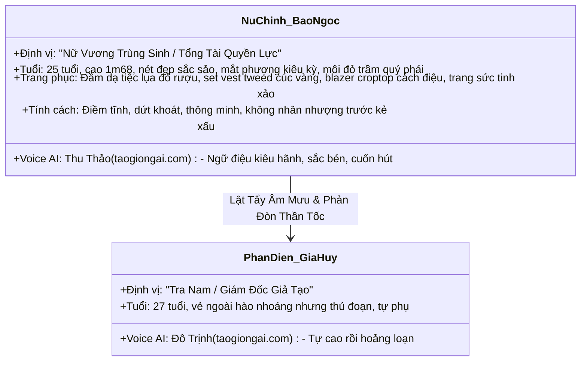

# 👑 KẾ HOẠCH XÂY KÊNH KOL: "NỮ TỔNG TÀI TRÙNG SINH — ĐỈNH CAO THỜI TRANG" (9:16)
### *Chiến Lược Drama Sảng Văn Giữ Chân Triệu View & Định Vị Bán Hàng Thời Trang Công Sở / Dạ Hội Cao Cấp*

---

## 💎 1. ĐỊNH VỊ CỐT LÕI (CORE IDENTITY & VIRAL HOOK)

* **Tên Kênh / Series:** *Vương Triều Trở Lại — Nhật Ký Nữ Tổng Tài Trùng Sinh* (*The Queen Returns*).
* **Định Dạng:** **100% Khung Hình Dọc 9:16** (Tối ưu thuật toán TikTok, Instagram Reels, YouTube Shorts).
* **Công Thức Gây Nghiện (Sảng Văn / Fast-Paced Drama):**
  > *"3 giây đầu giật gân, giữa video đối đầu nghẹt thở, cuối video lật mặt hả dạ. Xem là không thể dứt ra được!"*
* **Giai Đoạn Đầu (0% Bán Hàng Trực Tiếp):** 
  * Tuyệt đối không chèn link mua hàng thô thiển trong các video đầu.
  * Tập trung 100% xây dựng hình tượng **Nữ tổng tài thông minh, độc lập, sang chảnh, quyền lực** mà mọi cô gái trẻ đều khát khao hướng tới.
* **Mục Tiêu Thương Mại Hóa Dài Hạn (High-Ticket Fashion Affiliate):**
  * Tệp khán giả của thể loại này là phụ nữ có gu thẩm mỹ cao, sẵn sàng chi tiền cho các set đồ thanh lịch, tôn dáng.
  * Các mặt hàng bán chạy: Blazer công sở cách điệu, set dạ tweed phong cách quý tộc, đầm lụa dạ tiệc, son môi tone đỏ trầm quyền lực, túi xách hộp và trang sức ngọc trai.

---

## 👸 2. HÌNH TƯỢNG NHÂN VẬT THUẦN VIỆT

---

## 🎬 3. KỊCH BẢN CHI TIẾT TẬP 01: "SỰ TRỞ LẠI CỦA NỮ HOÀNG" (9:16)

* **Thời lượng:** 34 giây.
* **Tỉ lệ khung hình:** Chuẩn dọc 9:16 (720x1280).
* **Âm nhạc:** FlowMusic (Dòng nhạc Cinematic Orchestral dồn dập, violin kịch tính sang chảnh).

| Cảnh | Thời lượng | Visual & Hành động nhân vật (9:16) | Lời thoại & Voiceover (taogiongai.com) | Cảm xúc & Hiệu ứng |
| :---: | :---: | :--- | :--- | :--- |
| **01** | 0s – 7s | Góc máy thấp quay đôi giày cao gót mũi nhọn bước xuống từ siêu xe đen bóng loáng trước sảnh khách sạn 5 sao. Ánh đèn flash lóe sáng. Bảo Ngọc bước ra trong đầm lụa đỏ rượu kiêu sa, ánh mắt sắc lạnh ngước nhìn tòa nhà. | **Voiceover Bảo Ngọc (Thu Thảo):** *"Ba năm trước, các người đẩy tôi vào đường cùng, cướp đi tất cả mọi thứ của gia đình tôi..."* | **Hook sốc 3s đầu:** Sang chảnh, tò mò tột độ. |
| **02** | 7s – 14s | Sảnh tiệc thượng lưu lộng lẫy. Gia Huy đang nâng ly rượu vang cười đắc thắng thì nụ cười vụt tắt khi thấy Bảo Ngọc kiêu hãnh sải bước tiến vào giữa ánh nhìn kinh ngạc của toàn bộ khách mời. | **Voiceover Bảo Ngọc:** *"Gia Huy, anh nghĩ đẩy được tôi xuống vực là anh có thể làm chủ cuộc chơi này sao?"* | **Đối đầu căng thẳng:** Bắt biểu cảm biến đổi của kẻ phản diện. |
| **03** | 14s – 21s | Cận cảnh Bảo Ngọc tiến sát Gia Huy, khóe môi khẽ nhếch nụ cười nửa miệng đầy mỉa mai. Cô rút chiếc thẻ cổ đông VIP mạ vàng gõ nhẹ vào mép ly rượu vang của anh ta tạo tiếng "keng" thanh thoát. | **Thoại Bảo Ngọc (Đanh thép):** *"Từ giây phút này, tôi nắm 51% cổ phần tập đoàn. Người phải biến khỏi đây... là anh!"* | **Cú twist bùng nổ:** Khán giả cảm thấy cực kỳ hả dạ (sảng khoái). |
| **04** | 21s – 28s | Gia Huy mặt cắt không còn giọt máu, đánh rơi ly rượu vỡ tan dưới sàn đá cẩm thạch. Bảo Ngọc xoay người bước đi dứt khoát, tà váy đỏ tung bay uyển chuyển giữa tiếng vỗ tay và bàn tán của mọi người. | **Voiceover Bảo Ngọc:** *"Kiếp này, tôi trở lại không phải để cầu xin... mà là để đòi lại cả vốn lẫn lời!"* | **Hạ màn mãn nhãn:** Phong thái nữ vương làm chủ cuộc đời. |
| **05** | 28s – 34s | Bảo Ngọc đứng bên ban công tầng cao nhìn xuống thành phố đêm rực rỡ ánh đèn, tay nhấp ly vang, nụ cười kiêu sa rạng rỡ của người chiến thắng. | **Voiceover Bảo Ngọc:** *"Phụ nữ khóc là đồ ngốc. Phụ nữ kiếm tiền và làm chủ cuộc đời mình, mới là nữ hoàng.* **Hook kết:** *Nếu được trùng sinh, bạn sẽ chọn tha thứ hay lật mặt kẻ phản bội?"* | **Viral comment hook:** Kích thích hàng ngàn bình luận tranh luận. |

---

## 🛠️ 4. BỘ CÔNG CỤ CÔNG NGHỆ CHUẨN XÁC

1. **Giọng đọc AI Studio:**
   * Nền tảng: `https://taogiongai.com/` (Model `eleven_v4`).
   * Voice Nữ chính Bảo Ngọc: `Thu Thảo` (`Jmio6r8OUeqiK3cZ3N0K`) tinh chỉnh ngữ điệu đanh thép, kiêu kỳ.
   * Voice Phản diện Gia Huy: `Đô Trịnh` (`CxJbDdwqY48MY3gPVYwe`).
2. **Nhạc nền kịch tính:**
   * Nền tảng: `https://www.flowmusic.app/` (`FlowMusic_Auto`).
   * Thể loại: **Dark Cinematic Orchestral / Elegant Cello & Violins** (đậm chất phim truyền hình thượng lưu).
3. **Render Video Veo 3.1 Lite (9:16):**
   * Nền tảng: Google Veo 3.1 Lite (`aspect="9:16"`, `resolution="720p"`).
   * Khóa gương mặt kiêu sa của Bảo Ngọc qua Anchor Image độc quyền.
4. **Hậu kỳ & Hardsub:**
   * Phụ đề màu vàng ánh kim (Gold `#FFD700`) viền đen sắc sảo, dập chuẩn Lower-Third 9:16 phong cách phim truyền hình sang trọng.
