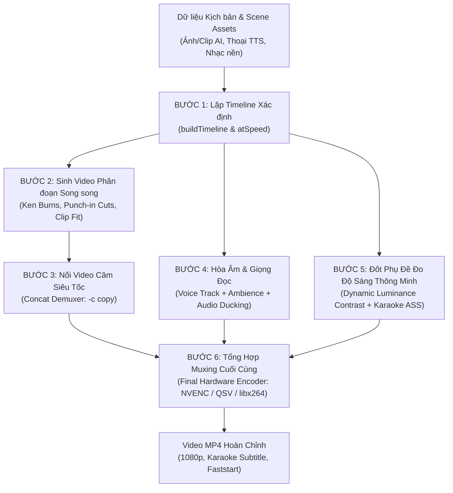

# 🎬 LOGIC GHÉP VIDEO TỰ ĐỘNG (AUTOMATED VIDEO ASSEMBLY PIPELINE)
## Bóc tách Kiến trúc Kỹ thuật từ Mã Nguồn Entervi Desktop v0.6.30

> **Tài liệu Kỹ thuật Nội bộ**
> **Nguồn trích xuất:** `E:\DIEN APP\Skill AI\audo edit\source_code\dist\main.js` (Hàm `renderFromScenes`, `renderProject`, `buildRenderPlan`)
> **Công cụ thực thi cục bộ:** `resources\bin\win32-x64\ffmpeg.exe` (222 MB - FFmpeg custom tích hợp `whisper.cpp`)

---

## 📌 I. SƠ ĐỒ TOÀN CẢNH PIPELINE GHÉP VIDEO AUTO



---

## 📌 II. CHI TIẾT 7 BƯỚC GHÉP VIDEO TỰ ĐỘNG

### 1. Bước 1: Tính toán Timeline & Nhịp Độ (Timeline & Pacing Calculation)
Hệ thống không ghép bừa mà xây dựng một bản thiết kế thời gian tuyệt đối chính xác trước khi bật FFmpeg:
- **Căn theo Voice:** Thời lượng của mỗi phân cảnh (Scene) được khóa chặt theo độ dài của câu thoại (`voiceSeconds`).
- **Co giãn tốc độ đọc (`atSpeed`):** Nếu người dùng chỉnh tốc độ (0.8x $\rightarrow$ 1.5x), độ dài từng cảnh sẽ tự co giãn chính xác đến 3 chữ số thập phân (`round(seconds / speed * 1000) / 1000`).
- **Khoảng nghỉ (`gapSeconds: 0.25s`):** Tự động chèn khoảng lặng 0.25s giữa các câu thoại để câu chuyện không bị dồn dập.
- **2 Chế độ Voice:**
  1. *Per-scene Voice:* Từng file thoại riêng cho mỗi scene, tự đệm im lặng (`anullsrc=r=48000:cl=stereo`) cho các cảnh câm.
  2. *Continuous Voice Track (`voiceTrackPath`):* 1 file thu âm dài duy nhất. App dùng **Whisper STT** căn chỉnh từ ngữ (`exactVoiceTimings`) để cắt cảnh chuẩn xác theo từng từ người nói phát ra.

---

### 2. Bước 2: Xử lý Hình ảnh & Chuyển động (Motion & Punch-in Cuts)
App chia video thành các segment nhỏ (`seg-0001.mp4`, `seg-0002.mp4`...) và render song song qua CPU/GPU:
- **Với Ảnh tĩnh (`asset.imagePath`):**
  - **Ken Burns Motion (`kenBurnsGraph`):** Zoom từ từ vào hoặc ra khỏi ảnh, tránh cảm giác ảnh tĩnh "chết".
  - **Punch-in Cuts (`planPunchIns`):** Tự động nhảy cỡ cảnh (zoom đột ngột 1.25x - 1.4x) ở những giây cao trào hoặc ngay cảnh mở đầu (Hook) để giữ chân người xem không lướt qua.
- **Với Video Clip AI (`asset.videoPath` từ Veo 3 / Seedance):**
  - **Tự động tìm điểm cắt (`sceneClipSeek`, `-ss`):** Cắt đúng đoạn hành động đẹp mắt nhất trong clip.
  - **Tự động Crop & Scale (`clipFit`, `clipChain`):** Tự động căn chỉnh về tỷ lệ đích (`16:9` hoặc `9:16`), xóa viền đen.

---

### 3. Bước 3: Ghép Nối Video Câm Siêu Tốc (Concat Demuxer)
Sau khi các đoạn video nhỏ (`seg-*.mp4`) được render xong:
- App tạo file danh sách `segments.txt`:
  ```text
  file 'seg-0001.mp4'
  file 'seg-0002.mp4'
  ```
- Sử dụng lệnh **FFmpeg Concat Demuxer** với cờ sao chép luồng (`-c copy`):
  ```bash
  ffmpeg -f concat -safe 0 -i segments.txt -c copy silent.mp4
  ```
- **Ưu điểm vượt trội:** Ghép nối hàng chục phân cảnh trong **chưa đầy 1 giây**, không cần re-encode lại video, tiết kiệm 90% thời gian render.

---

### 4. Bước 4: Hòa Âm Tự Động Né Tiếng (Smart Audio Ducking & Ambience)
Hệ thống xử lý âm thanh đa tầng bằng graph filter âm thanh chuyên nghiệp:
- **Tiếng động môi trường (Clip Ambience):** Trích xuất âm thanh gốc từ video clip (tiếng sóng biển, động cơ xe, tiếng bước chân), căn chỉnh gain phù hợp.
- **Nhạc nền vô tận (`-stream_loop -1`):** Tự động loop bài nhạc nền mượt mà suốt chiều dài video.
- **Audio Ducking (`musicDuck`):**
  - Khi có giọng thuyết minh nói: Âm lượng nhạc nền tự động **hạ xuống mức `0.12` - `0.45`**.
  - Khi có khoảng lặng hoặc chuyển cảnh: Âm lượng nhạc nền tự động **tăng dần trở lại** để tạo nhịp cảm xúc.

---

### 5. Bước 5: Đốt Phụ Đề Đo Độ Sáng Thông Minh (Dynamic Luminance Detection)
Đây là tính năng kỹ thuật thông minh nhất trong app nhằm chống hiện tượng phụ đề bị chìm vào video:
- **Tạo phụ đề nâng cao `.ass` (`captions.ass`):** Hỗ trợ 3 kiểu:
  - `karaoke`: Chữ đổi màu chạy theo từng từ phát âm (Word-by-word highlight).
  - `clean`: Phụ đề tối giản từng cụm từ ngắn.
  - `bold-word`: Tự động in đậm và phóng to từ khóa quan trọng.
- **Đo độ sáng nền video (`needsLuminance` / `boxedRanges`):**
  - Thuật toán quét độ sáng trung bình (`luminance`) của từng khung hình video.
  - Nếu khung hình **quá sáng** (`lum > LIGHT_BACKGROUND_LUMINANCE`), phụ đề tự động thêm **hộp nền mờ (Box background) hoặc viền đen dày (Thick outline)** để chữ màu trắng/vàng luôn nổi bật 100%, người xem đọc cực kỳ dễ chịu.

---

### 6. Bước 6: Giữ Chân Người Xem (Cold Open & Hook Headline)
- **Cold Open (Đoạn mở đầu giật gân):** Lấy đoạn video cao trào nhất (2 - 3 giây) đặt lên trước câu chuyện chính (`seg-cold.mp4`) để kích thích người xem xem tiếp.
- **Hook Title Overlay (`hook-title.ass`):** Đè một dòng tiêu đề lớn giật tít ở giữa/trên màn hình đúng trong 2 giây đầu tiên, sau đó tự động biến mất.

---

### 7. Bước 7: Muxing Xuất File Phần Cứng Tối Ưu (Final Hardware Encode)
Giai đoạn cuối cùng gộp toàn bộ các luồng (Video + Audio Ducked + Subtitle Burn):
- **Phát hiện bộ mã hóa phần cứng (Hardware Acceleration):**
  - NVIDIA GPU: `h264_nvenc`
  - Intel CPU: `h264_qsv`
  - AMD GPU: `h264_amf`
  - Apple Silicon: `h264_videotoolbox`
  - Fallback CPU: `libx264` (preset veryfast)
- **Cờ Web Faststart (`-movflags +faststart`):**
  Đưa bảng chỉ mục moov atom lên đầu file MP4. Giúp video tải lên TikTok, YouTube Shorts, Facebook Reels có thể phát ngay lập tức mà không cần người xem phải tải hết toàn bộ file về máy.

---

## 📌 III. BẢNG TỔNG HỢP CÁC LỆNH FFMPEG FILTER CHỦ LỰC

| Hạng mục | Lệnh / Filter FFmpeg trong code | Tác dụng |
| :--- | :--- | :--- |
| **Ken Burns** | `zoompan=z='min(zoom+0.0015,1.25)':d=...` | Tạo chuyển động zoom/pan mượt trên ảnh tĩnh |
| **Punch-in** | `crop=w=iw/1.3:h=ih/1.3,scale=...` | Nhảy góc cận đột ngột theo nhịp kịch bản |
| **Concat Video** | `-f concat -safe 0 -i segments.txt -c copy` | Ghép video phân cảnh tức thì không tốn CPU |
| **Audio Ducking** | `sidechaincompress=threshold=0.12:ratio=4...` | Nhạc nền tự hạ âm lượng né giọng đọc |
| **Subtitles** | `-filter_complex "[0:v]subtitles=captions.ass[vsub]"` | Đốt phụ đề karaoke & đo tương phản độ sáng |
| **Web Stream** | `-movflags +faststart` | Cho phép video phát ngay lập tức trên MXH |

---
*Tài liệu được trích xuất và hệ thống hóa tự động bởi Antigravity Pair Programmer.*
