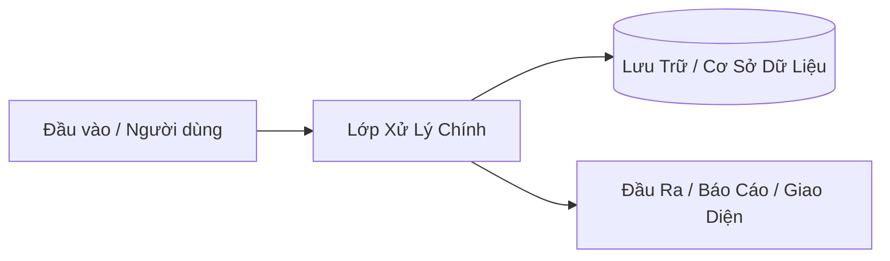

# Mẫu Chuẩn 1 File Master Blueprint Duy Nhất (`BLUEPRINT_<TEN_DU_AN>.md`)

Mỗi khi chốt xong yêu cầu với người dùng, `project-blueprint-architect` xuất ra **đúng 1 tệp Markdown tự đủ ngữ cảnh duy nhất** theo cấu trúc 10 mục dưới đây (không chia nhỏ thành hàng chục file rời rạc khó theo dõi, không để sót bất kỳ chữ `TODO` / `TBD` / `[NEEDS CLARIFICATION]` nào).

---

```markdown
# 🏛️ MASTER BLUEPRINT: [TÊN DỰ ÁN / CHỨC NĂNG MỚI]

- **Mã dự án / Phân hệ:** `[PRJ-YYYY-XX]`
- **Lĩnh vực chủ đạo:** `[VD: Phần mềm Web App + ERP SAP B1 + Bảo mật]`
- **Trạng thái đặc tả:** `LOCKED — Sẵn sàng thực thi cuốn chiếu từng Phase`
- **Ngày chốt:** `[YYYY-MM-DD]` | **Người phê duyệt:** `[Người dùng / Chủ dự án]`

---

## 1. Bối Cảnh Bài Toán, Mục Tiêu Cốt Lõi & Thước Đo Thành Công (Executive Summary & ROI)
- **Nỗi đau / Bài toán thực tế cần giải quyết:** [Mô tả ngắn gọn 2–3 câu rõ nguyên nhân gốc rễ].
- **Người dùng / Khách hàng mục tiêu:** [Ai trực tiếp sử dụng hoặc trả tiền].
- **Kết quả đầu ra kỳ vọng (North Star Metric):** [Con số đo lường cụ thể: tốc độ, tỷ lệ chuyển đổi, độ chính xác khớp số 100%, tiết kiệm X giờ/ngày...].

---

## 2. Khóa Biên Giới Phạm Vi 3 Vùng (Scope Boundary Lock)
| Phân Vùng | Hạng Mục Cụ Thể | Lý Do / Ghi Chú |
| :--- | :--- | :--- |
| **✅ In-Scope MVP (P1 — Làm ngay Bản 1.0)** | • [Tính năng cốt lõi 1]<br>• [Tính năng cốt lõi 2] | Đủ chạy thật end-to-end sớm nhất. |
| **⏳ Phase 2 / Mở rộng sau (P2 / P3)** | • [Tính năng nâng cao để dành] | Chừa sẵn cấu trúc dữ liệu, chưa code ở P1. |
| **⛔ Out-of-Scope / Anti-Goals (CẤM LÀM)** | • [Hạng mục tuyệt đối không làm] | Chống phình phạm vi & bảo vệ hệ thống gốc. |

---

## 3. Hành Trình Người Dùng (`Given / When / Then`) & 5 Tình Huống Biên Dễ Vỡ (`Review Focus`)
### 3.1. Kịch bản người dùng ưu tiên số 1 (`User Story P1`)
- **Vai trò:** Là `[Vai trò]`, tôi muốn `[Hành động]` để đạt được `[Giá trị]`.
- **Kịch bản nghiệm thu:**
  1. **Given** `[Trạng thái đầu vào]` $\rightarrow$ **When** `[Thao tác thực hiện]` $\rightarrow$ **Then** `[Kết quả chính xác trả về]`.

### 3.2. Top 5 Bẫy Thực Tế Phải Chặn Ngay Từ Thiết Kế (`Review Focus`)
1. **[Bẫy 1 — VD: Gửi trùng request / Đúp Webhook]:** Xử lý bằng `[Cơ chế Idempotency Key / Khóa Unique]`.
2. **[Bẫy 2 — VD: Dữ liệu tiếng Việt Unicode / File rỗng / Quá dung lượng]:** Xử lý bằng `[Chuẩn hóa UTF-8 NFC & giới hạn kích thước]`.
3. **[Bẫy 3 — VD: Mất kết nối API / Timeout DB giữa chừng]:** Xử lý bằng `[Transaction Rollback / Retry backoff & thông báo rõ]`.
4. **[Bẫy 4 — VD: Phân quyền truy cập chéo IDOR / Lộ Secret]:** Xử lý bằng `[Kiểm tra quyền sở hữu ở Server & đọc biến môi trường]`.
5. **[Bẫy 5 — VD: Sai lệch số liệu làm tròn tiền tệ / tồn kho]:** Xử lý bằng `[Kiểu Decimal chính xác & đối chiếu tổng kiểm tra]`.

---

## 4. Đặc Tả Yêu Cầu Chức Năng (`FR`) & Phi Chức Năng (`NFR`)
### 4.1. Yêu cầu Chức năng (`Functional Requirements`)
| Mã FR | Mô Tả Yêu Cầu Cụ Thể (Không Mập Mờ) | Ưu Tiên | Cách Kiểm Chứng Đạt (`Verifier`) |
| :--- | :--- | :--- | :--- |
| **`FR-001`** | Hệ thống bắt buộc phải... | `P1` | Test thực tế / CLI đạt `Exit code 0`. |
| **`FR-002`** | Hệ thống bắt buộc phải... | `P1` | Kiểm tra đầu ra file / DB khớp 100%. |

### 4.2. Yêu cầu Phi chức năng (`Non-Functional Requirements`)
- **`NFR-001` (Hiệu năng):** [VD: Phản hồi API `< 300ms`, LCP trang web `< 2.5s`].
- **`NFR-002` (Bảo mật & Quyền riêng tư):** [VD: Không hardcode API Key/Password, dùng Read-Only User cho truy vấn báo cáo ERP].
- **`NFR-003` (Tương thích & Vận hành):** [VD: Responsive Mobile `375px` -> Desktop `1440px`, xuất CSV chuẩn `utf-8-sig` mở tốt trên Excel].

---

## 5. Kiến Trúc Kỹ Thuật, Mô Hình Dữ Liệu & Công Nghệ Lựa Chọn (Tech Stack)

- **Ngôn ngữ & Framework:** `[VD: Python 3.12 + FastAPI / Next.js + Tailwind CSS + shadcn/ui]`
- **Cơ sở dữ liệu / Lưu trữ:** `[VD: SQLite WAL FTS5 / PostgreSQL / MS SQL SAP B1 Read-Only]`
- **Cấu trúc thư mục dự kiến:**
  - `[duong_dan_du_an/src/...]` — Trách nhiệm đơn nhất của từng tệp.

---

## 6. Hợp Đồng Giao Việc Cho AI Agent (`Agent Execution Contract`)
- **Nguồn sự thật gốc (`Authoritative Sources`):** `[Đường dẫn file schema / tài liệu chuẩn]`.
- **Vùng cấm chạm (`Untouchable Zones`):** `[Các bảng DB / thư mục đang chạy thật cấm sửa xóa]`.
- **Điều kiện dừng báo cáo (`Escalation Rules`):** Dừng hỏi ngay nếu phát hiện lệch schema thật hoặc phát sinh chi phí/xóa dữ liệu ngoài phạm vi P1.

---

## 7. Lộ Trình Triển Khai Cuốn Chiếu & Bảng Ánh Xạ Chính Xác Vào 92 Skills
| Giai Đoạn (Phase) | Hạng Mục Công Việc (Atomic Task) | Công Nghệ Sử Dụng | Skill Chủ Lực Cần Gọi (`@skill`) | Đầu Vào (`Consumes`) -> Đầu Ra (`Produces`) | Cổng Nghiệm Thu (`Gate Check`) |
| :--- | :--- | :--- | :--- | :--- | :--- |
| **Phase 1** | [Tên bước 1] | [Công nghệ 1] | `webapp-app-ux-workflow`, `ui-ux-design-pro-max` | Spec -> Luồng UX, Design System & UI | `audit_webapp_ux.py` `Exit 0` |
| **Phase 2** | [Tên bước 2] | [Công nghệ 2] | `lean-teamwork` | Giao diện -> Logic & DB hoàn chỉnh | Unit/Integration test `Exit 0` |
| **Phase 3** | [Tên bước 3] | [Công nghệ 3] | `security-audit`, `ifixai-agent-auditor` | Toàn bộ mã nguồn -> Báo cáo Audit | `0` lỗ hổng Critical/High, `Grade A` |

---

## 8. Bộ Prompt Mẫu Thực Thi Ngay Cho Từng Giai Đoạn (Copy & Paste)
### ▶️ Prompt Gọi Thực Thi Phase 1:
```text
Áp dụng đúng đặc tả đã khóa tại file `BLUEPRINT_<TEN_DU_AN>.md` (Mục 4 & Phase 1 Mục 7):
Dùng skill `[tên-skill-phase-1]` thực hiện trọn vẹn Phase 1: [Mô tả ngắn gọn đầu ra Phase 1].
Tuân thủ nghiêm ngặt Vùng cấm chạm tại Mục 6 và kiểm tra đạt cổng nghiệm thu trước khi báo cáo.
```

### ▶️ Prompt Gọi Thực Thi Phase 2:
```text
Tiếp nối kết quả Phase 1 và bám sát file `BLUEPRINT_<TEN_DU_AN>.md` (Phase 2 Mục 7):
Dùng skill `[tên-skill-phase-2]` triển khai Phase 2: [Mô tả ngắn gọn đầu ra Phase 2] và chạy test thực tế đạt Exit code 0.
```

---

## 9. Danh Sách Tiêu Chí Nghiệm Thu Tổng Thể (`Success Criteria Checklist`)
- [ ] **`SC-001`:** Đáp ứng 100% các mã yêu cầu `FR-001..FR-00N` và `NFR-001..NFR-003`.
- [ ] **`SC-002`:** Xử lý an toàn cả 5 tình huống biên tại Mục 3.2.
- [ ] **`SC-003`:** Chạy kiểm thử kỹ thuật & kiểm toán độc lập đạt `Exit code 0` và `Grade A/B`.

---

## 10. Tiêu Chuẩn Công Nghệ & Tài Liệu Tham Chiếu
• **[Tên tài liệu / Tiêu chuẩn áp dụng]:** [1 câu mô tả ngắn gọn nội dung áp dụng] (*[Tổ chức / Nguồn phát hành]*).
```
