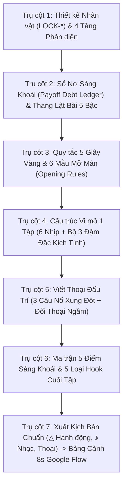

# KHO REPO GITHUB & CÔNG THỨC BIÊN KỊCH PHIM DRAMA TRUNG QUỐC (ĐOẢN KỊCH / SẢNG KỊCH) — TỪ VIẾT TRUYỆN, XÂY DỰNG NHÂN VẬT, VIẾT THOẠI ĐẾN KỊCH BẢN PHÂN CẢNH AI

> **Mục tiêu tài liệu:** Tổng hợp toàn bộ kho mã nguồn mở (GitHub Repositories) chuyên viết kịch bản **Đoản kịch / Sảng kịch Trung Quốc (`短剧剧本 / 爽剧 / 漫剧`)** đã được tải trực tiếp về máy tính tại thư mục `e:\DIEN APP\Lam phim AI Trung\github_drama_repos\`, đồng thời chắt lọc thành **Quy trình Biên kịch 7 Trụ cột** (Cốt truyện $\rightarrow$ Nhân vật & 4 Tầng Phản diện $\rightarrow$ Sổ nợ Sảng khoái $\rightarrow$ Lời thoại đấu trí $\rightarrow$ Kịch bản phân cảnh) để viết kịch bản cực cuốn trước khi đưa vào render trên **Google Flow (`Veo 3.1` + `Nano Banana Pro`)**.

---

## PHẦN 1: BẢN ĐỒ 20 KHO GITHUB BIÊN KỊCH ĐOẢN KỊCH & SẢNG VĂN TRUNG QUỐC ĐÃ TẢI VỀ MÁY (`8,554 FILES / 156.10 MB`)

Toàn bộ **20 kho công cụ, biểu mẫu biên kịch đoản kịch và kho ngữ liệu tiểu thuyết sảng văn hàng đầu** của cộng đồng AI Trung Quốc (bao gồm cả **Top các Repo đạt giải Nhất/Nhì trong cuộc thi thực nghiệm viết kịch bản mù `shortdramaskills.com`**) đã được tải trực tiếp về thư mục dự án tại `e:\DIEN APP\Lam phim AI Trung\github_drama_repos\`:

### 1.1. Nhóm 1: Top 8 Repo Quán Quân Viết Truyện Sảng Văn, Lên Khung Kịch Bản & Viết Thoại Đấu Trí

| STT | Tên Repo GitHub | Thư mục trên Máy (`github_drama_repos\`) | Thế mạnh Cốt lõi & Tài liệu Quan trọng Nhất |
| :-- | :--- | :--- | :--- |
| **01** | **`zhu5859243-free/hongguo-shortdrama-screenwriting`** | `github_drama_repos\hongguo-shortdrama-screenwriting\` (31 files) | **Hạng 1 Toàn劇 Khung Kịch Bản Hồng Quả / Douyin (`红果短剧编剧 v4.0`)**: Tổng hợp 10 bài giảng chính thức của nền tảng Hồng Quả (`hongguo-course-01-10.md`), chia mỗi 3–5 tập thành 1 hiệp đấu có bằng chứng, phản đòn và móc câu (`cliffhanger-master-formulas.md`), kèm kịch bản mẫu `ep01-longwang-demo.md` và `long-format-3min-demo.md`. |
| **02** | **`adoria111/emma-screenwriting-skills`** | `github_drama_repos\emma-screenwriting-skills\` (104 files) | **Hạng 2 Khung Kịch Bản & Quán quân Viết Thoại (26 Skills chuyên sâu)**: Gồm Kiến trúc sư cốt truyện (`em-story-architect`), Tổng biên kịch (`em-chief-writer`), Chuỗi logic nhân quả (`em-logic-chain`), Khử mùi văn AI (`drama-humanizer`), và **Bộ chuyển ngữ lời thoại sang tiếng Anh Bắc Mỹ chuẩn ReelShort (`drama-dialogue-localizer`, `em-us-localization`, `em-english-polish`)**. |
| **03** | **`Tomsawyerhu/Chinese-WebNovel-Skill`** | `github_drama_repos\Chinese-WebNovel-Skill\` (289 files, 32.14 MB) | **Hạng 1 Thiết kế Ý tưởng & Viết Tiểu thuyết Sảng Văn (`中文网文写作`)**: Có kho ngữ liệu tiểu thuyết thật (`data/` + `analysis/`), 10 module chuyên sâu (`concept_planning`, `opening`, `dialogue`, `plot_logic`, `anti_ai_voice`) kèm ví dụ tốt/xấu (`good_examples.md` / `bad_examples.md`). |
| **04** | **`Shanyin-ai/shanyin-screenwriting-master`** | `github_drama_repos\shanyin-screenwriting-master\` (4 files) | **Quán quân Viết Thoại Ngắn & Ẩn Ý (`山音超级编剧大师`)**: Thiết kế bởi đạo diễn AI đạt giải thưởng lớn tại Trung Quốc (@山音), chuyên viết phim ngắn 1–3 phút và 5–10 phút với lời thoại cực ngắn, giàu ẩn ý và cảm xúc đặt hoàn toàn vào hành động. |
| **05** | **`jtydhr88/screenwriting-skills`** | `github_drama_repos\screenwriting-skills\` (91 files) | **Quán quân Ngoại hóa Tâm lý & Xây dựng Nhân vật Phụ**: Bộ plugin kịch작 pháp chuyên biến tâm lý nhân vật thành hành động vật lý (không dùng độc thoại nội tâm sáo rỗng) và xây dựng hệ thống nhân vật phụ có động cơ thật. |
| **06** | **`0xsline/short-drama`** | `github_drama_repos\short-drama\` (12 files) | **Bộ khung biên kịch Sảng kịch thương mại 6 bước** (`/start` $\rightarrow$ `/plan` $\rightarrow$ `/characters` $\rightarrow$ `/outline` $\rightarrow$ `/episode` $\rightarrow$ `/compliance`). Chứa **8 sổ tay bí kíp (`references/`)**: 13 thể loại & bản địa hóa Âu-Mỹ (`genre-guide.md`), Quy tắc 5 giây vàng (`opening-rules.md`), Ma trận 5 điểm sảng khoái (`satisfaction-matrix.md`), 4 tầng phản diện (`villain-design.md`) và 5 loại Hook (`hook-design.md`). |
| **07** | **`SumOneHK/short-drama-scriptwriter`** | `github_drama_repos\short-drama-scriptwriter\` (67 files) | **Hệ thống biên kịch công nghiệp 18 chốt kiểm soát (`T01–T18`)** kèm **27 biểu mẫu Markdown (`assets/templates/`)**. Nổi bật với quy tắc **"Bộ 3 Đậm Đặc Kịch Tính" (`戏剧浓度三件套`)**: Thoại đối đầu ẩn ý, Ngoại hóa tâm lý thành hành động vật lý, Lựa chọn có trả giá của nhân vật chính. |
| **08** | **`Hao0321/ai-short-drama`** | `github_drama_repos\ai-short-drama\` (24 files) | **10 Luật Cứng Sảng Kịch (`10 Hard Rules`)**. Độc quyền công thức **Sổ Nợ Sảng Khoái (`Payoff Debt Ledger / 爽债账本`)** và **Thang Lật Bài 5 Bậc (`Reveal Ladder`)**: Kỹ năng $\rightarrow$ Tài nguyên $\rightarrow$ Nhân mạch $\rightarrow$ Thân phận thật $\rightarrow$ Chân tướng thế giới. |

### 1.2. Nhóm 2: 12 Repo Chuyển Thể Tiểu Thuyết Sang Phân Cảnh, Khóa Nhân Vật & Sản Xuất Video AI

| STT | Tên Repo GitHub | Thư mục trên Máy (`github_drama_repos\`) | Thế mạnh Cốt lõi & Tài liệu Quan trọng Nhất |
| :-- | :--- | :--- | :--- |
| **09** | **`zenstory-ai/drama-skills`** | `github_drama_repos\drama-skills\` (598 files) | **Quán quân Thực nghiệm & Dây chuyền 12 Kỹ năng chuyển thể Truyện sang Kịch bản & Prompt AI**: Đồng bộ hóa 5 tệp cốt lõi (`剧本.md`, `视觉设定.md` gắn mã khóa `LOCK-*`, `分镜.md`, `图片提示词.md`, `视频提示词.md`). |
| **10** | **`eternityspring/shuohao-skills`** | `github_drama_repos\shuohao-skills\` (135 files, 7.43 MB) | **Bộ 7 Kỹ năng Chuyển thể Tiểu thuyết sang Phân cảnh Có Kiểm Định Tự Động**: `novel-outline` (14 cổng kiểm tra), `novel-characters`, `character-refs`, `novel-art`, `novel-script`, `novel-staging` (sơ đồ vị trí đứng/ngồi của nhân vật trong cảnh) và `novel-storyboard`. |
| **11** | **`lixiaoxiao9888-create/short-drama-factory`** | `github_drama_repos\short-drama-factory\` (33 files) | **Nhà máy Sản xuất Kịch bản Đoản kịch v3.2**: Chứa sổ tay các mô hình xung đột (`conflict-modes.md`), công thức ngắt tập (`cliffhanger-master-formulas.md`) và sổ cái kiểm soát tính liên tục (`continuity-ledger.md`). |
| **12** | **`lingfengQAQ/webnovel-writer`** | `github_drama_repos\webnovel-writer\` (480 files, 6.52 MB) | **Hạng 2 Thiết kế Truyện Dài Kỳ & Hệ thống Bàn Tay Vàng Có Quy Tắc**: Kiến trúc đa tác tử viết tiểu thuyết mạng chống trùng lặp tình tiết ở giai đoạn giữa truyện. |
| **13** | **`UnderleveledBuilder/awesome-short-drama-skills`** | `github_drama_repos\awesome-short-drama-skills\` (5,315 files, 59.17 MB) | **Đại Từ Điển 86 Bộ Skill Đoản Kịch & Toàn bộ Dữ liệu Chấm Điểm Thực Nghiệm (`evals/`)**: Lưu trữ toàn bộ bài thi kịch bản thực tế của các bộ Skill để đối chiếu trực tiếp. |
| **14** | **`zenstory-ai/oh-story-dsh`** | `github_drama_repos\oh-story-dsh\` (940 files, 17.62 MB) | **Bàn làm việc 4-trong-1 (Tiểu thuyết + Đoản kịch + Game tương tác + Video Review)**: Tích hợp 14 Skills viết truyện (`Oh Story`) và 12 Skills làm đoản kịch. |
| **15** | **`YvonneMovingon/short-drama-skills`** | `github_drama_repos\short-drama-skills\` (20 files) | **Bộ 7 Prompt của LuxReal Studio** chuyên bóc tách kịch bản chữ thành chuỗi cảnh quay điện ảnh (`01-通用叙事拆解`, `02-深度情绪刻画`, `03-详细动态描述`, `06-高能戏剧化情节润色`). |
| **16** | **`liuxiao20051106-prog/ai-manga-drama`** | `github_drama_repos\ai-manga-drama\` (71 files) | **Quy trình 8 Giai đoạn sản xuất AI Mạn kịch & Đoản kịch** kèm **12 biểu mẫu dự án (`templates/`)** và **4 công cụ Python kiểm tra tự động (`scripts/`)**. |
| **17** | **`shuyu-labs/BigBanana-AI-Director`** | `github_drama_repos\BigBanana-AI-Director\` (32 files, 10.81 MB) | **Kiến trúc Đạo diễn AI theo Keyframe (`Script-to-Asset-to-Keyframe`)**: Quy trình khóa 3 tầng nhân vật (Ảnh định trang + Tủ đồ + Bối cảnh) trước khi nội suy video. |
| **18** | **`chatfire-AI/huobao-drama`** | `github_drama_repos\huobao-drama\` (288 files, 9.60 MB) | **Mã nguồn Nền tảng Sản xuất Đoản kịch Tự động (`火宝短剧`)**: Chứa hệ thống Agent bóc tách kịch bản, quản lý nhân vật và ghép FFmpeg tự động. |
| **19** | **`lovepoem/short-drama-prompt`** | `github_drama_repos\short-drama-prompt\` (8 files) | **Sơ đồ Luồng Prompt Cơ bản từ Truyện mạng $\rightarrow$ Kịch bản $\rightarrow$ Bảng Nhân vật/Bối cảnh $\rightarrow$ Phân cảnh**. |
| **20** | **`DU8866-nice/awesome-ai-drama`** | `github_drama_repos\awesome-ai-drama\` (12 files) | **Danh mục Tổng hợp Công cụ & Tài nguyên Sản xuất Đoản kịch AI**. |

---

## PHẦN 2: BẢN ĐỒ 13 THỂ LOẠI SẢNG KỊCH TRUNG QUỐC & MA TRẬN CHUYỂN ĐỔI SANG KÊNH TIẾNG ANH 9:16 (REELSHORT / DRAMABOX)

Từ tệp `genre-guide.md` (`0xsline/short-drama`), toàn bộ thị trường đoản kịch Trung Quốc và quốc tế xoay quanh **13 thể loại cốt lõi**. Đặc biệt, khi sản xuất phim **9:16 dạy tiếng Anh** hoặc đánh thị trường quốc tế, kịch bản phải tuân thủ **Quy tắc Chuyển đổi Văn hóa (`Cultural Adaptation`)** để lời thoại tiếng Anh tự nhiên như phim *ReelShort / DramaBox*:

### 2.1. Bảng 13 Thể loại Sảng Kịch & Công thức Kết hợp (`Genre Stacking`)

> **Quy tắc Kết hợp Thể loại (`题材叠加原则`):**
> - Mỗi bộ phim chỉ chọn **1 Thể loại Chính (chiếm 70% thời lượng)** + **1 đến 2 Thể loại Phụ (chiếm 30% thời lượng)**. Không bao giờ trộn quá 3 thể loại để tránh loãng mạch truyện.

| Nhóm | Thể loại Trung Quốc | Công thức Xung đột Cốt lõi | Tỷ lệ Phối hợp Đỉnh cao (`Combo`) |
| :--- | :--- | :--- | :--- |
| **Nhóm 1: Tình cảm & Hào môn** | **1. Bá đạo Tổng tài (`霸道总裁`)**<br>**2. Ngọt sủng (`甜宠`)**<br>**3. Đô thị Tình cảm (`都市情感`)** | Chênh lệch địa vị cực lớn + Cưới trước yêu sau / Hợp đồng hôn nhân + Hiểu lầm & Truy thê hỏa táng trường (hối hận muộn màng). | `Bá đạo tổng tài (70%) + Ngọt sủng (30%)` hoặc `Đô thị tình cảm (70%) + Nghịch tập báo thù (30%)`. |
| **Nhóm 2: Nghịch tập & Vả mặt** | **4. Chiến thần Quy lai (`战神归来`)**<br>**5. Lệ chí Nghịch tập (`励志逆袭`)**<br>**6. Trọng sinh Xuyên không (`重生穿越`)** | Nhân vật đỉnh cấp ẩn danh làm người thường (bảo vệ, shipper, ở rể) bị sỉ nhục $\rightarrow$ Lộ thân phận thật nghiền ép toàn trường; hoặc mang ký ức kiếp trước quay về sửa vận mệnh. | `Chiến thần quy lai (70%) + Gia đình/Bảo vệ vợ con (30%)` hoặc `Trọng sinh (70%) + Cổ trang cung đấu (30%)`. |
| **Nhóm 3: Cổ trang & Quyền mưu** | **7. Cổ trang Cung đình (`古装宫廷`)**<br>**8. Huyền nghi Phá án (`悬疑探案`)** | Đấu trí hậu cung / Tranh đoạt ngôi vị / Phế hậu phản kích bằng chứng cứ mật; mỗi tập lật mở một tầng âm mưu. | `Cổ trang cung đình (70%) + Trọng sinh báo thù (30%)` + `Huyền nghi (10%)`. |
| **Nhóm 4: Gia đình & Đời sống** | **9. Gia đình Luân lý (`家庭伦理`)**<br>**10. Mạnh bảo / Em bé thiên tài (`萌宝`)**<br>**11. Hài kịch Đô thị (`搞笑喜剧`)**<br>**12. Khoa học Viễn tưởng nhẹ (`轻科幻`)**<br>**13. Mạt thế Trọng sinh (`末日重生`)** | Thiên vị gia đình, thật giả thiên kim, mẹ đơn thân dẫn con thiên tài quay về nhận cha tỷ phú, hoặc tích trữ vật tư trước ngày tận thế. | `Mạnh bảo (60%) + Bá đạo tổng tài (40%)` hoặc `Gia đình luân lý (70%) + Lệ chí nghịch tập (30%)`. |

### 2.2. Ma trận Chuyển đổi Kịch bản Trung Quốc sang Kịch bản Học Tiếng Anh (`ReelShort Localization`)

Khi dùng công thức Sảng kịch Trung Quốc để làm **phim học tiếng Anh 9:16**, nếu dịch nguyên văn các tình tiết đặc thù Á Đông sẽ khiến câu thoại tiếng Anh bị ngượng. Tài liệu `genre-guide.md` quy định bảng chuyển đổi trực tiếp như sau:

| Tình tiết Gốc trong Đoản kịch Trung Quốc | Chuyển đổi sang Bối cảnh Âu-Mỹ / Tiếng Anh Quốc tế (`ReelShort Style`) | Mẫu Câu Thoại Tiếng Anh Chuẩn Kịch Tính (Dùng cho Kênh Học Tiếng Anh) |
| :--- | :--- | :--- |
| **Ép quỳ lạy / Dập đầu nhận lỗi (`下跪磕头`)** | Bị sa thải công khai trước Hội đồng Quản trị / Bị hủy hợp đồng triệu đô / Bị trục xuất khỏi buổi đấu giá VIP. | *"Pack your things. Effective immediately, your contract is terminated."* |
| **Ở rể chịu nhục (`上门女婿`)** | Chồng ký Hợp đồng Tiền hôn nhân (`Prenup Agreement`) bị gia đình vợ coi là kẻ đào mỏ (`Gold Digger`). | *"Sign the divorce papers. A gold digger like you doesn't belong in this family."* |
| **Thần y / Long Vương / Chiến thần (`龙王/战神`)** | Nhà sáng lập ẩn danh của Quỹ đầu tư Phố Wall / Chủ sở hữu thật sự của Tập đoàn Đa quốc gia / Bác sĩ phẫu thuật trưởng bí ẩn. | *"Check the signature on the acquisition file. I am the Chairman you've been waiting for."* |
| **Trọng sinh quay về quá khứ (`重生回到过去`)** | Bừng tỉnh trước lễ cưới / Sống sót trở về sau vụ tai nạn dàn dựng với danh tính mới (`New Identity Revenge`). | *"You thought I died in that fire three years ago? Surprise. I came back for everything you stole."* |
| **Mẹ chồng nàng dâu truyền thống (`婆媳矛盾`)** | Cuộc chiến giành quyền thừa kế Gia tộc (`Family Trust / Inheritance Battle`) hoặc Đấu đá giữa Vợ cũ và Trà xanh (`Mistress Confrontation`). | *"Keep the ring, keep the house, and keep him. Tomorrow morning, my lawyers will take the company."* |

---

## PHẦN 3: QUY TRÌNH 7 TRỤ CỘT VIẾT TRUYỆN, XÂY DỰNG NHÂN VẬT, VIẾT THOẠI & KỊCH BẢN PHÂN CẢNH

Để một bộ phim AI cuốn người xem từ giây đầu tiên đến giây cuối cùng, chúng ta không viết kịch bản theo kiểu văn xuôi tự do mà áp dụng **7 Trụ cột Kỹ thuật** đúc kết từ 6 Repo GitHub:



---

### TRỤ CỘT 1: THIẾT KẾ NHÂN VẬT ĐA CHIỀU & HỆ THỐNG 4 TẦNG PHẢN DIỆN (`villain-design.md` & `drama-skills`)

Một kịch bản drama hấp dẫn được quyết định bởi **sức nặng của nhân vật phản diện** và **sự tương phản của nhân vật chính**.

#### 1.1. Công thức Thiết lập Nhân vật Chính (`Protagonist Bible`)
Mỗi nhân vật bắt buộc có 4 lớp thông tin:
1. **Nhãn nhận diện 3 giây (`3-Second Tag`):** Khán giả nhớ ngay nhân vật qua 1 cụm từ (VD: *"Nữ hoàng Phố Wall giả làm thực tập sinh"*, *"Phế hậu giữ mật chỉ tiên đế"*).
2. **Bề ngoài vs. Bản chất (`Surface vs. Core`):**
   - *Bề ngoài:* Điềm tĩnh, nhẫn nhịn, ăn mặc giản dị hoặc đang ở thế yếu.
   - *Bản chất:* Sắc sảo, nắm giữ bằng chứng/kỹ năng tối thượng, không bao giờ tha thứ cho kẻ phản bội.
3. **Khóa Ngoại hình Cố định cho AI (`Visual LOCK-*` từ `zenstory-ai/drama-skills`):** Cố định tuổi, kiểu tóc, màu mắt, trang phục đặc trưng bằng tiếng Anh để ghép vào mọi Prompt ảnh/video.
4. **Phong cách Lời thoại & Câu cửa miệng (`Speech Pattern & Catchphrase`):**
   - Cách nói chuyện đặc trưng (VD: Nhân vật chính nói câu ngắn, nhịp chậm, dùng câu hỏi tu từ đâm thẳng vào tim đen; Phản diện cấp thấp nói nhanh, giọng chanh chua, hay khoe mẽ).

#### 1.2. Hệ thống 4 Tầng Phản diện (`4-Tier Villain Hierarchy` — `villain-design.md`)
Tuyệt đối không để nhân vật chính đấu với một kẻ địch duy nhất từ đầu đến cuối. Kịch bản chuẩn Trung Quốc chia phản diện làm **4 tầng leo thang**:

| Cấp độ Phản diện | Vai trò trong Kịch bản | Tuổi thọ (Thời gian bị hạ) | Cách thiết kế để khán giả vừa ghét vừa muốn xem tiếp |
| :--- | :--- | :--- | :--- |
| **Tầng 1: Pháo hôi (`炮灰反派` — Tiểu nhân)** | Quản lý hách dịch, nhân viên bán hàng khinh người, họ hàng tham lam, tiểu tam cấp thấp. | **1–3 tập (hoặc 1–2 cảnh trong phim ngắn 5 phút)** | Chuyên tạo **ức chế tức thời** bằng sự ngu xuẩn, hợm hĩnh để nhân vật chính "vả mặt" ngay lập tức, giải tỏa cơn tức cho khán giả. |
| **Tầng 2: Đối thủ Chính (`主要对手` — Phản diện Giai đoạn)** | Chồng cũ bội bạc, Quý phi đắc sủng, Giám đốc đối thủ, Thiên kim giả mạo. | **10–20 tập (hoặc Hồi 2 của phim 5 phút)** | Có quyền lực thật, có mưu mô, nhiều lần dồn nhân vật chính vào chân tường. Phải đấu qua 2–3 hiệp mới bị đánh bại hoàn toàn. |
| **Tầng 3: Trùm Cuối (`终极BOSS` — Đại Phản diện)** | Gia chủ hào môn, Hoàng đế/Thái hậu đứng sau giật dây, Chủ tịch tập đoàn đối địch. | **Xuyên suốt toàn bộ phim, quyết chiến ở Hồi cuối** | Cực kỳ thông minh, không bao giờ ra mặt ở đầu phim mà điều khiển Tầng 1 & Tầng 2. Có triết lý riêng ("Kẻ mạnh mới có quyền viết luật"). |
| **Tầng 4: Phản diện Ẩn / Cú Twist (`隐藏反派`)** | Người bạn thân nhất, người thầy đáng kính, hoặc trợ lý trung thành bất ngờ lật mặt ở phút 89. | **Lộ diện ở 20% thời lượng cuối phim** | Tạo cú sốc đảo chiều (`Plot Twist`) khiến khán giả sững sờ trước khi bước vào trận đại quyết chiến. |

---

### TRỤ CỘT 2: SỔ NỢ SẢNG KHOÁI (`PAYOFF DEBT LEDGER`) & THANG LẬT BÀI 5 BẬC (`REVEAL LADDER` — `Hao0321/ai-short-drama`)

Tại sao kịch bản Trung Quốc làm khán giả không thể rời mắt? Vì họ quản lý cảm xúc bằng **Sổ Nợ Sảng Khoái (`爽债账本`)**:

1. **Nguyên tắc Sổ Nợ Sảng Khoái (`Every Humiliation Opens a Debt`):**
   - Mỗi khi nhân vật chính bị vu oan, bị tước đoạt kỷ vật, bị đuổi khỏi nhà hay bị tát $\rightarrow$ Biên kịch phải ghi ngay **1 Khoản Nợ Cảm Xúc** vào bảng.
   - **Cấm làm nhân vật chính chịu khổ vô ích:** Khoản nợ nhỏ phải được trả ngay trong vòng 30–60 giây tiếp theo; khoản nợ lớn phải được trả gấp 10 lần ở cao trào chính với đúng món đồ/lời nói mà kẻ phản diện đã dùng để sỉ nhục.
   - *Ví dụ:* Cảnh 1 phản diện xé bản hợp đồng ném vào mặt nữ chính và nói *"Cô không xứng bước vào tòa nhà này"* $\rightarrow$ Cảnh 5 nữ chính mua đứt tòa nhà, ném quyết định sa thải xuống bàn bằng đúng câu nói đó.
2. **Thang Lật Bài 5 Bậc (`5-Step Reveal Ladder`):**
   - Không bao giờ lộ toàn bộ sức mạnh của nhân vật chính ngay từ tập 1. Hãy lật bài từng nấc từ thấp lên cao:
     - **Bậc 1 — Lộ Kỹ năng (`Skill`):** Giỏi ngoại ngữ, y thuật, võ thuật, định giá cổ vật, lập trình.
     - **Bậc 2 — Lộ Tài nguyên (`Resource`):** Có thẻ đen không giới hạn, sở hữu bằng sáng chế gốc, giữ mật chỉ/ấn tín.
     - **Bậc 3 — Lộ Nhân mạch (`Network`):** Nhân vật quyền lực mà phản diện đang cố nịnh bợ lại cúi đầu kính cẩn trước nhân vật chính.
     - **Bậc 4 — Lộ Thân phận Thật (`True Identity`):** Chủ tịch thật sự, Trưởng công chúa, Người thừa kế duy nhất.
     - **Bậc 5 — Lộ Chân tướng Toàn cục (`World Truth`):** Phơi bày toàn bộ âm mưu năm xưa trước bàn dân thiên hạ.

---

### TRỤ CỘT 3: QUY TẮC 5 GIÂY VÀNG & 6 MẪU MỞ MÀN BẮT SỐNG KHÁN GIẢ (`opening-rules.md`)

Khán giả lướt TikTok/Reels/Shorts quyết định xem tiếp hay vuốt qua trong **3–5 giây đầu tiên**. Tuyệt đối cấm mở đầu bằng cảnh giới thiệu bối cảnh bình yên hay thức dậy buổi sáng!

| Mốc Thời Gian | Nhiệm Vụ Bắt Buộc | Kỹ Thuật Thực Thi |
| :--- | :--- | :--- |
| **Giây thứ 1 (`1s`)** | **Cú đấm Thị giác (`Visual Shock`)** | Mở màn ngay giữa một hành động kịch tính: Ném tờ đơn ly hôn, bóp nát chén ngọc, hất rượu vang, rút thẻ đen, hoặc quỳ giữa mưa tuyết trước cung điện. |
| **Giây thứ 3 (`3s`)** | **Thiết lập Xung đột & Chênh lệch (`Conflict & Gap`)** | 1 câu thoại sắc lẹm cho thấy ngay ai đang ức hiếp ai và nhân vật chính đang giấu bí mật gì. |
| **Giây thứ 5 (`5s`)** | **Cài Câu hỏi Bỏ lửng (`Hook Question`)** | Khán giả buộc phải tự hỏi: *"Cô ấy sẽ đáp trả thế nào?"* hoặc *"Trong chiếc hộp đó là cái gì?"*. |

**6 Mẫu Mở Màn Triệu View (`6 Opening Templates` từ `opening-rules.md`):**
1. **Mẫu 1 — Mở màn Vả mặt Trực diện (`直接打脸开场`):** Nhân vật chính bị sỉ nhục trong 15 giây đầu $\rightarrow$ Giây thứ 20 rút bằng chứng/thân phận vả mặt ngay lập tức (Hiệu quả nhất cho phim ngắn 3–5 phút và tập 1).
2. **Mẫu 2 — Mở màn Đảo ngược Thân phận (`身份反差开场`):** Cảnh 1 nhân vật chính mặc đồ lao công/shipper bị khinh rẻ $\rightarrow$ Cảnh 2 bước lên xe Rolls-Royce hoặc nhận cuộc gọi từ Tổng thống/Hội đồng quản trị.
3. **Mẫu 3 — Mở màn Tuyệt cảnh Trọng sinh (`绝境重生开场`):** Mở đầu ở khoảnh khắc bị phản bội đến chết $\rightarrow$ Mở mắt tỉnh dậy đúng ngày định mệnh 3 năm trước và thề bắt kẻ thù trả giá.
4. **Mẫu 4 — Mở màn Đảo tự Hồi ức (`倒叙悬念开场`):** Mở đầu bằng cảnh cao trào đỉnh điểm ở tương lai (VD: Lễ cưới biến thành buổi xét xử) $\rightarrow$ Tua ngược về *"72 giờ trước"*.
5. **Mẫu 5 — Mở màn Cao ngọt Bất ngờ (`高甜暴击开场`):** Tổng tài lạnh lùng nổi tiếng không gần nữ sắc lại đích thân quỳ xuống buộc dây giày hoặc ký giấy chuyển nhượng tài sản cho nữ chính.
6. **Mẫu 6 — Mở màn Phát hiện Bí mật (`秘密揭露开场`):** Nhân vật chính vô tình nghe lén hoặc mở được tài liệu mật làm sụp đổ toàn bộ niềm tin trước đó.

---

### TRỤ CỘT 4: CẤU TRÚC VI MÔ 1 TẬP PHIM (6 NHỊP) & BỘ 3 ĐẬM ĐẶC KỊCH TÍNH (`SumOneHK` & `Hao0321`)

Mỗi tập phim ngắn (60–90 giây) hoặc mỗi hồi trong phim 5 phút phải được thiết kế như một **vở kịch 3 hồi thu nhỏ** gồm **6 Nhịp Cứng (`6 Hard Beats`)**:

```
[1. Cold Open (0–10s)]  --> Nối ngay điểm treo tập trước hoặc tung cú sốc mở màn
         │
[2. Pressure (10–35s)]  --> Phản diện ra đòn ép sát ván / Hiểu lầm đẩy lên đỉnh điểm
         │
[3. Turn (35–55s)]      --> Nhân vật chính tung chiêu phản kích / Xuất hiện bằng chứng mới
         │
[4. Payoff (55–75s)]    --> Trả 1 khoản nợ trong Sổ Nợ Sảng Khoái (Phản diện cứng họng)
         │
[5. Cliffhanger (75–90s)]--> Xuất hiện nguy cơ lớn hơn / Nhân vật bí ẩn bước vào -> Cắt phụp!
         │
[6. State Delta]        --> Kiểm tra: Quan hệ / Quyền lực giữa 2 bên đã thay đổi từ A sang B chưa?
```

**Quy tắc "Bộ 3 Đậm Đặc Kịch Tính" (`戏剧浓度三件套` từ `SumOneHK/short-drama-scriptwriter`):**
Một tập kịch bản chỉ được duyệt khi hội tụ đủ 3 yếu tố sau:
1. **Thoại Đối đầu Ẩn ý (`潜台词对手戏`):** Hai nhân vật nói chuyện bề ngoài lịch sự nhưng từng câu đều là dao găm thăm dò hoặc đe dọa ngầm.
2. **Ngoại hóa Tâm lý thành Hành động Vật lý (`心理瞬间外化`):** AI Video không thể diễn tả suy nghĩ trừu tượng trong đầu. Mọi cảm xúc (giận dữ, run sợ, quyết tâm) **phải chuyển thành hành động nhìn thấy được bằng mắt**: *ngón tay siết chặt làm vỡ tách trà, đồng tử co rút, nụ cười đông cứng trên môi, chậm rãi tháo chiếc nhẫn ném vào ly rượu*.
3. **Lựa chọn Có Trả Giá của Nhân vật Chính (`主角代价选择`):** Nhân vật chính không đứng im chịu trận mà chủ động đưa ra quyết định dứt khoát (VD: Tự tay đốt kỷ vật, công khai đoạn tuyệt quan hệ để lật bàn cờ).

---

### TRỤ CỘT 5: NGHỆ THUẬT VIẾT THOẠI ĐOẢN KỊCH ("3 CÂU PHẢI NỔ XUNG ĐỘT")

Lời thoại là linh hồn của kịch bản. Trong đoản kịch Trung Quốc và phim ngắn học tiếng Anh, viết thoại phải tuân thủ **5 Luật Thép**:

1. **Luật Ngân sách Tốc độ Nói (`Speech Budget` — `ai-manga-drama`):**
   - Tiếng Trung: `4–5 chữ/giây`. Tiếng Việt / Tiếng Anh: **`2.5–3 từ/giây`**.
   - Với 1 cảnh video **8 giây** trên Google Flow (`Veo 3.1`), lời thoại chuẩn nhất là **12–18 từ (kéo dài khoảng 4.5–5.5 giây)**, chừa `2.5 giây` đầu/cuối cho tiếng động vật lý (SFX), nhịp thở và biểu cảm khuôn mặt.
2. **Luật "3 Câu Phải Nổ Xung Đột" (`3-Line Conflict Rule`):**
   - Cấm tuyệt đối các câu chào hỏi xã giao (*"Chào anh, hôm nay anh khỏe không?"*, *"Mời ngồi uống nước"*).
   - Câu 1: Kẻ địch tấn công/ép buộc. Câu 2: Nhân vật chính hỏi vặn lại. Câu 3: Tung đòn lật ngược tình thế!
3. **Kỹ thuật "Đòn Phản Câu Chữ" (`Echo & Twist Line`):**
   - Lấy chính từ khóa kiêu ngạo của phản diện để đập lại phản diện.
   - *Ví dụ (Song ngữ Anh–Việt):*
     - **Phản diện:** *"Do you know how much this dress costs? More than your annual salary!"* (Cô biết chiếc váy này giá bao nhiêu không? Hơn cả lương cả năm của cô đấy!)
     - **Nữ chính:** *"Funny. As the designer who owns the brand, I only made one genuine piece—and you're wearing a counterfeit."* (Thú vị thật. Với tư cách là nhà thiết kế sở hữu thương hiệu này, tôi chỉ làm đúng một bản thật—và thứ cô đang mặc là hàng giả.)
4. **Cấm Thoại Giải thích Dài dòng (`No Info-Dump Monologue`):**
   - Không bao giờ để nhân vật đứng kể lể quá khứ dài 5–6 câu. Hãy cắt nhỏ thông tin thành màn đấu khẩu qua lại kèm đạo cụ trực quan (tờ ngân phiếu, vết sẹo, bức ảnh, đoạn ghi âm).
5. **Mỗi Nhân vật Một Nhịp Thoại Riêng (`Distinct Voice Signature`):**
   - Kẻ có quyền lực thật sự nói **ít chữ, giọng trầm, không cần la hét**. Kẻ yếu thế hoặc phản diện sắp thua mới gào thét, lắp bắp.

---

### TRỤ CỘT 6: MA TRẬN 5 ĐIỂM SẢNG KHOÁI (`5 SATISFACTION MATRIX`) & 5 LOẠI HOOK CUỐI TẬP (`hook-design.md`)

#### 6.1. Công thức 5 Bước Tạo Điểm Sảng Khoái (`爽点五步法` — `satisfaction-matrix.md`)
Mỗi cao trào vả mặt đều phải đi qua 5 nhịp nén và bung lò xo:
1. **Áp chế (`压制`):** Phản diện khoe quyền lực, đám đông hùa theo chế giễu.
2. **Nhẫn nhịn / Tích lực (`隐忍/蓄力`):** Nhân vật chính im lặng 2 giây, ánh mắt lạnh dần (khán giả hồi hộp chờ đợi).
3. **Tín hiệu Phản kích (`反击信号`):** Một động tác nhỏ báo hiệu bão tố (nhếch môi cười lạnh, rút điện thoại, vỗ tay 2 tiếng).
4. **Bùng nổ Nghiền ép (`爆发碾压`):** Bằng chứng/nhân vật lớn xuất hiện đập tan toàn bộ sự kiêu ngạo của phản diện.
5. **Dư chấn Toàn trường (`余波震慑`):** Cả khán phòng chết lặng, phản diện mặt cắt không còn giọt máu, quỳ sụp xuống.

#### 6.2. 5 Loại Móc Câu Cuối Tập (`5 Cliffhanger Hooks` — `hook-design.md`)
Ở 5 giây cuối cùng của mỗi tập, bắt buộc dùng 1 trong 5 loại Hook sau để khóa chặt ngón tay khán giả:
1. **Hook Huyền nghi (`悬念钩`):** Mở chiếc hộp/phong thư ra, đồng tử co rút nhưng chưa cho khán giả thấy bên trong là gì.
2. **Hook Đảo chiều (`反转钩`):** Tưởng đã thắng lợi hoàn toàn, nhưng trang cuối hợp đồng hoặc mặt sau bức ảnh lại hiện ra tên một người không ngờ tới.
3. **Hook Cảm xúc (`情绪钩`):** Đẩy cảm xúc lên đỉnh điểm (sắp hôn, sắp nói lời tỏ tình, hoặc vừa rơi nước mắt nói lời chia tay) thì bị cắt ngang.
4. **Hook Thông tin Một nửa (`信息钩`):** Tiết lộ một nửa bí mật động trời: *"Đừng tin bất kỳ ai trong căn nhà này, đặc biệt là—"* (tờ giấy bị xé mất tên).
5. **Hook Nguy cơ Đột kích (`危机钩`):** Giữa tiệc ăn mừng chiến thắng, điện thoại rung lên báo tin dữ hoặc kẻ thù lớn hơn đạp cửa bước vào.

---

### TRỤ CỘT 7: ĐỊNH DẠNG KỊCH BẢN CHUẨN CÔNG NGHIỆP ĐỂ CHUYỂN THẲNG SANG GOOGLE FLOW

Từ `0xsline/short-drama` và `zenstory-ai/drama-skills`, một bản kịch bản chuẩn phải sử dụng các ký hiệu định dạng thống nhất để vừa đọc như truyện kịch tính, vừa tách tự động sang Prompt Ảnh (`Nano Banana Pro`) và Prompt Video (`Veo 3.1`):

- **`【Nhân vật & LOCK-*】`:** Khai báo ngoại hình cố định ở đầu kịch bản.
- **`△` (Tam giác):** Chỉ dẫn **Hành động vật lý, Biểu cảm khuôn mặt và Góc máy** (Sẽ chuyển trực tiếp thành phần mô tả hình ảnh/chuyển động trong Prompt Google Flow).
- **`♪` (Nốt nhạc):** Chỉ dẫn **Nhạc nền (BGM Phase) và Hiệu ứng âm thanh vật lý (SFX)**.
- **`Nhân vật (Cảm xúc/Giọng điệu): "Lời thoại"`:** Lời thoại kèm hướng dẫn ngữ điệu để tạo giọng đọc trực tiếp trong Veo 3.1.

---

## PHẦN 4: BỘ 3 SIÊU PROMPT BIÊN KỊCH ĐOẢN KỊCH TRUNG QUỐC (COPY-PASTE DÙNG NGAY)

Dưới đây là 3 Prompt đã được chắt lọc từ tinh hoa của 6 Repo GitHub. Trước khi làm bất kỳ bộ phim nào, chúng ta chỉ cần chạy 3 bước này để có cốt truyện, nhân vật, lời thoại và kịch bản đỉnh cao:

### PROMPT 1: Thiết kế Cốt truyện, Sổ Nợ Sảng Khoái & Hồ sơ Nhân vật (`Story Bible & Character LOCK`)

```markdown
Đóng vai Tổng Biên kịch Đoản kịch & Sảng kịch hàng đầu Trung Quốc (kết hợp quy trình của 0xsline/short-drama, SumOneHK/short-drama-scriptwriter và Hao0321/ai-short-drama).
Hãy xây dựng Hồ sơ Cốt truyện & Nhân vật (Story Bible) cho dự án phim ngắn sau:
- Thể loại chính & phụ: [VD: Bá đạo tổng tài / Trọng sinh báo thù / Cổ trang cung đấu / Hào môn thật giả thiên kim]
- Ngôn ngữ lời thoại: [VD: Tiếng Việt cổ trang / Song ngữ Anh - Việt chuẩn ReelShort để học tiếng Anh]
- Thời lượng & Số tập dự kiến: [VD: Phim ngắn 3-5 phút (24-38 cảnh x 8s) HOẶC Series 10 tập (60-90s/tập)]
- Ý tưởng cốt lõi: [Nhập 1-2 câu ý tưởng của bạn]

BẮT BUỘC XUẤT ĐỦ 5 PHẦN SAU:
1. LOGLINE & TƯƠNG PHẢN CỐT LÕI (Core Gap): 1 câu tóm tắt kịch tính nhất, chỉ rõ sự đối lập giữa "Bề ngoài yếu thế" và "Thân phận/Bằng chứng tối thượng" của nhân vật chính.
2. HỒ SƠ NHÂN VẬT & MÃ KHÓA NGOẠI HÌNH (UID01, UID02, UID03):
   - Với mỗi nhân vật, ghi rõ: Nhãn nhận diện 3 giây, Bề ngoài vs. Bản chất, Phong cách lời thoại & Câu cửa miệng.
   - Viết khối mô tả ngoại hình cố định bằng tiếng Anh (Visual LOCK Block) gồm tuổi, gương mặt, kiểu tóc, trang phục đặc trưng để nạp vào Nano Banana Pro.
3. HỆ THỐNG PHẢN DIỆN ĐA TẦNG: Chỉ rõ ai là Pháo hôi cấp 1 (chịu vả mặt sớm), ai là Đối thủ chính cấp 2, ai là Trùm cuối cấp 3.
4. SỔ NỢ SẢNG KHOÁI (Payoff Debt Ledger): Liệt kê bảng gồm 3 cột: [Khoản nợ / Sự sỉ nhục mà nhân vật chính phải chịu] -> [Đạo cụ / Bằng chứng then chốt] -> [Cách trả nợ gấp 10 lần ở cao trào].
5. THANG LẬT BÀI (Reveal Ladder): Lộ trình lật mở sức mạnh của nhân vật chính qua từng hồi.
```

### PROMPT 2: Viết Kịch bản Chi tiết Có Truyện, Có Nhân Vật, Có Thoại Đấu Trí & Nhịp Điện Ảnh (`Full Episode Script`)

```markdown
Dựa trên Story Bible đã chốt, hãy viết Kịch bản Chi tiết theo chuẩn công nghiệp Đoản kịch Trung Quốc (áp dụng Quy tắc 5 Giây Vàng, Bộ 3 Đậm Đặc Kịch Tính của SumOneHK và Công thức 5 Bước Điểm Sảng Khoái).

QUY TẮC BẮT BUỘC KHI VIẾT KỊCH BẢN:
1. Mở màn 5 giây vàng: Cảnh 1 phải bắt đầu ngay giữa một hành động xung đột mạnh (tuyệt đối không mở đầu bình yên).
2. Định dạng chuẩn công nghiệp cho từng cảnh (mỗi cảnh tương ứng 1 shot 8 giây trên Google Flow):
   - 【CẢNH XX | Thời lượng: 8s | Góc máy & Cỡ cảnh | BGM Phase】
   - △ [Miêu tả hành động vật lý & biểu cảm ngoại hóa tâm lý — không viết suy nghĩ trừu tượng, chỉ viết những gì ống kính quay thấy được].
   - ♪ [Chỉ dẫn nhạc nền BGM và tiếng động SFX vật lý].
   - **Tên nhân vật** ([Hướng dẫn giọng đọc & cảm xúc]): "[Lời thoại sắc bén, tối đa 14-18 từ/cảnh 8s, tuân thủ quy tắc 3 câu nổ xung đột & đòn phản câu chữ]".
3. Nếu là kịch bản Kênh Học Tiếng Anh 9:16:
   - Lời thoại viết bằng Tiếng Anh tự nhiên chuẩn phim ReelShort/DramaBox, kèm dòng dịch nghĩa Tiếng Việt và giải thích 1 cụm từ/cấu trúc đắt giá ngay bên dưới.
4. Cuối mỗi hồi/tập phải có 1 Điểm Sảng Khoái (Payoff) trả nợ rõ ràng hoặc 1 Móc câu (Cliffhanger Hook) khiến người xem không thể rời mắt.
```

### PROMPT 3: Chuyển Kịch bản sang Bảng Phân Cảnh Prompt Ảnh (`Nano Banana Pro`) & Prompt Video (`Veo 3.1`)

```markdown
Từ kịch bản chi tiết đã duyệt, hãy áp dụng quy tắc của zenstory-ai/drama-skills và YvonneMovingon/short-drama-skills để xuất Bảng Phân Cảnh Sản Xuất trên Google Flow gồm:
1. Danh sách nhân vật có mặt trong cảnh (để đính kèm ảnh tham chiếu @UID01, @UID02).
2. Prompt Tạo Ảnh Khung Hình Đầu (First Frame Prompt cho Nano Banana Pro): Bắt đầu bằng cụm từ khóa ngoại hình cố định (LOCK Block) + Cỡ cảnh/Góc máy + Hành động đóng băng tại giây đầu tiên + Ánh sáng & Bối cảnh.
3. Prompt Tạo Video Chuyển Động & Thoại (Video Prompt cho Veo 3.1 Lite): Mô tả chuyển động camera, hành động vật lý tiếp diễn từ khung hình đầu, biểu cảm khuôn mặt, lời thoại đặt trong dấu ngoặc kép "..." kèm chỉ dẫn giọng đọc, và câu khóa cuối: "No background music, only clear dialogue and natural ambient sound effects."
```

---

## PHẦN 5: MẪU KỊCH BẢN ĐOẢN KỊCH THỰC CHIẾN VIẾT THEO CHUẨN 6 REPO GITHUB

Để thấy rõ sự khác biệt giữa **một kịch bản viết ẩu** và **một kịch bản viết đúng chuẩn Đoản kịch Trung Quốc (tích hợp học tiếng Anh 9:16 kiểu ReelShort)**, dưới đây là trích đoạn **Hồi Mở Màn (6 Cảnh = 48 giây)** áp dụng đầy đủ **Sổ Nợ Sảng Khoái**, **Bộ 3 Đậm Đặc Kịch Tính** và **Thoại Đấu Trí**:

### Bộ phim mẫu: 《BẢN HỢP ĐỒNG TRIỆU ĐÔ TRONG PHÒNG HỌP VIP》 (*The Billionaire's Secret Architect*)
- **Thể loại:** Nghịch tập Vả mặt (`70%`) + Bá đạo Thương trường (`30%`) — Định dạng dọc `9:16` học Tiếng Anh Giao tiếp & Thương mại.
- **Nhân vật:**
  - **`UID01` — Elena Lin (26 tuổi, Nữ chính):** Kiến trúc sư trưởng ẩn danh đứng sau bản thiết kế đạt giải Pritzker. *Bề ngoài:* Mặc áo sơ mi trắng giản dị, đeo kính gọng mảnh, điềm tĩnh. *Bản chất:* Sắc sảo, nắm quyền phủ quyết toàn bộ dự án.
  - **`UID02` — Victoria Vance (28 tuổi, Phản diện Tầng 1 & 2):** Phó giám đốc kiêu ngạo, kẻ đã đánh cắp bản thảo sơ bộ của Elena để nhận vơ công trạng. Mặc vest đỏ rực, đeo trang sức kim cương phô trương.
  - **`UID03` — Marcus Sterling (32 tuổi, Chủ tịch Tập đoàn Sterling):** Nhà đầu tư tỷ phú chỉ ký hợp đồng với tác giả thật sự của bản vẽ gốc.
- **Sổ Nợ Sảng Khoái (`Payoff Debt Ledger`):**
  - *Khoản nợ #01 (Cảnh 01):* Victoria hất ly cà phê lên bản vẽ tay của Elena, đuổi cô khỏi phòng họp và chế giễu cô chỉ là "trợ lý pha trà".
  - *Trả nợ #01 (Cảnh 05–06):* Chủ tịch Marcus bước vào, từ chối bắt tay Victoria, cúi đầu chào Elena và kích hoạt mã khóa vân tay trên bản thiết kế gốc khiến Victoria bị vạch mặt ngay tại bàn họp.

#### Kịch bản Chi tiết 6 Cảnh Đầu (Chuẩn ký hiệu `△`, `♪`, `Thoại` & Học Tiếng Anh):

> **【CẢNH 01 | 00:00–00:08 | Cận cảnh & Trung cảnh (`Close-up to Medium Shot`) | Mở màn Vả mặt — Giây thứ 1 Gây Sốc】**
> - **△ Hành động & Hình ảnh:** Trong phòng họp kính sang trọng tầng 88. Bàn tay sơn móng đỏ của Victoria (`UID02`) thẳng tay hất đổ ly cà phê đen đặc xuống bản vẽ kiến trúc trải trên bàn. Vệt cà phê loang nhanh. Elena (`UID01`) đứng đối diện, ngón tay khẽ siết chặt cây bút máy kim loại nhưng gương mặt vẫn lạnh băng không lùi nửa bước.
> - **♪ Âm thanh & Nhạc nền:** Tiếng ly sứ vỡ choang (`SFX Glass Smash`) + Nhạc nền `Phase 1: Dark Cello & Ticking Clock` dồn dập.
> - **Victoria (`UID02`)** *(Giọng cao ngạo, khinh miệt, chỉ tay ra cửa)*:
>   - **EN:** `"Know your place, Elena! You're just an assistant—get out before Chairman Sterling arrives!"`
>   - **VI:** *"Biết thân biết phận đi, Elena! Cô chỉ là một trợ lý quèn — cút ra ngoài trước khi Chủ tịch Sterling tới!"*
>   - **Cụm từ Tiếng Anh đắt giá:** `Know your place` *(Biết điều / Biết vị trí của mình đi)*.

> **【CẢNH 02 | 00:08–00:16 | Cận cảnh Đấu mắt (`Over-the-Shoulder Close-up`) | Ngoại hóa Tâm lý & Phản đòn Câu chữ】**
> - **△ Hành động & Hình ảnh:** Elena (`UID01`) chậm rãi rút khăn giấy chấm nhẹ lên góc bản vẽ bị ướt, sau đó ngẩng đầu nhìn thẳng vào mắt Victoria (`UID02`), khóe môi nhếch lên một nụ cười nửa miệng đầy ẩn ý.
> - **♪ Âm thanh & Nhạc nền:** Tiếng nhịp tim trầm (`SFX Low Heartbeat`) + Nhạc Cello căng như dây đàn.
> - **Elena (`UID01`)** *(Giọng trầm, điềm tĩnh, rõ từng chữ)*:
>   - **EN:** `"You stole my draft, Victoria. Are you sure you can answer his questions without me?"`
>   - **VI:** *"Cô đã đánh cắp bản thảo của tôi đấy, Victoria. Cô có chắc mình trả lời nổi câu hỏi của ngài ấy khi không có tôi không?"*
>   - **Cụm từ Tiếng Anh đắt giá:** `steal someone's draft` *(đánh cắp bản thảo của ai)*.

> **【CẢNH 03 | 00:16–00:24 | Trung cảnh (`Medium Shot`) | Phản diện Tăng Áp lực — Nén Lò Xo】**
> - **△ Hành động & Hình ảnh:** Victoria (`UID02`) cười khẩy, cầm tập hồ sơ bìa vàng đập mạnh xuống bàn trước mặt các cổ đông, hất cằm đầy đắc thắng.
> - **♪ Âm thanh & Nhạc nền:** Tiếng đập hồ sơ (`SFX Folder Slam`) + Nhạc nền tăng tốc.
> - **Victoria (`UID02`)** *(Giọng đắc ý, thách thức)*:
>   - **EN:** `"My name is on the cover now! In this company, winners write the rules."`
>   - **VI:** *"Tên của tôi nằm trên trang bìa rồi! Ở công ty này, kẻ thắng mới là người viết luật."*
>   - **Cụm từ Tiếng Anh đắt giá:** `Winners write the rules` *(Kẻ chiến thắng là người đặt ra luật chơi)*.

> **【CẢNH 04 | 00:24–00:32 | Toàn cảnh Cửa Phòng Họp (`Wide Low-Angle Shot`) | Bước Ngoặt (`The Turn`)】**
> - **△ Hành động & Hình ảnh:** Cánh cửa kính đôi bật mở. Chủ tịch Marcus Sterling (`UID03`) trong bộ suit đen sắc lạnh sải bước vào phòng. Victoria (`UID02`) lập tức đổi sắc mặt, nở nụ cười nịnh nọt đưa tay ra định bắt tay, nhưng Marcus đi lướt thẳng qua cô như người vô hình.
> - **♪ Âm thanh & Nhạc nền:** Tiếng bước chân giày da vang dội (`SFX Heavy Footsteps`) + Tiếng sub-bass trầm hùng (`BGM Phase 3: Reversal`).
> - **Marcus (`UID03`)** *(Giọng trầm uy quyền, không thèm nhìn Victoria)*:
>   - **EN:** `"Save the flattery. This blueprint has an encrypted layer—only the real chief architect can unlock it."`
>   - **VI:** *"Dẹp những lời xu nịnh đi. Bản thiết kế này có một lớp mã hóa — chỉ kiến trúc sư trưởng thật sự mới mở khóa được."*
>   - **Cụm từ Tiếng Anh đắt giá:** `Save the flattery` *(Bớt nịnh nọt đi / Để dành lời tâng bốc đó đi)*.

> **【CẢNH 05 | 00:32–00:40 | Cận cảnh Đặc tả (`Extreme Close-up to Medium`) | Bùng nổ Điểm Sảng Khoái (`Payoff`)】**
> - **△ Hành động & Hình ảnh:** Mặt Victoria (`UID02`) tái mét, mồ hôi lạnh rịn trên trán. Marcus (`UID03`) dừng lại trước mặt Elena (`UID01`), hơi cúi đầu kính trọng và đẩy chiếc máy tính bảng bảo mật về phía cô. Elena đặt ngón tay cái lên màn hình — ánh sáng xanh quét qua hiện dòng chữ `ACCESS GRANTED: CHIEF ARCHITECT L. ELENA`.
> - **♪ Âm thanh & Nhạc nền:** Tiếng quét sinh trắc học (`SFX Digital Unlock Beep`) + Nhạc nền `Phase 4: Triumphant Brass & Strings` bùng nổ.
> - **Elena (`UID01`)** *(Nhìn thẳng sang Victoria đang chết trân, giọng đanh thép)*:
>   - **EN:** `"You took the first page, Victoria. Too bad the core structure was locked in my fingerprint."`
>   - **VI:** *"Cô lấy được trang đầu đấy, Victoria. Tiếc thật, kết cấu cốt lõi lại khóa bằng vân tay của tôi."*
>   - **Cụm từ Tiếng Anh đắt giá:** `core structure` *(kết cấu cốt lõi)*.

> **【CẢNH 06 | 00:40–00:48 | Trung cảnh Đối diện (`Two-Shot Confrontation`) | Dư chấn & Móc Câu Cuối Hồi (`Cliffhanger Hook`)】**
> - **△ Hành động & Hình ảnh:** Victoria (`UID02`) khuỵu chân lùi lại va vào ghế họp. Marcus (`UID03`) quay sang nhìn Victoria với ánh mắt băng giá, trong khi màn hình lớn phía sau bất ngờ bật sáng đoạn video camera an ninh quay cảnh Victoria lẻn vào phòng làm việc lúc nửa đêm.
> - **♪ Âm thanh & Nhạc nền:** Tiếng chấn động trầm (`SFX Bass Drop Impact`) + Nhạc kết hồi dồn dập.
> - **Marcus (`UID03`)** *(Giọng lạnh lùng phán quyết)*:
>   - **EN:** `"Security, escort her out—and call the police. The real game starts now."`
>   - **VI:** *"Bảo vệ, áp giải cô ta ra ngoài — và gọi cảnh sát. Trò chơi thật sự giờ mới bắt đầu."*
>   - **Cụm từ Tiếng Anh đắt giá:** `escort someone out` *(áp giải / mời ai đó rời khỏi tòa nhà)*.

---

## Tiêu chuẩn công nghệ & Tài liệu tham chiếu

- **Bộ khung Biên kịch Đoản kịch Thương mại 6 Bước (`0xsline/short-drama`):** Quy chuẩn phân loại 13 thể loại Sảng kịch, ma trận bản địa hóa kịch bản sang thị trường Âu-Mỹ (`ReelShort / DramaBox`), quy tắc 5 giây vàng mở màn, ma trận 5 điểm sảng khoái, hệ thống 4 tầng phản diện và 5 mẫu móc câu cuối tập (*Open-Source Screenwriting Skill Repository*).
- **Hệ thống Kiểm soát Mật độ Kịch tính 18 Chốt (`SumOneHK/short-drama-scriptwriter`):** Quy chuẩn thiết kế "Bộ 3 Đậm đặc Kịch tính" (*Thoại đối đầu ẩn ý, Ngoại hóa tâm lý thành hành động vật lý, Lựa chọn có trả giá*) và phân rã cấu trúc tập phim thành các đơn vị kịch tính liên hoàn (*Industrial AI Short Drama Screenwriting Workflow*).
- **Kiến trúc Sổ nợ Sảng khoái & Thang lật bài 5 Bậc (`Hao0321/ai-short-drama`):** Cơ chế quản lý nhân quả cảm xúc (*Payoff Debt Ledger*) và cấu trúc 6 nhịp vi mô cho từng tập phim ngắn (*AI Short Drama Skill Specification*).
- **Hệ thống Đồng bộ Kịch bản – Thiết lập Thị giác – Phân cảnh AI (`zenstory-ai/drama-skills` & `YvonneMovingon/short-drama-skills`):** Quy chuẩn khóa ngoại hình nhân vật bằng mã `LOCK-*` và bóc tách kịch bản đối thoại sang chuỗi cảnh quay điện ảnh (*LuxReal & ZenStory Production Skills*).
- **Quy chuẩn Ngân sách Lời thoại & Kiểm định Phân cảnh (`liuxiao20051106-prog/ai-manga-drama`):** Định mức tốc độ phát âm trên thời lượng cảnh quay và quy trình kiểm tra tính liên tục giữa các khung hình (*AI Manga & Short Drama Production Assistant*).
